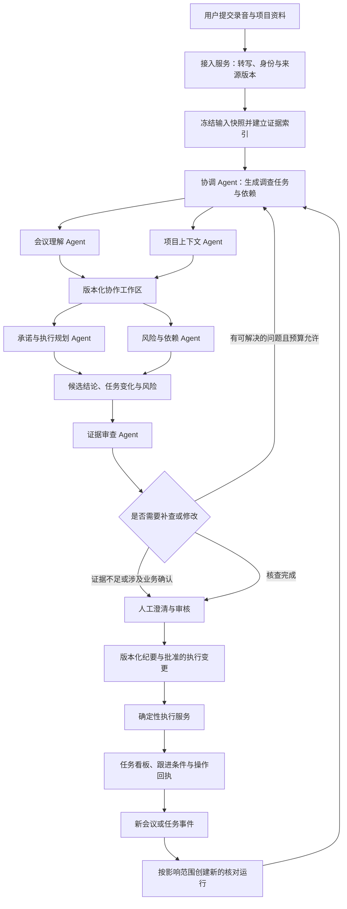
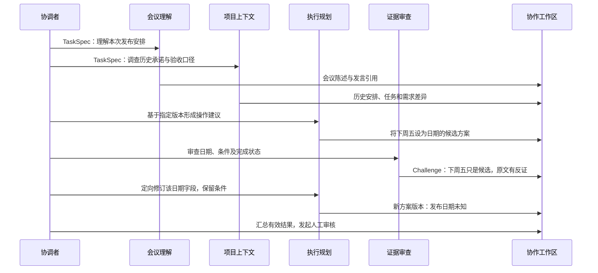

# MeetFlow：会议驱动的多智能体项目协作系统

设计日期：2026-10-24。当前主方案，从产品目标和协作机制重新设计，不沿用原项目的五角色划分。

**本文描述完整目标架构。当前已有 v0.1 本地 Web、LangGraph 协作、版本审核、本地任务、导出和可选音频适配；真实模型/ASR 效果及外部集成仍未测量或完成。** 以 [实际实现范围](docs/12-implementation-status.md)和 [开发进度](PROGRESS.md)区分目标与实现；框架实验不能当成模型效果。

## 阅读导航

1. [系统目标、需求和完成程度](#一系统目标需求和完成程度)
2. [输入、输出和贯穿案例](#二输入输出和贯穿案例)
3. [完整数据流与多智能体组织](#三完整数据流与多智能体组织)
4. [每个环节怎样实现](#四每个环节怎样实现)
5. [协作协议与运行机制](#五协作协议与运行机制)
6. [记忆、检索和跨会议闭环](#六记忆检索和跨会议闭环)
7. [框架和 Python 技术选型](#七框架和-python-技术选型)
8. [可靠性、部署与用户界面](#八可靠性部署与用户界面)
9. [实验、开发和简历交付](#九实验开发和简历交付)

详细资料：[框架研究与源码](docs/08-framework-research.md)｜[数据契约与调度](docs/09-cooperation-contracts.md)｜[评测与开发计划](docs/10-evaluation-and-delivery.md)｜[用户流程与便利性](docs/11-user-experience.md)。

---

## 一、系统目标、需求和完成程度

### 1. 项目定位

面向持续开展研发例会、需求评审和发布评审的项目团队。系统接收会议录音以及项目中已有的资料，由多个具备独立上下文和工具循环的 Agent 协作，完成会议事实理解、历史承诺核对、行动计划设计、风险分析和证据审查。

用户最终得到的不仅是一份纪要，还有一份可审核的项目变化说明：哪些安排改变了、哪些承诺仍然有效、哪些执行条件尚未满足、应该新建或修改什么任务、下一次会议需要确认什么。

项目有两个循环：**本次会议的分析与执行准备**，以及**后续事件进入后的核对与下一次会议准备**。录音、任务、历史会议和需求文档共同构成环境，Agent 根据观察结果决定补查路径和提出的协作请求。

多智能体协作是本项目明确的设计目标。工程深度集中在任务分解、上下文分配、证据交接、分歧处理、执行恢复和效果评估；并保留单 Agent 对照，以识别这套协作在哪些场景有效、代价是什么。

### 2. 从产品目标推导需求

| 编号 | 用户需要什么 | 必须达到的程度 |
|---|---|---|
| R01 | 从录音进入系统 | 上传、解码、转写、时间戳和说话人标签形成真实产物；文字导入可独立运行 |
| R02 | 看懂本次讨论 | 区分事实陈述、建议、决定、承诺、条件和未决问题，重要结论能定位原文 |
| R03 | 知道相对历史发生了什么变化 | 跨会议识别延续、改期、暂停、取消、重开及相互冲突；保存变化依据 |
| R04 | 让系统调查缺失上下文 | Agent 按需查询已授权的历史、需求、任务和成员资料，记录查过什么及未找到什么 |
| R05 | 得到可执行的任务方案 | 提出新增/修改建议、负责人候选、依赖、验收条件和阻塞项；事实与建议明确区分 |
| R06 | 发现安排中的风险 | 检查条件未满足、依赖循环、过期承诺、来源冲突；没有证据时只给待核查风险 |
| R07 | 理解 Agent 为什么分歧 | 展示争议结论、双方证据和处理结果，保留无法自动解决的歧义 |
| R08 | 审核后才改变正式业务状态 | 审核绑定报告版本与操作集合，执行前复核任务版本与审批范围 |
| R09 | 继续跟踪已确认事项 | 任务状态变化和新会议触发局部重分析，生成待审核更新和下次议程 |
| R10 | 长任务失败后可以继续 | 可恢复执行、幂等产物、重试与预算限制；不把重跑等同于重复发布 |
| R11 | 用 Web 界面完成全过程 | 上传、进度、原文播放、证据对照、争议审核、任务看板、导出、运行追踪 |
| R12 | 证明协作机制的效果 | 相同数据与工具能力下比较架构，做消融、故障测试和人工评测 |

### 3. 完成程度

| 层次 | 范围 | 可验收交付 |
|---|---|---|
| 核心协作版本 | 文字会议＋两次历史会议＋任务快照＋一份需求文档 | 六类角色参与一个完整案例；动态分派、工具补查、反证、人工确认和本地任务更新走通 |
| 完整产品版本 | 增加真实录音、Web、持久化恢复、持续跟进 | 实际用户可上传和审核；跨会议和事件更新有可靠闭环 |
| 研究增强版本 | 多项目并发、外部任务系统、技能复用与模型路由 | 有规模、失败、成本和质量对照，形成可复现实验报告 |

完整版本的初始测试范围建议为中文研发会议、10–90 分钟、2–10 人，属于待验证设计目标。文件大小、并发数、延迟和质量承诺由目标硬件及留出数据测试确定。先做好一个项目的端到端深度，再扩展规模。

---

## 二、输入、输出和贯穿案例

### 1. 用户最开始输入什么

系统处理必需的信息是录音或转写文字、会议实际时间与时区、所属项目，但不等于要求用户逐项手填。首次可使用默认个人项目，时区沿用可见设置，实际会议时间从可靠信息预填或由用户确认；来源不可靠时保留待确认，不能直接用上传时间。历史会议、需求、成员和任务资料按项目接入一次后复用，资料包是可选入口，不是每次使用的前提。资料不足时仍生成本次纪要，明确哪些跨源分析无法完成。

每份材料保存来源、版本、采集时间、业务生效时间和访问范围。任务系统中的“完成”、会议中的“已完成”和测试报告中的“通过”属于不同来源的陈述，不能互相替代。

### 2. 最终输出什么

| 输出 | 内容 | 用户操作 |
|---|---|---|
| 可追溯纪要 | 议题、讨论要点、决定、未决问题、原文时间位置 | 播放、编辑、导出 |
| 承诺变化表 | 旧安排、本次变化、当前解释、支持和反对证据 | 逐项确认、保留争议 |
| 执行变更方案 | 新建/修改/暂停任务建议、依赖、条件、验收标准、操作差异 | 审核具体变更 |
| 风险与冲突清单 | 来源不一致、前置条件、身份歧义、依赖冲突、未知信息 | 补充资料或提交确认 |
| 会后任务与下次议程 | 正式任务、观察条件、待确认问题、下次会议准备包 | 跟进、更新、再次核对 |
| 协作追踪 | 委派任务、工具调用、证据交接、审查反馈、用量与错误 | 查看摘要；开发者查看详细追踪 |

### 3. 贯穿设计的案例

使用新的 [合成项目评审场景](examples/project-review-scenario.json)，与之前的样例独立。它是设计与文本测试资料，没有真实录音，也不是效果测量。

历史会议 2026-10-19 决定接口幂等改造由李明负责，10-23 完成后评估发布。当前会议 2026-10-23 出现这些信息：

- “幂等改造改到下周三交；发布必须等压测和安全评审通过。”
- “压测排期还没定，代码合并不代表验收通过。”
- “客户通知让老王准备，但发布确定前先不要发送。”
- “下周五只是候选窗口，今天不定发布日期。”

任务快照却显示“幂等改造已完成”，状态说明只是代码已合并；需求文档要求额外的重试与重复请求测试；项目中有两位姓王的成员。

系统应协作得到：10-28 是改造交付承诺；10-30 只是发布候选窗口；“代码合并”和“验收完成”存在状态口径冲突；压测与安全评审是发布条件；老王身份待确认；准备通知与发送通知是不同动作。以上每项都要有依据，不能自行认定测试通过或人员身份。

用户批准后，系统才把确认的日期、条件和任务修订写入正式任务。后续收到“压测通过”，仍需检查安全评审状态，并重新形成发布建议，而不是立即发布或发送客户通知。

---

## 三、完整数据流与多智能体组织

### 1. 业务完整流程

这张图表示主要依赖，不要求所有会议机械调用全部角色。协调者可以跳过无资料可查的历史调查、按议题创建多个实例，或因反证增加一次定向任务。当前轮的最终汇聚必须等待该轮预期任务达到明确终态。

### 2. 六类角色及行为边界

| 角色 | 自主决定什么 | 主要工具与上下文 | 交付物与禁止事项 |
|---|---|---|---|
| 协调 Agent | 分解问题、选择角色、安排依赖、决定是否定向补查 | 议题索引、资料清单、任务/争议状态、预算摘要 | 有限任务 DAG 与补查指令；不能绕过代码中的预算、权限和审批 |
| 会议理解 Agent | 如何划分议题、哪些发言需要补读、候选结论之间怎样关联 | 当前转写检索、邻近发言、时间信息、已确认身份 | 当前会议陈述和引用；不以历史材料篡改本次会议说了什么 |
| 项目上下文 Agent | 查哪些历史会议、任务和文档，是否继续追查 | 授权历史检索、任务读取、需求版本、成员目录 | 历史承诺、资料差异、未找到的信息；不把检索摘要当作原始证据 |
| 承诺与执行规划 Agent | 候选是否对应同一任务、如何表达修订、需要核实哪些依赖 | 当前陈述、历史调查、任务快照、日期解析、依赖查询 | 行动变更方案、备选和待确认项；不直接修改正式任务、不伪造资源或日期 |
| 风险与依赖 Agent | 调查哪些阻塞、状态口径或条件冲突，如何排序待核查问题 | 需求约束、任务依赖、测试/评审状态、确定性图检查 | 风险、条件、影响路径与核查建议；无依据的风险必须标为推断 |
| 证据审查 Agent | 哪些结论需要反证检索、哪里遗漏条件或混淆来源 | 候选陈述、原始证据索引、来源版本、审查规则 | 问题与反证、支持范围；不能批准业务操作，不能保证自己绝对正确 |

六类角色不是六个常驻进程。角色配置可复用，每次委派创建独立执行状态；每个执行实例有自己的工具循环、局部上下文、预算和终态。不同议题可以产生多个同角色实例。

### 3. 为什么这个题材下采用这种协作

本系统主动扩展到跨会议、跨资料源的调查和执行准备。会议理解关注“说了什么”，项目上下文关注“之前约定与当前记录是什么”，规划关注“应怎样形成可审核变更”，风险关注“哪些约束尚未满足”，审查关注“结论是否有充分支持”。这些任务需要不同上下文、工具路径和判断标准。

它们共享稳定证据与结构化产物，但不共享一个不断膨胀的聊天记录。通过分工可以研究上下文隔离、并行调查、反证审查和局部返工的价值。协作收益是待检验的研究问题；设计目标已经明确为多智能体，因此基线与消融用于改进协作，而不是把项目重新缩成一个简单摘要工具。

---

## 四、每个环节怎样实现

每一步按“输入输出—处理—备选—本项目选择—验证”展开。选型依据分为工程需求与模型效果；后者需要实测，不能将文档上的功能支持当作效果证明。

### S01 接入录音与项目材料

**输入 → 输出**：文件、时间、项目标识及连接配置 → 文件对象、来源版本、处理运行和资料清单。

**处理**：FastAPI 流式接收文件；媒体解析在隔离的音频 worker 执行；文档解析保留章节/页码；任务导入保留外部 ID、状态及版本。计算内容 hash，建立不可变版本。文件内容和文档中的指令作为业务数据，不授予工具权限。

**备选与选择**：内存上传只适合小演示；选择流式写入 `BlobStore`，本地目录用于单机开发，完整部署使用 S3 兼容存储。资料接入先做文件与本地任务适配器，再接一个真实平台；不为每个平台重写 Agent。

**验证**：大文件、非法格式、断线、不完整文件、跨项目访问、重复提交。版本创建成功后再引用，失败不替换成演示数据。

### S02 转写、说话人和可核对证据

**输入 → 输出**：音频与会议元数据 → 不可变转写、词/发言时间区间、匿名说话人及身份映射版本。

**处理**：音频服务解码、VAD、ASR、可选对齐、说话人分离、时间交叠映射。说话人簇不能直接当真实姓名；重叠和不确定段保留标记。用户更正产生新版本，依赖这些证据的分析需要重新核查。ASR 置信信号用于定位疑点，不能当作已校准的事实概率。

**备选与选择**：比较 faster-whisper＋独立 pyannote、WhisperX 集成路径及远端批量 ASR。先按适配器集成 faster-whisper＋pyannote，是否增加强制对齐按引用定位质量决定。这是服务，不计入六个协作角色。

**验证**：参考音频测 CER/WER、说话人 DER、引用定位误差、RTF、显存和修正时间；固定是否统计重叠、时间容差和中文规范化口径。WhisperX 的对齐语言支持按所选模型实测。

### S03 建立来源快照与检索入口

**输入 → 输出**：转写、历史会议、任务、需求 → `SourceManifest`、原文块、实体候选及可检索证据。

**处理**：按发言/章节边界和 token 预算组织块，保留稳定 span ID、原文位置及上下文邻接。以本次运行快照限制分析所见版本；需要刷新外部状态时，记录新的观察版本，不能静默覆盖旧快照。查找接口同时支持精确 ID、时间/人员过滤、关键词与语义检索。

**备选与选择**：纯向量查找可能漏掉任务编号、否定和新旧版本；纯关键词不擅长语义改写。选择关系过滤＋精确字段检索＋词法/向量召回，再按 RRF 等方式融合，必要时重排并返回邻近原文。中文词法可预分词写入 PostgreSQL `tsvector`，不能假定默认英文配置能正确处理中文。

**验证**：按项目和可见版本做检索 recall@k、跨会议链路召回、过期资料误用测试。ANN 过滤导致结果不足时采用扩大扫描或精确检索；权限校验在服务端读取前执行。

### S04 协调者形成调查任务

**输入 → 输出**：资料清单、议题索引、用户目标与预算 → 任务 DAG、上下文包和预期产物。

**处理**：先用轻量结构化调用建立议题/实体索引，再由协调 Agent 决定哪些议题需要历史核对、哪些问题存在跨源依赖。代码验证角色白名单、任务数量、依赖无环、权限范围、预算分配、输入引用及输出契约；不执行模型生成的任意代码或任意图节点。

**备选与选择**：固定所有角色每次全跑容易展示但浪费；自由群聊缺少完成条件。选择“协调者提出任务＋代码验证执行”的受控委派；执行图结构预先定义，任务数量、议题、依赖和补查内容动态变化。

**验证**：短会议不制造无意义任务；长会议有覆盖清单；拒绝循环依赖、未定义角色、超预算计划和越权数据范围。规划失败可使用固定角色模板继续，但在运行记录中标为降级。

### S05 专家独立调查与结构化交接

**输入 → 输出**：`TaskSpec`＋限定上下文 → `AgentResult`、证据引用、未决问题与协作请求。

**处理**：每个专家是独立子图，执行“观察—选择只读工具—处理结果—提交产物/请求补查”的循环。证据少时继续查；查不到时说明已查询范围；工具失败时区分资料不存在与服务不可用。结果保存不可变 artifact，再把引用提交给父图。

**备选与选择**：全文共享聊天记录、自然语言消息转发、结构化产物交接。选择结构化交接＋原文按需读取，保留各角色消息历史的私有范围。专家可提出 `InformationRequest`，协调者据此派发另一个角色；禁止无限嵌套直接互调。

**验证**：同角色并发实例互不污染；信息请求能回到正确任务；部分失败产生明确终态；引用均能回源。工具请求次数、token、期限由运行器限制，提示词中的“最多几次”只是辅助。

### S06 形成承诺修订、执行依赖与风险

**输入 → 输出**：当前陈述、历史调查、业务任务快照 → 任务/决策变化、执行方案和风险。

**处理**：模型提出候选实体匹配与事件关系，代码检查 ID、来源和字段约束；对不确定的任务关联保留备选。用 `supersedes`、`supports`、`contradicts`、`depends_on` 表达关系。日期保存原话、基准时间、解析值和来源类型。准备通知与发送通知、代码合并与验收完成分开建模。

任务依赖用 NetworkX 等确定性工具检查环和可达性，发布条件保存为可观察谓词及其依据。若已有工时、容量和日历，后续可接约束求解器；资料缺失时不能编造精确排期。

**备选与选择**：纯规则难覆盖改口；全由模型直接覆盖任务难审计。选择模型提出事件/关系、规则验证、人工批准变更。关系数据先保存在 PostgreSQL，递归查询和图工具满足当前范围；需要复杂图分析时再评估专用图数据库。

**验证**：错误任务合并、日期覆盖、取消后重开、条件丢失、历史矛盾、依赖环、事实/建议混淆。状态不一致先生成差异，不能自动以最新发言覆盖任务系统。

### S07 反证审查、分歧处理与局部返工

**输入 → 输出**：候选陈述、变更方案与证据 → `Challenge`、问题处理记录和报告候选版本。

**处理**：全量做结构、引用存在性、时间及权限验证；审查 Agent 从原文检索反证，特别检查决定/建议、条件/承诺、新旧日期和状态口径。初轮可不提供专家的解释性理由，只提供待核查结论与来源，减少直接沿袭解释的机会；其价值要消融验证。

分歧区分证据遗漏、实体歧义、来源口径冲突与业务选择。能补查的指派定向任务；同一问题无新证据时停止重复争论；人工确认用于业务真值、身份和授权。投票数与自报信心不能覆盖原始证据。

**备选与选择**：全员辩论、简单多数票、审查驱动定向返工。选择最后一种；重规划只影响依赖相关 artifact 的任务，不重跑整场会议。每个问题允许的修复轮数和全局调用上限可配置，超过后输出待确认草稿。

**验证**：故意放入遗漏条件、错误引用、过期任务、对抗指令；测错误检出、误报、返工量、预算和人工负担。审查通过只代表模型检查完成，不代表业务批准。

### S08 人工澄清、版本审核与产物生成

**输入 → 输出**：报告版本、争议、操作差异 → 审核记录、发布纪要、批准的操作集合。

**处理**：用户在同页看到结论、原文和项目资料，确认负责人/日期、选择冲突解释、修改行动项。批准绑定 `report_revision`、`operation_set_hash`、目标任务预期版本和审批主体。编辑后生成新版本，已有批准不自动扩大范围。

**备选与选择**：只做一个“批准”按钮不能处理混合风险；选择按操作/争议项审核，批量批准明确展示范围。LangGraph 中断承载执行等待，PostgreSQL 保存正式报告与审批。模板生成 Markdown/Word，关键事实直接来自批准版本；展示摘要可由模型辅助，但不得改写批准字段。

**验证**：页面断开、进程重建、重复批准、并发编辑、批准旧版本、审核期间源任务变动。暂停释放 worker；恢复后重新检查审批有效性，不能只相信 `resume=True`。

### S09 执行、结果对账与持续跟进

**输入 → 输出**：批准的 `OperationPlan` → 本地任务变化、外部回执、条件观察和后续核对运行。

**处理**：执行服务按预期版本提交本地任务；外部系统使用适配器处理唯一标记/幂等能力、限流与查询。数据库事务中写业务变更与 outbox。远端创建响应丢失时进入结果未知状态，先按可用标记查询对账，再决定重试或人工处理。无查询或幂等能力时不能承诺零重复。

会后条件如“压测通过且安全评审通过”由观察器读取状态，Agent 可对状态口径补查，但正式状态更新受业务规则限制。新证据形成新运行与待审核变更，不沿用旧批准执行扩大后的操作。

**备选与选择**：首版本地任务＋模拟外部适配器，完整版本接一个真实平台。定时扫描与事件唤醒结合，按 event_id、来源版本和业务状态去重。工作流完成后退出；不让一个循环等待数周。

**验证**：重复/乱序事件、创建成功后响应丢失、部分操作成功、任务人工改期、条件撤回、取消后旧提醒、连接器不可用。补偿不应擅自删除其他用户已经修改的任务。

---

## 五、协作协议与运行机制

### 1. 采用层次协调与版本化协作工作区

主执行方式是协调者委派专家，专家通过结构化产物交换信息。共享工作区存放任务、证据、候选、挑战和处理记录；它是业务协调数据，不是一个无边界的共享提示词。

### 2. 动态任务 DAG 与执行轮次

协调者生成 `TaskSpec`，由调度代码维护 `blocked → ready → running → succeeded/partial/failed/cancelled`。每个计划修订有 generation；同一轮派发一个可独立执行的 ready 集合，父图验证该集合全部达到终态后再汇聚。任务读取指定输入版本，输出不可变结果。

出现新反证时，创建任务修订并标记受影响的下游产物失效。旧 generation 的迟到结果记录在运行历史中，不能进入当前报告。不要把不同计划的结果放进同一个列表后让模型猜哪些仍有效。

LangGraph 的 `Send` 用于动态派发，子图承载专家循环，`Command`/条件边控制下一轮和审核。Send 是进程内图任务机制，本身不是跨机器 RPC；跨进程扩展需要显式任务投递和结果关联。

### 3. 并行结果与业务冲突分开处理

图状态只收集轻量的 `task_attempt_id → immutable_result_ref`。reducer 做可重复、与到达顺序无关的合并；同一不可变键出现不同值就报错，不能最后写入覆盖。

“两个结果都认为自己正确”属于业务冲突，由 `Challenge/Resolution` 流程处理。reducer 不负责语义裁决，模型也不能绕过 reducer 修改其他专家的结果。

### 4. 工具、上下文和预算由运行器管理

工具注册表给每个角色提供不同的白名单，服务端注入项目/用户/来源范围。模型不能通过参数把 `project_id` 换成另一个项目。所有专家默认只读；写业务状态的执行服务在批准后单独调用。

上下文包包括任务目标、必要材料、证据入口、上游有效产物、禁止越界的约束和剩余预算。压缩保留来源及未解决的条件，不能只保留一段没有版本的总结。检索缓存键包含权限与来源版本，避免旧缓存跨用户复用。

预算包括总 token、模型请求、工具调用、并发、时间和返工轮数。图步数限制只用于防止拓扑循环，不能代替这些预算。并行调用先原子预留配额，完成后按实际用量结算；留出预留误差，无法取消的在途请求可能仍计费。

### 5. 三类失败采用不同处理

- 网络、限流等暂态错误：有限退避；工具幂等与调用回执复用。
- 结构或语义问题：结构化反馈给责任角色，有限修复，保留原产物。
- 证据不足、权限缺失或业务冲突：明确未决，不靠反复调用制造确定性。

计划、工具和检索错误都保留机器可读类型，便于追踪和评测。任务终态中的 `partial` 不等于无问题成功。

---

## 六、记忆、检索和跨会议闭环

### 1. 三类数据承担不同责任

| 层次 | 保存什么 | 如何使用 |
|---|---|---|
| 执行记忆 | 当前运行状态、专家局部消息、预算、检查点 | 中断恢复；按 run/子图范围隔离 |
| 项目记忆 | 已确认会议版本、任务事件、决定及证据关系 | 跨会议查询；事实状态可回溯，不靠向量摘要覆盖 |
| 程序性知识 | 发布评审、需求评审等技能的检查项、schema、工具要求与示例 | 按任务加载，版本化发布和回归测试 |

未审核的候选可以被本次协作引用，但必须带候选状态；不能自动进入“已确认项目事实”。长期记忆更新发生在业务批准之后，召回时返回原始来源，不只返回模型的二手摘要。

### 2. 承诺与决策的时间模型

对关键关系同时保存业务生效时间和系统获知时间。例如 10-23 的会议回顾 10-21 已经取消的任务：取消生效时间与录入时间不同。能够查询“当时已知的安排”与“目前重建的安排”。

本项目不需要一开始实现任意复杂的时态知识图谱。先用不可变 `Statement/Event`、关系表和版本化物化视图实现；`supersedes` 必须有明确关系依据，不能用时间最新自动判断真值。来源冲突仍保留双方。

### 3. 新事件如何推动下一次协作

例如压测通过只影响等待该条件的任务，不重跑整场 ASR；说话人映射修订会影响相关负责人归属；需求文档更新会影响依据该版本提出的验收建议。依赖记录使增量重分析可实现，也使失效范围可以测试。

### 4. Skills 的实际用途

`release_review` 技能包含发布检查项、条件词表、状态口径映射、输出 schema、允许工具和评测场景；`requirement_review` 包含范围变更与验收检查。协调者选择技能，运行器加载受审版本并校验工具权限。

人工纠正可以生成候选改进记录，不能直接自动改写生产技能。经过离线评测、人工确认和版本发布才能启用。此处“学习”指知识和程序性配置更新，不宣称模型权重训练或自我进化。

---

## 七、框架和 Python 技术选型

### 1. 框架候选与本项目选择

| 候选 | 已核实能力 | 本项目判断 |
|---|---|---|
| LangGraph | 状态图、动态 Send、子图、检查点、人工中断 | 选择为主运行时，便于显式实现协作轮次、状态隔离和局部恢复 |
| Microsoft Agent Framework | Python Agent、类型化工作流、多种协作及检查点机制 | 强候选；当前方案选择 LangGraph 是围绕机制可控性与源码实验，不宣称其性能更优 |
| CrewAI | 角色/任务、层次流程、Flows 与持久化 | 原型表达角色方便；若采用，需要同样显式实现来源版本、业务审批和冲突协议 |
| Pydantic AI | 类型化 Agent、委派/交接、图控制和持久执行集成 | 类型契约清楚的强候选；本项目用 Pydantic 定义领域对象，不再叠第二套 Agent 运行时 |
| AutoGen | 多智能体通信设计可参考 | 官方仓库当前标记维护模式，新项目不作为首选 |

以上为官方文档能力核对，没有做框架间性能基准。来源、当前状态和源码位置见 [框架研究](docs/08-framework-research.md)。

### 2. LangGraph 需要掌握到什么程度

不是只会 `add_node()`。应能解释：StateGraph 编译后由 Pregel 运行；superstep 内更新何时可见；普通字段与 reducer 字段为何有不同并发行为；Send 如何产生不同上下文的任务；不同深度分支如何汇聚；子图调用范围怎样隔离；中断为何重入节点；检查点与业务事务为何不是一个概念。

本次源码研究固定在 `eb066bd31a2bf01fc0cd58256df4800a3695c233`，其中核心包版本为 **1.2.16**。独立实验已运行真实包验证六项机制。源码研究与框架实验不等于完整应用已经实现。

### 3. Python 工程技术栈

| 组件 | 选择 | 职责 |
|---|---|---|
| 后端 | Python、FastAPI、Pydantic v2 | API、契约、业务服务；目标 Python 3.12，依赖锁定后验证 |
| 协作 | LangGraph＋统一模型适配 | 主图、专家子图、工具循环与用量记录 |
| 数据 | PostgreSQL、SQLAlchemy、pgvector | 业务版本、协作产物元数据、事件关系和检索 |
| 文件 | BlobStore，本地开发/S3 兼容部署 | 原录音、解析文档、导出与大产物 |
| 后台 | Celery＋Redis | 音频任务、图运行唤醒、外部操作与调度；不逐条工具调用再套 Celery |
| 实时界面 | REST＋SSE | 用户操作和可恢复的单向进度推送 |
| 音频 | faster-whisper、pyannote；可选 WhisperX | 转写、说话人、按需对齐 |
| 图检查 | NetworkX | 任务依赖环与影响路径；时间不完整时不计算伪精确排期 |
| 前端 | Vue 3＋TypeScript | 会议工作台、证据审核、任务与协作追踪 |
| 追踪 | OpenTelemetry＋可选追踪查看器 | run/task/Agent/tool 关联、时延、用量和错误 |

模型适配层要求结构化输出、工具调用、用量和失败规范。先用同一模型验证架构，再比较角色采用不同档位模型的成本/质量；同一基线实验不混入模型升级。具体供应商和模型版本通过预算、中文效果和工具可靠性评测确定，不预先声称某款最优。

---

## 八、可靠性、部署与用户界面

### 1. 三个状态系统明确分工

PostgreSQL 业务表拥有报告、正式任务和审批真值；LangGraph checkpointer 拥有图的执行位置；Celery 只负责投递与唤醒。图暂停、完成或失败后释放 worker；新任务/恢复请求通过队列再次驱动。

一个 graph thread 同时只能由一个获得租约的运行器推进。租约含 fencing token 并在业务提交时检查；续租失败停止派发和提交。原型可由单 runner 简化，完整版本必须测试旧 worker 在租约到期后迟到提交的情形。

业务写入的 fencing 检查不能保护默认 checkpointer 的写入。首版将同一 thread 串行交给单 driver；允许自动接管前，需增加能在写 checkpoint 的同一事务内锁定运行所有权并校验 token 的 saver 集成，或采用有明确单线程执行保证的运行服务。仅有 Redis 锁或 TTL 不能据此宣称旧 runner 不会污染图状态。这是完整可靠性版本的独立验收项。

产物保存与图 checkpoint 不是天然同一事务。保存不可变 artifact 后再向图提交引用；崩溃重跑按任务/输入/模型/技能版本查询已完成产物。孤立产物可以清理，不能为了省调用而复用来源或权限不匹配的结果。

### 2. 部署边界

开发采用模块化单体和独立 worker：API/Web、CPU/GPU 音频 worker、Agent runner、执行/调度 worker，加 PostgreSQL、Redis 和文件存储。优先用 Linux 容器或 WSL 部署与验证 worker；Windows 原生实验环境只证明已运行部分，不推导完整部署兼容性。

ASR 模型常驻复用；音频与工具网络任务分队列；API 不加载整套 GPU 模型。模型 API 有项目/全局并发配额，GPU 按显存容量配置，Redis 故障不能清空业务状态。吞吐目标需要压测确定。

### 3. Web 的核心界面

- 主导航为会议、我的任务和项目，项目资料及集成在设置中一次配置后复用。
- 会议详情汇集纪要、任务变化与待确认事项，证据/音频在侧栏按需展开，不要求依次访问多个审核页。
- 我的任务按个人相关性呈现任务、变更、阻塞和依据；项目页提供全局看板与承诺演变。
- 协作追踪作为高级/开发入口，普通用户无需理解角色、模型或原始调用记录。

用户页面展示事实、依据、变化和需要做的决定。原始模型消息与底层调度细节放到开发追踪视图，且不要求记录或展示模型私有思维过程。

### 4. 使用便利性的设计要求

日常路径收敛为上传、查看结果、集中确认必要疑点和所选变更、会后跟进。用户不必每场准备全部项目资料，不必逐句批准纪要，也不会收到每个 Agent 的重复问题。先展示有明确草稿标记的可读结果，再补充核查；用户编辑不能被后台更新直接覆盖。

待确认项允许暂缓，明确依赖它的操作暂不能执行，其他独立事项仍可处理。批准展示具体操作差异和范围，避免重复确认；跟进默认应用内按相关性汇总。没有历史/平台连接也能完成首次整理，连接失败不冒充核查无问题。

完整使用流程、失败恢复、页面结构和用户测试见 [用户流程与便利性](docs/11-user-experience.md)。目前没有真实界面和用户测试，不能宣称便利性已经验证。

---

## 九、实验、开发和简历交付

### 1. 研究问题

1. 专家上下文隔离对长会议与跨资料核对是否有帮助？
2. 动态委派相比固定六角色全跑，能否减少无效调用而保持质量？
3. 反证审查相比自检或多数票，能否减少遗漏条件和错误承诺？
4. 事件与证据依赖是否能减少局部变更后的重计算？
5. 持久化、版本审核和执行对账在故障下是否正确？

### 2. 主要对照

同一个资料环境中比较：强工作流基线、单 Agent 多工具、按纪要栏目固定分工、多智能体动态委派与审查。再消融历史记忆、上下文隔离、审查、动态委派和增量更新。等预算比较质量，等质量比较成本与等待时间，披露每场实际用量与失败。

公开 QMSum 与 MeetingBank 可支持会议定位/摘要等子任务研究，但不具备本系统全部跨会议任务和审批标注。需要另建带任务、文档、事件和期望操作的中文项目场景集，真实录音与合成文本分开报告。详见 [评测与开发计划](docs/10-evaluation-and-delivery.md)。

### 3. 开发顺序

先实现文本资料和本地任务上的真实多 Agent 协作核心：委派、查询、交接、反证、定向返工、审核、执行。随后增加持久化与故障测试、跨会议记忆、Web 和真实音频，最后接外部平台并做全套评测。基础录音纪要只是其中一条输入输出链，不能在核心协作尚未完成时就宣称完整系统已完成。

阶段时间是排期而非开发经历；实际完成后才能记录简历起止时间。每个阶段应交付可运行演示、对应测试、运行追踪和局限说明。

### 4. 完成后可写进简历的方向

以下是未来完成版的写作模板，尚不能作为已实现经历。没有测量结果时不填指标，未实现的条目删除。

**MeetFlow 会议驱动的多智能体项目协作系统｜AI 应用开发**

面向研发例会与发布评审，融合录音、历史会议、需求文档和任务状态，构建具备动态委派、跨源核对、证据审查与审核执行能力的多智能体协作系统，支持跨会议承诺跟踪与事件驱动的局部更新。

- 基于 LangGraph 构建协调者与专家子图，通过动态任务 DAG、受限工具循环和结构化产物交接实现多 Agent 协作，并处理并行汇聚、结果版本和局部返工。
- 设计带来源版本的证据与承诺事件模型，结合关系过滤、词法/向量检索和依赖分析，实现历史安排核对、改期取消识别和条件风险检查。
- 实现反证驱动的审查与澄清流程，通过定向补查、预算控制和人工审核处理 Agent 分歧，保留无法确认的事实与执行条件。
- 基于持久化检查点、版本化审批和 outbox 构建恢复与执行机制，处理过期批准、重复投递、外部结果未知和持续跟进。
- 建立架构对照、消融和故障评测，从任务状态正确性、证据支持、执行方案质量、时延和成本分析多智能体协作的适用范围。

当前可如实描述的工作是：重新完成产品与协作架构设计，核对官方资料和固定版本源码，编写并通过六项运行时实验。产品功能和模型协作效果仍待开发验证。
