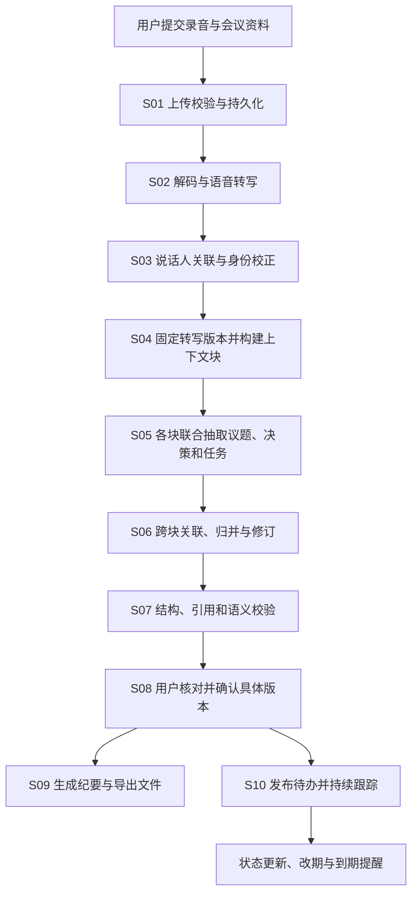
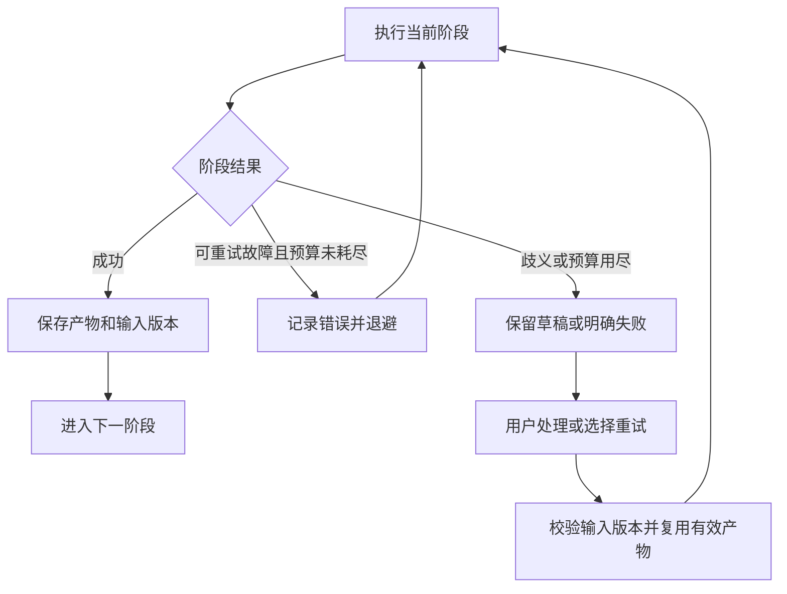

# MeetFlow 技术方案：沿着一场会议的数据流设计

> 历史讨论快照。用户已明确将有深度的多智能体协作作为核心目标；当前方案请阅读 [BLUEPRINT.md](BLUEPRINT.md)。本文保留此前的需求收敛与选型论证，不代表当前主架构。

版本：2026-10-24。本文按最新讨论重新组织方案，作为当前主阅读入口。前面的文档保留为背景材料。

**文档状态：需求与实施方案，尚未实现完整系统，也没有模型性能实测数据。** 文中“暂选”表示准备首先实现的方案，“最终选型”需要同条件实验支持。参考任务书用于补充需求，Hermes、Profile、五 Agent 数量和 WebSocket 均不预设为必须采用的实现方式。

## 阅读顺序

1. [需求与完成标准](#一需求与完成标准)：系统为什么存在，需要做到什么程度。
2. [用户输入与最终输出](#二用户输入与最终输出)：先确定两端的数据契约。
3. [完整数据流](#三完整数据流)：观察中间数据怎样一步步产生。
4. [逐环节设计](#四沿数据流逐环节设计)：每一步的实现方法、备选技术与比较计划。
5. [贯穿全流程的设计](#五贯穿全流程的设计)：排队、进度、重试和数据修订。
6. [实验与最终选型](#六怎样比较并最终确定技术)：用什么依据选代码实现。
7. [开发计划和补充要求](#七开发与验收计划)：先做什么、怎样确认完成。

---

## 一、需求与完成标准

### 1. 要解决的业务问题

用户已经开完一场会议，手中有录音。用户希望得到能核对的纪要，并把会议承诺转成可跟踪的任务。系统应减少重复整理，同时让用户能够发现和修正模型错误。

首版采用会后上传，不处理实时会议音频。处理进度需要及时反馈，会议进行中的实时字幕另行评估。

### 2. 功能需求及验收方式

| 编号 | 用户需要什么 | 达到什么程度算完成 |
|---|---|---|
| F01 | 上传录音并创建会议 | 输入合法时返回会议和运行编号；非法文件给出可理解的错误 |
| F02 | 得到转写与说话人 | 能查看原文、时间戳、匿名说话人，必要时人工映射姓名 |
| F03 | 得到结构化纪要 | 包含议题、讨论要点、确认决策、待办和未决问题 |
| F04 | 核对结论依据 | 自动生成的重要决策和任务可以定位到原始发言 |
| F05 | 修订和确认结果 | 可以编辑、保留修订版本，审核针对用户实际看到的版本 |
| F06 | 导出纪要 | 下载真实生成的 Markdown 文件；Word 导出作为下一格式实现 |
| F07 | 跟踪待办 | 按状态查看和更新任务，修改负责人、日期，记录变化 |
| F08 | 查看处理进度 | 后台每个真实阶段有状态；断开页面后任务继续，重连可查 |
| F09 | 从失败中恢复 | 能看到失败环节；重试复用可用产物，避免重复创建本地任务 |
| F10 | 评估效果 | 有固定样本、参考标注、运行配置和可重复执行的评测入口 |

### 3. 分阶段达到的程度

| 层级 | 输入范围和功能 | 交付门槛 |
|---|---|---|
| 纵向原型 | 先处理一段 5–10 分钟真实录音，走通上传到导出和看板 | 能现场演示一条完整流程，真实输入与演示数据分开 |
| 可交付首版 | 暂定 5–60 分钟、1–8 名发言人、中文为主的会议；文件同时满足大小限制 | 核心功能、版本修订、异常恢复和固定场景测试通过 |
| 研究增强版 | 扩展不同噪声、长会议、并发、历史检索与会议类型模板 | 对照实验能解释质量、延迟、成本和适用边界 |

输入范围是建议的设计目标，需通过目标机器和测试录音验证，不能当成已支持容量。音频格式暂定 WAV、MP3、M4A；文件上限暂定 200 MB，可配置，超过时明确拒绝。

功能验收与模型质量分别处理：引用和版本可以做严格校验；转写、抽取等质量需要固定数据和人工标注。当前先定义指标并测基线，再在验证集上确定可接受阈值；不提前填写“准确率 95%”等结果。

### 4. 首版边界

先完成本系统的纪要、看板和提醒。外部 Jira/飞书同步、自动技能改写、实时字幕、视频分析放在核心流程稳定之后。身份、文件和查询均绑定有权限的用户/项目，不能仅凭会议编号读取任意材料。

### 5. 架构前提：这些需求是否需要多智能体

**当前判断：已有需求足以支持“受控的多阶段工作流”，不足以证明“必须由多个自主 Agent 协作”。** 前面按纪要、任务、风险等产物分工，是一种候选任务拆分，不能直接作为多智能体必要性的证据。

先区分三个问题：业务要做哪些处理；下一步由代码还是模型决定；用哪个库承载执行。采用 LangGraph 不等于采用多智能体。多个提示词、多个模型调用和分块并行，也不自动等于多个自主 Agent。本文把自主 Agent 具体限定为：具有任务上下文，并能根据观察结果决定后续工具调用或结束的执行单元；其他命名习惯可以更宽泛，但实验中必须明确实际行为。

| 候选架构 | 谁决定步骤，怎样实现 | 对当前需求的适用性与代价 |
|---|---|---|
| 规则与传统 NLP 流水线 | 代码执行 ASR、关键词/规则抽取和模板渲染 | 工程行为清楚，可作简单基线；自由表达、改口和条件理解需要验证 |
| 单次结构化模型调用＋业务代码 | 模型一次提取，代码验证、审核和发布 | 适合窗口内短会议，可作最小基线；长输入和复杂修订可能需要分阶段处理 |
| 固定多阶段工作流 | 代码编排分块抽取、跨块归并、核查与审核，节点按需调用模型 | 与当前输入输出明确、阶段可预先定义的任务最匹配，暂作主架构 |
| 单 Agent 多工具 | 一个 Agent 按观察选择读取片段、查名单、查历史等工具，再提交结构化结果 | 当前功能原则上可以实现；动态补查有价值，但整条固定流程没有必要逐步交给模型规划 |
| 多 Agent 协作 | 多个执行单元分别拥有上下文及工具循环，通过结构化产物协调 | 可隔离独立探索和上下文；增加交接、重复阅读、冲突合并和故障定位成本，暂作实验候选 |

会议的“议题、决策、任务”通常依赖同一段发言。例如“如果压测通过，李明下周五发布”，拆成决策与任务两路后，执行条件可能在交接中丢失。因此，按产物分工既可能让提示词更聚焦，也可能破坏关联，收益需要测量。单 Agent 也能按需检索、调用多个工具，运行器也可以并发执行独立工具；不能把这些能力算成多智能体独有的优势。

**暂定实现**：主流程由代码控制，抽取和归并采用结构化模型函数；仅在确定性补读不足时，引入一个预算受限的澄清 Agent，允许只读检索原文、名单和已授权历史记录。语音转写、数据库提交、版本批准、导出和提醒由业务服务执行。澄清仍不能确定时交人工审核，不让 Agent 为缺失信息编造答案。

多智能体何时值得重新考虑：出现多个可以独立探索的历史/业务资料源，每一路都需要依据检索结果继续查询，且单一上下文或工具循环成为实测瓶颈。此时可以比较多个检索 Agent 并行探索、返回证据的方案。角色隔离本身也能通过代码和权限实现；需要证明独立 Agent 的上下文和执行轨迹额外带来了收益。

框架选择放在架构判断之后。纵向原型可以直接用 Python 函数和数据库状态机；完整版本若持久化图、条件分支和审核恢复确实降低实现负担，再采用 LangGraph。模型调用函数和数据契约保持独立，使框架变化不要求重写业务语义。多智能体方案通过 E00 与主方案比较后再决定是否采用，不能先由项目名称决定架构。

这一划分参考 [Anthropic 对工作流与 Agent 的区分](https://www.anthropic.com/research/building-effective-agents)及 [LangGraph 官方工作流说明](https://docs.langchain.com/oss/python/langgraph/workflows-agents)。[多智能体研究系统的工程实践](https://www.anthropic.com/research/multi-agent-research-system)说明了独立探索、上下文分离的价值及协调成本；它的研究检索场景和实测数字不能直接推广到本项目。

---

## 二、用户输入与最终输出

### 1. 用户最开始提交什么

| 输入 | 是否必需 | 后面为什么需要 |
|---|---|---|
| 会议录音文件 | 是；文字导入作为调试和辅助路径 | 生成真实转写与时间依据 |
| 会议开始日期/时间 | 是，可以由文件信息预填后由用户确认 | 解析“下周三”等相对时间 |
| 会议时区 | 是，默认设置需在界面可见 | 日期换算和提醒时间 |
| 主题 | 可选 | 会议管理与纪要标题 |
| 参会人名单 | 可选但建议提供 | 负责人候选和姓名映射 |
| 会议类型 | 可选 | 选择纪要组织模板 |
| 说话人与姓名映射 | 可在转写后补充 | 把“我负责”可靠关联到真实成员 |

会议时间不能直接等同于上传时间；名单也不能自动证明录音中的声音身份。

### 2. 最终需要输出什么

| 产物 | 内容 | 用户怎样使用 |
|---|---|---|
| 转写版本 | 原文片段、时间戳、speaker_id 与已确认身份 | 阅读和播放核对 |
| 纪要草稿/发布版本 | 摘要、议题、观点、决策、任务、未决问题 | 编辑、确认、阅读 |
| 原文依据 | 对应片段、原话、所属转写版本 | 查看结论从哪里来 |
| 行动项 | 稳定任务 ID、负责人、日期、状态、条件及修订 | 看板管理与跟进 |
| 下载文件 | 按所选版本生成的纪要 | 下载保存 |
| 运行记录 | 处理阶段、用量、错误与重试 | 查询问题、复现实验 |
| 提醒记录 | 计划时间、接收者、发送或跳过结果 | 跟踪到期事项 |

### 3. 一场会议贯穿方案

采用已有合成文字场景说明语义处理，见 [示例输入](examples/meeting-fixture.json)。它没有配套录音，因此只能验证文本行为，不能证明语音识别效果。

例子中的会议日期为 **2026-10-09，Asia/Shanghai**：

1. 李明：“我负责接口幂等改造，下周二交付。”
2. 后续发言：“李明的交付调整到下周三。”
3. “如果压测通过，下周五再安排发布，目前只是候选计划。”
4. “客户通知让老王跟进。”随后又说“先不要发客户通知”。

正确结果应保留：李明任务最终日期为 2026-10-14，同时保留原承诺与改期依据；发布为条件候选；客户通知处于暂停状态，“老王”身份尚不确定。

---

## 三、完整数据流

这张图说明业务顺序。实际并行发生在可独立处理的上下文块中；语音识别与说话人分离是否并行，要看 GPU/CPU 资源和实际耗时。

进度通知是贯穿各阶段的旁路：各阶段先保存状态与事件，浏览器通过事件流观察。浏览器连接不参与后台任务的正确性判断。

### 中间数据分别是什么

| 阶段结束 | 新产生的数据 | 后一步依赖什么 |
|---|---|---|
| S01 | audio_id、文件 hash、run_id、会议元数据 | 一个可读取且已确认的输入 |
| S02 | 转写词/片段与时间戳 | 实际识别出的内容 |
| S03 | 匿名发言人标签与身份映射版本 | 谁说了哪段话及其确定程度 |
| S04 | transcript_version、稳定片段 ID、chunk 清单 | 有边界且能回溯的模型输入 |
| S05 | 块级议题/决策/任务候选 | 信息候选与来源，不是正式任务 |
| S06 | 归并结果、修订关系、歧义列表 | 当前应采用的事实与候选 |
| S07 | 校验问题和通过检查的草稿 | 需要用户重点核对的位置 |
| S08 | report_version、review_id、被确认的范围 | 发布所依据的具体版本 |
| S09/S10 | 下载文件、正式行动项与后续变化 | 用户可使用的实际产物 |

---

## 四、沿数据流逐环节设计

每个环节固定回答：**为什么处理 → 输入输出 → 代码如何实现 → 有哪些备选 → 怎样比较 → 暂选什么 → 失败怎样处理、如何验收**。

### S01：接收录音，形成可重复处理的输入

**为什么处理**：大文件不能全部读进 API 内存；重复点击不能悄悄创建多份相同运行；后续计算必须能够重新读取输入。

**输入 → 输出**：音频与会议资料 → 已持久化文件、audio_id、文件 hash、run_id 和 queued 状态。

**处理与代码入口**：流式写入临时文件，限制累计大小，校验媒体信息；写入正式存储后创建运行记录。建议接口为 `POST /meetings/{id}/audio` 和 `POST /meetings/{id}/runs`，核心函数为 `store_audio()`、`create_run()`。

| 候选方法 | 代码实现方式 | 主要取舍 |
|---|---|---|
| 本地持久目录 | UploadFile 分块读取，写入按文件 ID 组织的目录 | 单机部署直接；需要备份和容量管理 |
| S3 兼容存储 | 后端流式上传，或使用预签名上传 | 多实例共享方便；增加配置和服务 |

**怎样比较**：用不同文件大小测上传耗时、API 峰值内存和失败清理；验证断线、不完整文件和重复提交。

**暂选**：首版使用容器持久卷中的文件目录，并封装 `AudioStore` 接口；需要多机器共享时替换存储实现。相同幂等键与输入摘要返回同一运行，变更处理参数允许显式新建运行。

**异常与验收**：非法文件不进入计算队列；数据库只引用已经持久化的输入，失效临时文件可清理。能够凭运行编号找到原文件与输入配置。

### S02：把录音转成有时间依据的文本

**为什么处理**：语义模型主要分析文本，而任务和结论需要能定位到录音。

**输入 → 输出**：持久化原录音 → 供模型使用的音频副本、转写内容、词/片段时间戳、语言与识别状态。

**处理与代码入口**：读取媒体属性，保留原始声道信息，必要时解码、重采样；通过 `ASRProvider.transcribe()` 执行转写。模型在语音 worker 中加载并复用。只对工作副本进行转换，不覆盖原录音。

| 候选方法 | 代码实现方式 | 主要取舍 |
|---|---|---|
| 本地 faster-whisper | 调用预训练模型，按配置启用 VAD 与词时间戳 | 结果易复现；速度与资源受硬件和模型影响 |
| 远端批量 ASR | 提交文件并查询服务结果，转换为统一数据格式 | 本地资源需求较小；有网络、费用与服务差异 |
| WhisperX 路线 | 使用其转写及可选强制对齐流程 | 更细粒度时间对齐可评估；依赖和处理步骤更多 |

**怎样比较**：固定真实录音与参考转写，测中文 CER、混合语种 WER、RTF、峰值内存/显存。冷启动与热启动、纯识别与包含对齐的耗时分开。先确认中文术语质量，再比较速度；不能直接搬用项目主页基准。

**暂选**：先实现 faster-whisper 适配器，具体模型大小通过目标机器测试选择。无可用本地模型时可配置远端实现，但返回的结果仍需满足相同契约。

**异常与验收**：无语音时明确显示未检测到可识别内容；真正失败时保留错误与重试入口。任何失败都不替换成固定演示文本。

### S03：确定谁说了什么，并保留身份不确定性

**为什么处理**：“我来做”需要关联到发言人；同一声音簇的标签不能直接证明真实姓名。

**输入 → 输出**：音频、转写时间信息、参会人资料 → 带 speaker_id 的发言片段和可修订的姓名映射。

**处理与代码入口**：`DiarizationProvider.diarize()` 返回说话人区间；`assign_speakers()` 将词/片段与区间关联，保留边界及重叠标记；`confirm_speaker_mapping()` 保存用户确认的映射。区间交叠和不确定项不能随意强制指定姓名。

| 候选方法 | 代码实现方式 | 主要取舍 |
|---|---|---|
| pyannote 分离＋应用层关联 | 计算说话人区间，与词时间范围对齐 | 可控制映射逻辑；需验证边界与重叠发言 |
| 使用 ASR 服务的说话人结果 | 在适配器中统一服务返回的角色标签 | 集成步骤较少；质量和标签语义依服务而异 |
| 依赖独立录音声道 | 在确认录制方式后按声道关联 | 对特定录制场景有效，不能泛化到任意混音 |

**怎样比较**：测 DER 或预先定义清楚的区间分配指标，记录是否统计重叠、时间容差与发言人数条件；另测姓名映射正确性与人工修正时间。

**暂选**：pyannote 与 ASR 适配器解耦，默认匿名 speaker_id，界面允许映射。ASR 与分离能否共用环境、是否串行运行，通过依赖和资源测试决定。

**异常与验收**：分离失败可继续生成匿名转写，但标记身份不可用，涉及“我”的负责人保持待确认。已确认映射修订后，相关任务需要重新校验。

### S04：把长转写组织为有预算且可追溯的输入

**为什么处理**：长会议可能超过模型窗口；直接截断会漏掉后续改口。重复分块也可能生成重复任务。

**输入 → 输出**：带发言人的转写 → 固定转写版本、稳定片段 ID、上下文块、块间重叠关系。

**处理与代码入口**：`freeze_transcript()` 保存不可变版本；`build_chunks()` 优先按发言边界组织，在 token 预算内组合，保留少量相邻上下文。重叠片段沿用原片段 ID，不复制成新的业务证据。

| 候选方法 | 代码实现方式 | 主要取舍 |
|---|---|---|
| 全文一次输入 | 预算足够时直接提交完整转写 | 流程简单；长会议成本、窗口和关注位置需要评估 |
| 固定字符/时间切块 | 按字数或分钟切分 | 实现直接；可能切断语义，时间不等于 token |
| 发言边界＋token 预算 | 组合发言，超限后分块并保留邻近上下文 | 可控制预算和引用；需要归并重复与跨块关系 |

**怎样比较**：短、长会议分组，测超窗比例、跨边界任务召回、改口识别、输入 token、分块调度开销。

**暂选**：窗口内短会议可以一个块；长会议使用发言边界和 token 预算分块。具体块大小作为实验参数，不先假设固定五分钟最合适。

**异常与验收**：任何输出引用都能追到固定片段；预算不够时继续拆分，禁止静默截断。人工改正原文产生新版本，旧引用继续指向旧版本。

### S05：从原文块提取信息候选

**为什么处理**：原文中的观点、决定、承诺和条件混在一起，需要转换成可组织、可校验的数据。

**输入 → 输出**：上下文块、会议日期、参会人及输出契约 → 块级议题、决策候选、行动项和未决问题，每一项附原文引用。

**处理与代码入口**：`extract_chunk()` 通过统一模型接口请求结构化结果；Pydantic 校验字段、枚举和日期类型，服务端分配候选 ID。输出保留 proposed/committed/conditional 等状态；对“先不要发”保留 paused。负责人和时间缺失允许为空。

| 候选方法 | 代码实现方式 | 主要取舍 |
|---|---|---|
| A：全文综合调用 | 一个结构化请求生成整场结果 | 简单且适合作基线；长会议遗漏和窗口问题需测 |
| B：按信息类型分工 | 议题、决策、任务分别调用，可并行 | 每个契约较小；原文重复输入，结果可能不一致 |
| C：按块联合抽取 | 每个块一次提取多类候选，各块受限并行 | 同一局部上下文联合理解；必须处理跨块归并 |

**怎样比较**：冻结测试输入与输出要求，比较待办 precision/recall、决策质量、条件/否定保留、引用有效性、总 token、模型调用量和耗时。明确记录各方案实际预算，不能把额外上下文或更多调用带来的收益全部归因于 Agent 数量。

**暂选**：C 作为主实现，A 作为最小基线，B 作为对照。原因是长会议需要分块，而关键的全局修订可以集中在下一阶段。它不预设 C 的质量一定最好。

这里比较的是信息抽取的拆分方式。B 的三个固定模型调用、C 的多个并行块，都可以由普通工作流实现；E05 不能替代 E00 的架构对照，也不能单独证明多智能体优于单 Agent。

**异常与验收**：无效结构允许有限格式修复，失败块单独记录；空任务列表与提取失败是两种状态。没有证据的关键陈述不能直接进入自动发布结果。

### S06：解决重复、改口和跨块关联

**为什么处理**：块级结果未必是会议最终结论。同一任务可能反复出现，负责人、日期或执行条件也可能被修改。

**输入 → 输出**：全部块候选及所需原文引用 → 归并后的议题、决策、稳定任务身份、修订关系和歧义列表。

**处理与代码入口**：`reconcile_candidates()` 先按重复引用和确定标识筛选，再对可能相关的候选进行语义判断。归并角色仅在需要时调用 `get_context()`、`lookup_participants()` 读取依据，产出 supersedes/cancels 等关系；日期换算由 `normalize_date()` 基于会议时间执行。

| 候选方法 | 代码实现方式 | 主要取舍 |
|---|---|---|
| 精确规则 | 相同引用、明确实体和固定表达匹配 | 可解释且成本低；隐含关联召回有限 |
| 全量模型归并 | 提交所有候选及证据，由模型判断关系 | 能处理语义关联；预算和错误合并需控制 |
| 规则筛选＋定向模型判断 | 先生成候选关联组，再补读相关原文 | 兼顾可解释性与复杂语义；要测筛选造成的漏检 |

**怎样比较**：使用跨块改期、同名、相似但不同任务、取消和重新提出任务等固定场景，测错误合并、遗漏关联、字段最终正确性、补读次数和耗时。

**暂选**：规则处理确定重复，语义归并处理不确定关联。不能仅因任务标题相似就合并，也不能以“最后出现的日期”覆盖所有任务。

**日期推测**：保存 due_raw、normalized_value、source 与依据；source 区分 explicit/inferred/policy/unknown。估计日期先作为待确认建议，不伪装成会议中明说的承诺。

**异常与验收**：存在多个合理关联时保留候选并交给审核。贯穿案例中，李明任务采用 2026-10-14，原 2026-10-13 及两段证据保留；以后重跑不随执行当天变化。归并错误不能通过默默删除候选掩盖。

### S07：检查结构、引用和陈述是否受到支持

**为什么处理**：结果能解析成 JSON，不等于任务、决策和条件正确。

**输入 → 输出**：归并结果、固定转写版本、身份目录 → 校验通过的草稿、问题清单、必要修复和待审核项。

**处理与代码入口**：`validate_structure()` 检查模型；`validate_evidence()` 检查片段存在、版本、引文范围和文本匹配；`validate_business_rules()` 检查身份、状态及日期；`verify_claims()` 对关键或疑点陈述进行语义核查。

| 候选方法 | 代码实现方式 | 主要取舍 |
|---|---|---|
| 纯规则 | 类型、引用、日期和状态约束 | 能严格检查可计算条件，语义覆盖有限 |
| 全量模型核查 | 对全部候选再调用模型审查 | 语义覆盖面广，增加成本；核查模型也会出错 |
| 分层核查 | 全量规则＋关键陈述/疑点的定向模型核查 | 更容易控制成本；需检验疑点筛选是否漏掉重要错误 |

**怎样比较**：在有人工标注的样本中统计无依据陈述检出率、条件遗漏检出率、误报、额外调用和审核负担。模型不能作为自己输出正确性的唯一裁判。

**暂选**：全量规则＋定向语义核查，并对部分未标疑点的内容做抽样检查。每个争议项至多一次定向修复，单次运行另设总预算；预算用尽后保留问题，不无限循环。

**异常与验收**：引用存在但不支持结论时，删除候选、降为待确认或请用户修订。校验输出能说明哪一项、哪类问题、对应哪段原文；不把整个报告笼统标成“AI 不准确”。

### S08：让用户核对并确认具体版本

**为什么处理**：身份歧义、业务语境和语音错误未必能自动解决。用户需要看到依据，修订之后的内容还要与发布内容一致。

**输入 → 输出**：草稿、引用、问题清单 → 新的报告版本、审核记录及批准范围。

**处理与代码入口**：前端将原文与纪要并列展示，点击任务定位引用；`save_revision()` 保存编辑结果；`approve_report()` 校验用户权限、当前版本和内容 hash，记录用户批准的任务及发布范围。人工新增信息标记 origin=manual，不伪造转写依据。

| 候选方法 | 代码实现方式 | 主要取舍 |
|---|---|---|
| 纯业务状态机 | 数据库保存 waiting_review，审核后启动下一任务 | 路径直接；复杂条件和执行恢复由业务代码维护 |
| 持久化图中断 | LangGraph checkpointer＋人工中断，审核后恢复 | 工作流可统一表达；需要正确处理节点重放和版本 |

**怎样比较**：测审核中重启、重复提交、同时编辑、批准旧版本、修改后继续等案例。主要比较状态正确性、代码复杂度和恢复行为，不能只看一次请求快几毫秒。

**暂选**：纵向原型使用数据库审核状态；完整版本以 LangGraph 持久化工作流为候选，是否引入取决于恢复场景和实现负担。业务报告及审批保存在 PostgreSQL。若使用图中断，暂停后释放 worker；恢复只接收审核记录引用，再读取被确认的版本。中断前无条件外发消息等副作用禁止混入。这项框架选择与采用一个还是多个 Agent 分开判断。

**异常与验收**：批准旧版本返回冲突，不能执行更新后的另一份内容。已确认未知负责人/日期的任务可保留为空并显示待分配，不得擅自补造；未批准的执行项不自动发布。

### S09：把已确认内容变成可阅读、可下载的纪要

**为什么处理**：结构化结果便于校验，但用户需要清楚的页面和实际文件；重新生成时还要保持同一版本内容一致。

**输入 → 输出**：已选择的 report_version 与模板版本 → 页面内容、Markdown 文件及文件校验信息。

**处理与代码入口**：`render_minutes()` 把结构化字段填入模板，按议题展示观点、决策、任务和未决问题；`export_report()` 生成并保存文件，下载接口做权限与版本检查。标题、表格等内容做格式转义。

| 候选方法 | 代码实现方式 | 主要取舍 |
|---|---|---|
| 模型直接生成最终全文 | 提示模型按指定格式写纪要 | 语言组织灵活；需再次检查事实漂移和格式 |
| 结构化结果＋确定性模板 | 模板函数或 Jinja2 渲染 Markdown | 事实与字段对应清楚，可重复；表达灵活性较小 |
| 模型摘要＋确定性关键字段 | 可选生成短摘要，决策和任务由模板固定输出 | 兼顾可读性；摘要仍需引用核对 |

**怎样比较**：人工评价阅读效率、格式一致性、事实保留，记录用户修改量、渲染耗时和额外 token。导出还需实际打开检查文件，而非只检查返回路径。

**暂选**：确定性模板为主；已有摘要可以展示，新增模型润色单独评估。首版完成 Markdown，之后按同一结构输出 Word；增加格式不应重新做语义抽取。

**异常与验收**：文件未成功保存时显示导出失败；同一版本的任务、负责人和日期在页面与导出中一致。重新下载可以复用已生成文件。

### S10：把行动项发布到看板并持续跟踪

**为什么处理**：纪要生成是一时的，任务还要经历执行、改期、完成或取消，提醒不能沿用过期信息。

**输入 → 输出**：审核通过的任务与修订 → 正式行动项、看板状态、变化记录和提醒记录。

**处理与代码入口**：`publish_actions()` 在数据库事务中按稳定 action_id 创建或更新任务；`update_action()` 记录修订；`schedule_reminders()` 创建持久化提醒；`dispatch_due_reminders()` 领取到期项并在发送前复核最新状态。

| 候选方法 | 代码实现方式 | 主要取舍 |
|---|---|---|
| 只保存纪要中的任务列表 | 查询 JSON 中的行动项 | 开发快，但不便于独立更新、查询和跟踪 |
| 本地任务表＋持久化提醒 | 任务/修订表，定时扫描提醒表 | 闭环清楚，便于检验并发和改期 |
| 外部平台作为主要任务系统 | 调用 Jira/飞书并同步远端状态 | 贴近真实组织流程，增加授权、映射、限流和结果歧义 |

**怎样比较**：测试重复发布、并发修改、任务改期、完成后旧提醒、调度器重启。若接外部平台，再测创建成功但响应丢失、回调重复和乱序。

**暂选**：本地任务表＋持久化提醒。提醒时间以实际有日期的任务和用户可见的规则生成；没有日期的任务不创建虚构的到期提醒。先实现应用内通知，再评估外部渠道。

**异常与验收**：重复同一次发布不创建重复本地任务；改期更新原 action_id，旧提醒失效；已完成、取消或暂停任务发送前再次检查。外部渠道如果结果未知，需要记录并对账，不能把本地唯一约束解释为远端绝对零重复。

---

## 五、贯穿全流程的设计

### 1. 长任务怎样运行，为什么需要队列

用户提交后，API 保存输入并创建 run。后台先进行音频处理，再运行文本分析；API 只接受、查询或修改业务资料，不持续占用请求等待全部计算。

| 方法 | 适用范围 | 本项目的选择 |
|---|---|---|
| API 请求内执行 | 小型原型和短操作 | 只用于明确的短操作，不承担完整会议计算 |
| 进程内后台任务 | 可容忍重启丢失的小任务 | 不作为可恢复主流程的依据 |
| Celery＋Redis | 独立 worker、排队和重投递 | 音频与分析分粗粒度任务，业务状态仍存数据库 |

创建 run 和入队之间可能失败。首版保留 queued 运行的扫描补投机制，worker 按运行租约与产物键幂等领取；需要更强的业务事件投递时增加 outbox。Celery 的确认与进程退出行为按实际配置做故障测试，不能仅开启某个选项就宣称恰好一次。

若引入 LangGraph，由它管理 S04–S08 的图状态、局部更新和审核恢复。图状态主要存产物引用，分块结果按 chunk_id 合并；音频字节、HTTP 客户端、数据库连接不写进检查点。语音处理独立运行，避免两层同时管理同一粒度的节点重试。固定模型节点不因采用图编排而被计为自主 Agent；可选的澄清工具循环有独立预算与结束条件。

### 2. 页面怎样得到进度

| 方法 | 代码实现方式 | 比较重点 |
|---|---|---|
| 定时轮询 | GET 运行状态 | 请求量、状态延迟、实现直接程度 |
| SSE | 事件编号、事件类型和数据通过单向流发送 | 重连补取、权限、代理缓冲和事件顺序 |
| WebSocket | 双向连接、心跳和消息协议 | 双向需求、连接管理、断线续传 |

**暂选 SSE**，因为首版上传走 HTTP，后续主要是服务端向页面推送。选型首先依据通信方向和交互需求，再验证断线和负载，而非为两个协议安排无关的吞吐竞赛。

运行事件先持久化，Redis 仅用于唤醒和分发；浏览器用最后事件编号补取。页面显示真实阶段及已处理块数，无法可靠计算总工作量时不生成虚构的精确百分比。

### 3. 并发资源怎样限制

语音 worker 复用加载后的模型，按 CPU/GPU 资源限制并发；模型 API 使用受限并发和请求预算。单进程 semaphore 只限制当前进程，多 worker 的总量需要通过队列并发配置或共享限流协调。

短的外部操作与耗时音频任务使用独立队列。HTTP 客户端与异步数据库连接的创建和关闭跟随实际事件循环生命周期，避免在多次创建的事件循环间错误复用连接。

先完成 1、2、5 场并发的阶梯测试，观察排队时间、失败率、内存/显存和模型限流，再确定容量。角色数量不直接决定进程数量，也不预设持久 Profile 池。

### 4. 失败以后从哪里继续

重试按错误类别设计：参数和权限错误要求修正；临时限流按预算等待；格式修复只补指定输出；语义歧义交审核。调用层、节点层、队列层共享尝试记录，避免多层重试放大。

每项产物保存 run_id、stage、chunk_id、input_hash、prompt/schema/model 版本。进程在保存产物后退出，恢复时可查询已有结果。模型调用响应丢失仍可能造成重复调用和费用，检查点不能消除所有网络歧义。

### 5. 用户改了数据，哪些步骤要重做

| 用户改变什么 | 产生什么新版本 | 重新处理的范围 |
|---|---|---|
| 纠正转写文本 | transcript_version | 受影响的块抽取与后续归并/校验，原录音无需重新识别 |
| 修改说话人与姓名映射 | identity_mapping_version | 负责人相关候选和检查；原始转写时间戳不变 |
| 修改会议时间/时区 | meeting_metadata_revision | 相对日期及受影响的计划和提醒 |
| 修改提示词或模型配置 | 新 run 与 pipeline/prompt 版本 | 重新分析，允许复用同一转写 |
| 人工改任务日期 | action_revision、report_version（如纪要跟随更新） | 本地任务、视图和提醒；不自动重跑语音模型 |
| 修改导出样式 | template_version | 重新渲染，语义结果保持对应原版本 |

审批绑定内容和范围。已审批内容一旦变化，应对受影响部分重新确认。旧结果保留以便核对，并标明是否已被新版本替代。

### 6. 每一份数据在哪里

| 数据 | 首版保存位置 | 设计要求 |
|---|---|---|
| 原音频、转换副本、导出文件 | 持久化文件目录 | 稳定 ID、权限校验、清理和备份策略 |
| 会议、转写、候选、报告、任务和审核 | PostgreSQL | 关联、版本、事务和唯一约束 |
| 运行、分块产物、模型用量与事件 | PostgreSQL | 恢复与实验需要，不只依赖 worker 内存 |
| 队列消息与实时通知 | Redis | 可重复、可恢复，不能独占最终业务事实 |
| 图检查点 | 持久化 checkpointer 对应表 | 保存图进度，与业务任务表职责分开 |

删除会议时同步处理文件、产物、缓存、检查点和未执行提醒。该规则需要在保存数据前定义，避免后期难以找到关联数据。

### 7. 历史记忆与技能何时加入

先验证当前会议处理，再增加历史检索。历史来源限定为有权限的、已确认的决策和任务，始终带日期与引用，防止将旧任务当成本次新任务。备选是 SQL/关键词检索、向量检索或混合检索；以关联召回与历史误用率比较，再决定是否引入 pgvector。

会议类型模板、抽取提示与校验规则先作为版本化配置。技能自动选择、技能更新是增强实验，需有真实复用记录、修改依据和回归样本。只建一个技能目录不代表获得了自动学习效果。

---

## 六、怎样比较并最终确定技术

### 1. 四种决策用四种证据

| 决策类型 | 应依赖什么 | 例子 |
|---|---|---|
| 业务必要性 | 用户操作与数据依赖 | 审核要绑定版本；日期要有会议基准 |
| 模型质量 | 固定标注集与对照实验 | ASR、抽取、归并、语义核查 |
| 工程可靠性 | 并发、重启、断线和重复事件测试 | 队列、检查点、任务发布和提醒 |
| 实现复杂度 | 依赖、配置、维护与部署记录 | 单机文件存储、消息通道、模板渲染 |

每个阶段都列备选方法，但只对会影响实际决策的差异安排实验。业务正确性优先于毫秒级微优化。

### 2. 实验编号及比较计划

| 实验 | 对应环节 | 控制变量 | 主要观察 |
|---|---|---|---|
| E00 架构范式 | S04–S07 | 相同文本输入、输出契约、模型版本、工具能力和数据权限；分别做等预算与等质量比较 | 工作流、单 Agent、多 Agent 的质量、等待时间、用量与故障 |
| E01 音频输入 | S01 | 相同文件与网络条件 | 耗时、峰值内存、失败清理 |
| E02 语音质量 | S02 | 相同参考转写、音频和明确规范化规则 | CER/WER、RTF、资源 |
| E03 说话人 | S03 | 相同说话人标注、容差和重叠口径 | DER、姓名映射和人工修订 |
| E04 上下文 | S04 | 相同模型与输出要求 | 边界遗漏、token、超窗 |
| E05 抽取拆分 | S05 | 相同会议、标注、模型，记录各方案预算 | 待办/决策质量、耗时、成本 |
| E06 跨块归并 | S06 | 相同候选与关系标注 | 错误合并、遗漏修订、补读 |
| E07 校验 | S07 | 相同草稿与人工问题标注 | 错误检出、误报、审核量 |
| E08 恢复与版本 | S08 及调度 | 固定故障位置与输入版本 | 是否恢复、是否执行过期内容 |
| E09 导出 | S09 | 同一报告和模板 | 内容一致性、格式、耗时 |
| E10 看板与提醒 | S10 | 固定重复/并发/改期事件序列 | 重复任务、过期提醒、状态正确性 |
| E11 端到端 | 全流程 | 相同会议与运行环境 | 各阶段时间、质量、人工审核与总成本 |

先用参考转写评估语义模块，再使用 ASR 真实输出做端到端评估。这样可以区分错误来自语音、身份关联还是后续语义处理。

### 2.1 E00 怎样避免先选多智能体、再找理由

保留三个有实际竞争力的实现：W 为分块联合抽取＋跨块归并＋证据核查的工作流；A 为可以读取同样材料和工具的单 Agent；M 为具有独立上下文和工具循环的多个 Agent，并定义交接 Schema。单次调用是额外的最小基线，不能作为唯一对手。各方案允许合理优化提示词，但只在训练/验证样本上调优，测试集保持冻结。

先隔离语义处理，以相同参考转写测试；再使用实际 ASR 结果复测。按短会议、长会议、跨块修订、需要历史检索分层观察。保证数据权限和工具能力相同，并记录各次输入、检索上下文及实际 token。做两组比较：预算上限相同时比较任务质量；达到预先规定的质量要求时比较延迟、费用与人工修改量。多 Agent 使用更多调用得到的提升，不能全部归因于协作结构。

质量关注行动项完整性、负责人/日期/条件正确性、决策识别、证据支持，以及把候选/取消事项误当承诺的严重错误；工程关注 P50/P95 延迟、总 token、调用数、工具失败和交接信息丢失。记录独立重复运行的波动。多 Agent 只有在目标场景中持续带来足够收益、且成本与维护负担可接受时才升级为主实现；否则保留为研究对照。框架与手写状态机的恢复行为另用 E08 验证，不混同为 Agent 数量的收益。

### 3. 怎样准备数据

开发初期即可使用合成文本测试改口、条件、否定、身份与版本规则；它们不用于报告 ASR 质量。随后收集有使用许可的真实录音及对应转写、说话人、任务/决策标注。

文字场景起步至少分开发、验证、留出三部分，同一会议及其近似改写不能跨集合。音频包括短会议，并在交付范围评估时加入至少一场较长会议；噪声和重叠条件单独分组。样本规模及单/多标注者情况如实报告。

用开发集修提示词，用验证集选择参数和可接受阈值，留出集只作最后报告。不能看过留出结果后不断调整规则，再把它当未知测试。

### 4. 怎样计时和计费

端到端草稿时间 = 上传/持久化＋排队＋转写/身份处理＋抽取＋归并＋校验＋保存。人工审核等待另报。并行阶段按实际开始结束测量，不把各分支耗时相加当作用户等待时间。

记录 CPU/GPU、内存、模型和依赖版本、并发、冷/热启动、实际请求与 token。费用按运行时价格配置计算并保存来源；没有计价资料时报告用量，不能直接发明单场成本。

关键方案在同一数据上配对比较，必要时多次运行，记录波动。只有一次成功的演示不能支持容量和可用性结论。

### 5. 最终选型规则

先排除无法满足数据契约、关键业务约束或部署条件的候选。模型方案在验证集上确定质量底线，再比较满足底线的候选的用户等待时间、人工修改量、资源和费用。结果接近时，优先依赖较少、失败行为清楚、维护成本较低的实现。

每个决定保存一条记录：问题、候选、数据和环境、结果、选择原因、局限、何时重新评估。没有实验时写“暂选及原因”，有实验后再写“最终选型与证据”。

### 6. 当前技术预选从哪里推导出来

| 技术预选 | 所支撑的处理需求 | 需要完成的验证 |
|---|---|---|
| Vue 3＋TypeScript | 上传、对照查看、编辑与看板 | 页面流程、错误提示、引用定位 |
| FastAPI＋Pydantic | 输入接收、结构契约、查询与审核 | 上传限制、schema、接口权限与错误 |
| PostgreSQL＋SQLAlchemy | 关联数据、版本、审核和任务状态 | 事务、唯一约束、并发更新 |
| faster-whisper＋pyannote | 语音转写与说话人关联 | E02/E03 及依赖/资源兼容 |
| Python 状态机；可选 LangGraph | 代码控制的语义工作流与审核恢复；原型先直接实现 | E08、恢复行为与实现负担；Agent 架构另由 E00 比较 |
| Celery＋Redis | 长任务排队、独立计算资源 | 重投递、租约、故障恢复和并发 |
| SSE | 单向进度通知 | 断线补取、权限和部署代理 |
| 确定性模板 | 已确认内容稳定呈现与导出 | E09 内容与格式 |

技术清单在流程分析之后出现；它是前面需求和处理方法的汇总，不是方案推导的起点。

---

## 七、开发与验收计划

### 1. 开发顺序

| 阶段 | 本阶段完成什么 | 如何演示或验收 |
|---|---|---|
| M1 数据契约与文字流程 | 会议输入、固定片段、联合抽取、归并与校验 | 用贯穿样例查看原文、最终日期、暂停与条件 |
| M2 真实语音接入 | 文件、ASR、说话人、姓名校正 | 用真实 5–10 分钟录音产生真实转写 |
| M3 可用 Web 闭环 | 上传、进度、草稿编辑、审核、Markdown、看板 | 从上传一路走到下载和更新任务 |
| M4 可靠性 | 持久化产物、图恢复、幂等发布、提醒 | 中断重启、重复请求、改期和完成后提醒 |
| M5 实验与交付 | 对照实验、部署、说明和论文材料 | 固定配置可重复运行，报告限制与结果 |

每个阶段完成一个可检查结果。必要测试围绕业务不变量和真实故障，不为包装函数写没有判断价值的同形测试。

### 2. “输入—输出”之外必须补充的要求

1. **范围与边界**：支持什么会议、格式、时长、语言与人数，超出时怎样处理。
2. **中间数据契约**：每步产物的结构、版本、保存位置、谁能读取、是否可以复用。
3. **分支与人工介入**：什么能自动判断，什么必须保留不确定，用户在哪里补充或修正。
4. **失败和重入**：失败后从哪步继续，哪些操作可能重复，怎样避免重复发布任务。
5. **修改影响范围**：改原文、改身份、改日期、改提示词分别会使哪些结果失效。
6. **资源与成本**：谁占用 GPU，谁调用模型，如何限流、排队、超时和计量。
7. **可验证的完成标准**：功能测试、标注样本、模型质量与端到端效果分别怎样验收。
8. **决定的证据等级**：需求推导、设计判断、原型测试和最终实测必须明确区分。
9. **用户核对成本**：除了模型分数，还要看定位依据是否方便、修订是否省事。
10. **交付与运行环境**：依赖、模型获取、配置、数据库迁移、文件存储与部署都要可复现。

### 3. 本轮交付与待完成事项

本轮完成的是按数据流组织的方案重写，以及文档结构与引用检查。尚未实现各阶段服务、运行模型实验或证明技术预选优于备选。进入实施后，按 M1 起步，把每个候选方法和实验转成具体代码与记录。

---

## 技术依据与背景入口

- [faster-whisper 官方实现](https://github.com/SYSTRAN/faster-whisper)：转写、VAD 和词时间戳等候选能力；实际效果在本项目录音上测试。
- [pyannote 官方实现](https://github.com/pyannote/pyannote-audio)：说话人分离与模型使用条件。
- [Pydantic 模型文档](https://docs.pydantic.dev/latest/concepts/models/)：结构验证；不提供会议事实正确性的保证。
- [SQLAlchemy ORM 文档](https://docs.sqlalchemy.org/en/20/orm/quickstart.html)：数据库对象与会话管理；实施时选择并锁定兼容版本。
- [LangGraph 概述](https://docs.langchain.com/oss/python/langgraph/overview)、[人工中断](https://docs.langchain.com/oss/python/langgraph/interrupts)：有状态流程与审核恢复。
- [Celery 任务文档](https://docs.celeryq.dev/en/stable/userguide/tasks.html)：确认、重投递与幂等处理；实际配置需要故障验证。
- [SSE 事件流](https://developer.mozilla.org/en-US/docs/Web/API/Server-sent_events/Using_server-sent_events)：单向通知、事件 ID 与重连。
- [原仓库审阅](docs/01-source-review.md)、[参考要求对齐](docs/06-requirements-alignment.md)、[文献状态](docs/07-literature-check.md)：历史来源，不替代本轮需求与选型推导。
