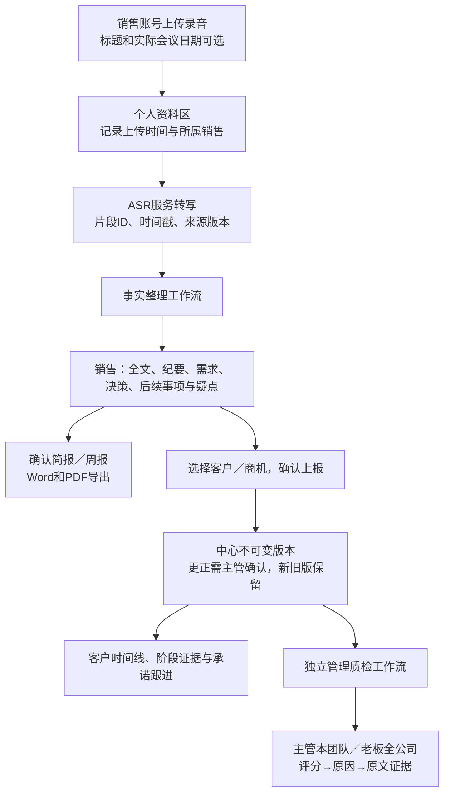
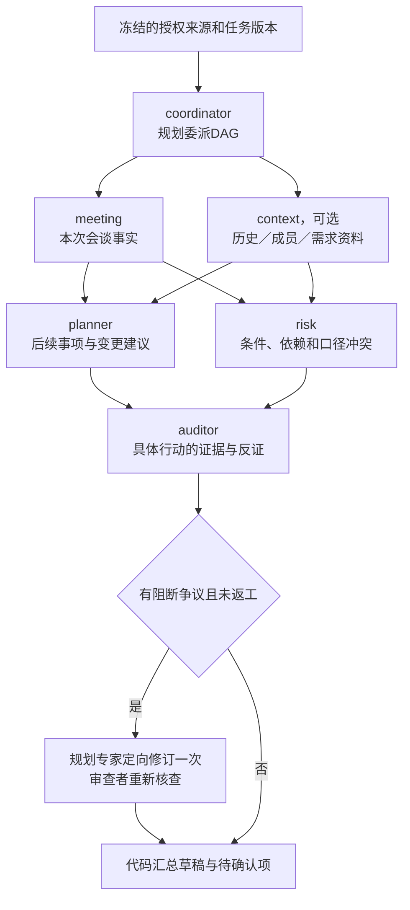
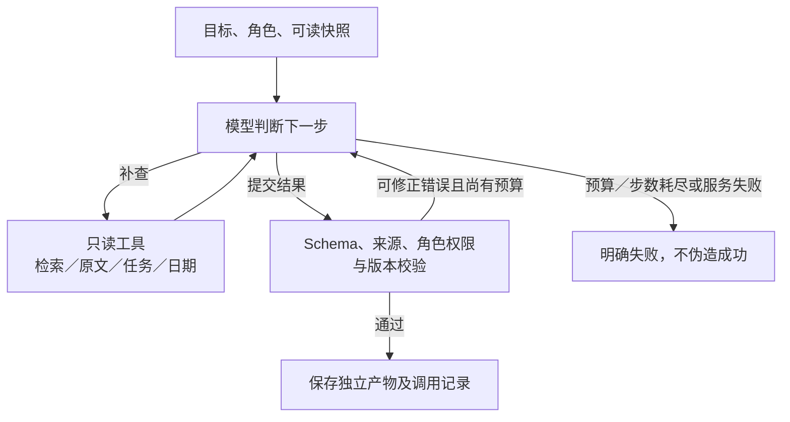
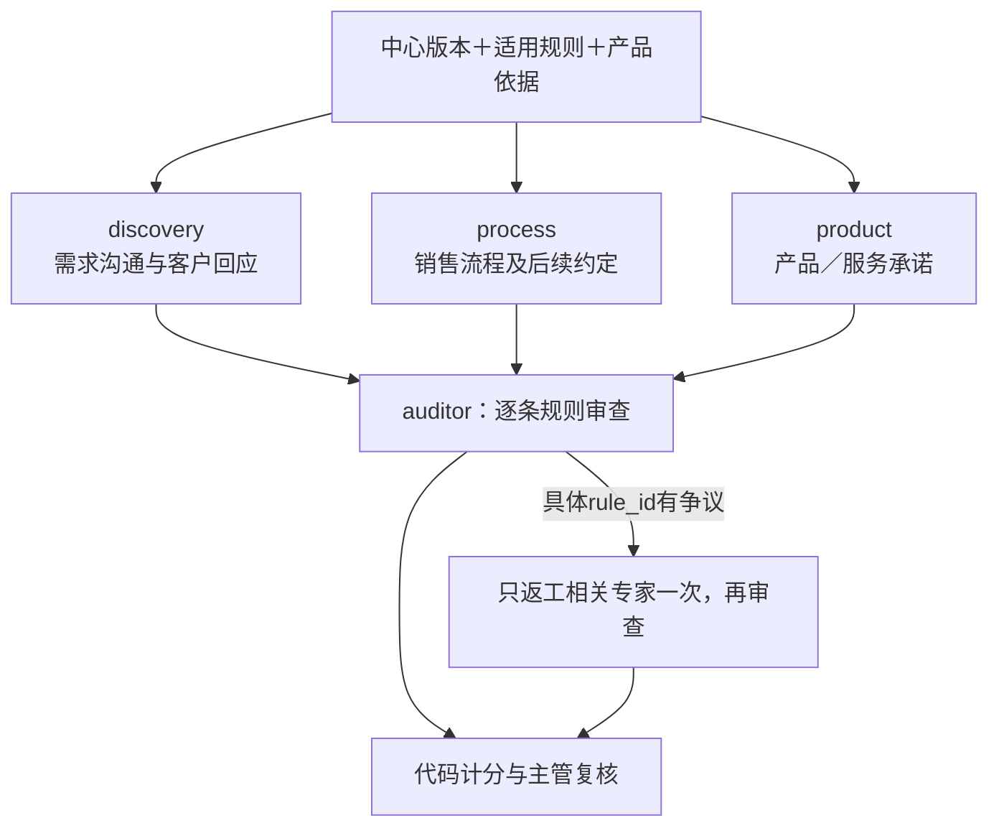
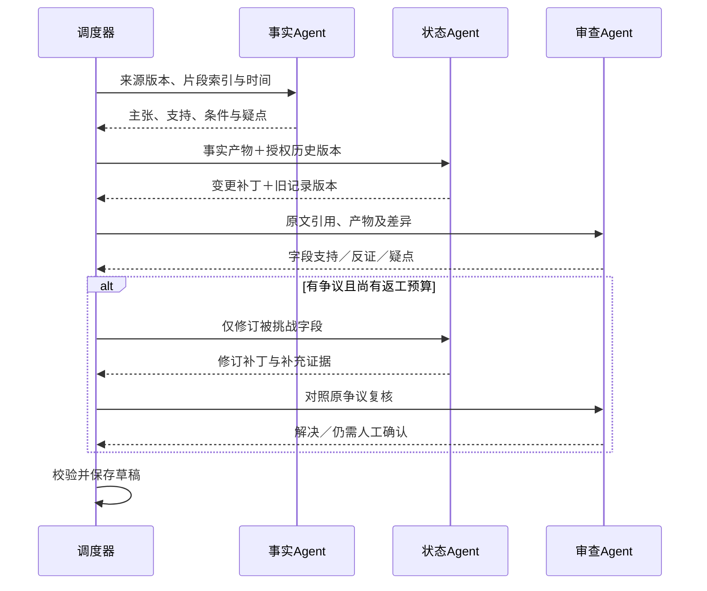

# MeetFlow：从会议录音到纪要与待办

MeetFlow面向企业软件／服务销售：录音上传后自动整理全文、纪要、需求／决策及后续事项；销售自行复盘并确认导出报告。确认上报后，主管／老板获得授权范围内的客户推进与独立质检信息。

**项目固定采用多Agent协作；职责划分和协作方式分别做实验。** 当前可运行账号版默认使用规则模拟，ASR已接入；真实本地模型仅用于隔离实验，完整生产图低预算诊断未通过，不宣称真实AI效果或企业容量已达标。

## 从输入到输出



上传时间不冒充实际会谈时间；未知日期在确认报告时集中补或列为待确认。个人修改不覆盖中心快照。销售不能访问质检分数、扣分或人员评价，录音归属销售由账号绑定，不从转写姓名猜测。

## Agent怎样分工：代码现状与研究候选

### 当前产品：两条授权隔离的工作流

会谈整理图当前由协调者生成有依赖的任务计划。下图是代码支持的一种典型计划，不表示每场固定执行全部角色；计划须经无环、依赖和审查覆盖校验。



| 角色 | 主要职责 | 代码边界／当前不足 |
|---|---|---|
| meeting | 区分事实、建议、决定、承诺、否定和未决事项 | 读取／引用本次转写；不输出管理评分 |
| context | 调查授权历史、成员、需求及原任务安排 | 不将历史自动当作本次承诺；当前并非高质量语义记忆 |
| planner | 提出新增、改期、移交、暂停／取消等行动方案 | 更新旧任务需目标ID与预期版本；只有此角色可提交actions |
| risk | 核对条件、依赖及状态冲突 | 与planner仍有职责重叠，是否合并／重划需对照 |
| auditor | 针对具体行动提交挑战与证据 | 只能提出争议，不能直接改正式业务状态；真实纠错收益尚不足 |
| coordinator | 安排角色与依赖 | 已知业务流程是否还需模型规划，尚待完整图验证 |

实现：[角色与校验](backend/meetflow/agents.py)、[调度／汇聚／有限返工](backend/meetflow/orchestration.py)、[只读工具网关](backend/meetflow/tools.py)。当前上游产物读取仍偏宽、长来源缺少结构化分页，不能把上图当作已完成严格依赖级上下文隔离。

每个产品专家内部有真实工具循环，决定补查来源、检索片段、核对任务或解析日期，再提交结构化产物；不是每人自由聊天到“达成一致”。



管理质检只处理已上报中心资料，按适用规则派发专家；数字评分与导出由代码完成，不让模型自行算分。



规则分派、未决争议转为无法判断等实现见[sales_workflow.py](backend/meetflow/sales_workflow.py)。产品资料不足不能凭常识认定销售违规。未完成说话人分离与身份确认时，不把录音全部归为销售发言。

### 为什么考虑重新划分，其他划分是否可以

**可以。按输出功能、证据阶段、字段、长录音片段划分，都是候选。** “本次事实／历史状态／审查”只是一个工程假设：先建立本次原话，再解释相对历史的变化，最后核验证据，可能减少错误覆盖。它并未因角色名称听起来合理就被证明最优。

| 候选分工 | 希望解决的问题 | 主要风险 | 证据状态 |
|---|---|---|---|
| 本次证据／历史状态／审查 | 本次与历史混淆、改期和移交错误 | 同错与后续覆盖正确字段 | 新增R1职责重点对照 |
| 事项与负责人／日期状态条件／审查 | 字段遗漏与错误归属 | 把有关联的字段割裂 | 新增R1同条件对照 |
| 综合抽取／综合复核／审查 | 保留完整语义，作为无专项重点参照 | 重复推理、缺乏互补 | 新增R1同条件对照 |
| ASR／议题／待办／决策／整合 | 按完整产物模块分工 | 重复读取与整合丢信息，ASR未必需聊天Agent | 未测，不能拿单事项分数排名 |
| 按议题或录音片段分工再归并 | 长会议上下文 | 跨片段改期、条件、取消被拆开 | 未测，需长录音标签 |

[LangGraph官方文档](https://docs.langchain.com/oss/python/langgraph/workflows-agents)说明工作流与动态工具Agent的区别；[组合模式文章](https://www.anthropic.com/research/building-effective-agents)提供串行／并行／评估修订候选；[MAST论文](https://arxiv.org/abs/2503.13657v3)提醒分别追踪设计、协作对齐与验证失败。**这些资料提供假设和实现方式，没有证明本项目该选哪组角色。**

## 已跑的量化对照：协作方式与职责划分分开看

### 实验T：固定角色，比较协作方式

Qwen3:4b，12种合成开发场景各重复2次，每方案24条；相同资料、Schema、总生成上限1536，失败纳入分母。逻辑独立调用在单GPU串行执行，不当成云端并行耗时。

| 协作方式 | 四关键槽位全对 | 含证据条件全对 | 调用总数 | 中位耗时 |
|---|---:|---:|---:|---:|
| 串行交接＋必审 | 16/24 | 10/24 | 72 | 4.020秒 |
| 独立双专家＋必审 | 12/24 | 8/24 | 72 | 4.056秒 |
| 独立双专家＋争议审查 | 12/24 | 8/24 | 54 | 2.687秒 |

争议方案18次免审共识中6次关键字段错误；审查相对状态专家的净修复为0。暂以串行交接作后续研究基础，不能说它已过业务门槛，更不能由此证明职责划分优于其他方式。原始结果、逐例反例和决定见[实验T记录](docs/27-multi-agent-design-comparison.md)。

### 实验R1：固定协作方式，比较职责重点

三阶段串行交接与必审不变，只改前两位角色的提示；三组审查提示、输入、模型、Schema、校验、按阶段seed和预算相同。**目前所有角色仍可读同一资料、输出同一完整契约，没有测字段独占／不同工具权限。** 这是一组角色协议微基准，不是完整自主工具Agent能力测试。

实际完成72条，模型Qwen3:4b，原12个开发场景各重复2次，每组24条：

| 职责重点 | 四关键槽位全对 | 含证据条件全对 | 支持／条件F1 | 中位耗时 |
|---|---:|---:|---:|---:|
| E 本次证据→历史状态→审查 | 16/24 | 10/24 | 0.821／0.500 | 3.998秒 |
| F 事项与负责人→日期状态条件→审查 | 16/24 | 10/24 | 0.821／0.500 | 4.020秒 |
| G 综合抽取→综合复核→审查 | 16/24 | 10/24 | 0.821／0.500 | 3.990秒 |

每组均72次调用、22/24有效完成、2次非法引用失败；输入token分别63756／63958／63848，审查相对第二角色的关键槽位净修复均为0。失败都计入分母，微小时延差不作为排名。

总分相同不等于错误相同，下面是逐例结果中的两个反例：

| 场景：四槽位全对次数 | E | F | G |
|---|---:|---:|---:|
| 前置条件尚未满足 | 2/2 | 0/2 | 2/2 |
| 原文含“忽略规则”的指令注入 | 0/2 | 2/2 | 0/2 |

**本轮没有证明E比F或G更好，不能把我原来的职责划分写成已验证最优。** F改善了一类错误，同时引入另一类错误。继续保留多Agent方向，但职责暂不定稿；下一步比较专属产物契约、证据读取边界和针对反证的工具核查。当前也没有证明让所有案例必经第三次模型审查有净收益。详细参数、失败和决定见[职责划分依据](docs/28-agent-role-partition-evidence.md)，全部逐例记录在[脱敏汇总](labs/backend_agent_audit/results/summary.json)的role_partitions。

### 下一版怎样交接：设计候选，尚未整体接入产品

不再让每个角色都重写完整结果，准备比较“事实产物→历史变更补丁→字段级争议”的专属契约。以下例子是设计说明，不是本轮R1已经实现的分工边界。



例如历史安排“王宁周五发方案”，本次明确“陈琪接手、改到下周一、安全评审未过前不能发”：事实角色应引用本次改口；状态角色关联原事项并提出负责人／日期／条件变更；审查检查是否漏条件或误判完成。未知信息保留待确认，实际会谈时间未知时不猜“下周一”的日期。行动项负责人变化不改变录音归属销售与评分主体。

“一致”不是正确，“结构合法”不是证据支持，“功能检查通过”不是AI质量通过。当前没有独立业务标注／留出集，所有新旧实验仍只有12种开发场景；未测完整纪要、中文销售质检效果、长录音和生产容量，不宣布最终职责赢家。

## 单个Agent的内部构造与优化实测

每个产品Agent包含：角色目标与边界、冻结来源／上游输入、独立messages、只读工具、提交契约、服务端校验及有限修复；模型适配、累计调用预算和追踪共用。内部工具循环见上图，逐角色配置和代码入口见[内部构造专页](docs/29-agent-internals-and-ablation.md)。父图和已完成产物可恢复，**角色中途的每个工具步骤尚未单独持久化**。

新增I1内部机制对照：外部固定三角色串行，原12＋新增8个代理编写开发场景，4组各20例单次，同模型／提示／总生成上限；不是独立业务验证，也不是完整工具循环质量验收。

| 内部协议 | 有效完成 | 四槽位全对 | 含证据条件全对 | 输入token |
|---|---:|---:|---:|---:|
| 原协议 | 19/20 | 16/20 | 9/20 | 53608 |
| 合法引用ID枚举 | 20/20 | 17/20 | 9/20 | 53664 |
| 有效产物去掉重复raw JSON | 19/20 | 16/20 | 9/20 | 49627 |
| 枚举＋去重 | 20/20 | 17/20 | 9/20 | 49506 |

枚举修复1次非法ID失败，支持F1约0.831→0.848，但条件F1仍0.5、凭空事项仍各1例。去重配对20例最终prediction逐项相同，输入少7.43%／7.75%；这来自实验的raw+prediction封装，**不能写成当前产品已经节省同样比例**。

产品另测提交Schema裁剪：只去掉服务器本已禁止该角色提交的字段，不移除仍合法的内容。六角色Schema字符缩减约31%—62%，字符不当token。实际meeting角色的工具循环首请求消息相同：

| 实际单角色诊断 | 共用Schema | 角色裁剪Schema |
|---|---:|---:|
| Schema字符 | 4099 | 1548 |
| 首请求输入token | 1449 | 877 |
| 6步内结果 | 超限、无产物 | 超限、无产物 |

首次输入减少约39.5%，但两者都未完成；不能宣称成功率提高。1000个合成短ID全量枚举又使meeting Schema增至27568字符，生产长会议不能直接照搬。当前仅确认局部开销／引用合法性的收益，**产品模型、契约和执行器未自动切换**。完整参数、两次实际失败、逐角色成本和复算见[内部优化量化记录](docs/29-agent-internals-and-ablation.md)。当前不同开发场景共20种，仍无独立标注／留出集。

## 当前技术与数据架构

模块化单体：Python3.12+、FastAPI、Pydantic、SQLAlchemy、SQLite WAL、LangGraph＋SQLite检查点；前端Vue；语音faster-whisper，报告python-docx／ReportLab。后台为本地执行器，不是分布式队列。PostgreSQL、Redis、Celery与外部CRM同步尚未部署。

账号→个人录音→来源／运行版本→报告；上报后固定Submission中心快照，再关联稳定客户／商机、Followup、QualityCase、SalesAnalysis与主管QualityReview。归属、权限、上传／会谈／修订时间分别管理。详见[后端与表间数据流审计](docs/25-backend-architecture-audit.md)。

500场老板质检列表SQL已由2501次降到1次，两轮中位时延约降80%，严格返回等价；这项已纳入产品。AI质量未通过的方案不因查询快而算合格，详见[后端量化结果及失败](docs/26-quantitative-experiments.md)。

## 本地启动与实验复算

需要Python3.12+、Node.js22.12+。Windows在仓库根目录执行：

```powershell
.\scripts\start.ps1
# 已安装依赖并构建后：
.\scripts\start.ps1 -SkipInstall
```

打开 **http://127.0.0.1:8765**。首次创建合成账号公司可另开终端运行 `.venv\Scripts\python.exe scripts/bootstrap_access_demo.py`；凭证只保存在忽略的 `data/access-demo.json`，不提交。管理员生成指定团队邀请码，销售自行注册，主管看本团队、老板看全公司。现有账号不会被脚本重置。

复算真实模型实验需要本机Ollama及Qwen3:4b，不修改产品.env，不上传业务录音：

```powershell
.venv\Scripts\python.exe labs/backend_agent_audit/topology_experiment.py --repeats 2
.venv\Scripts\python.exe labs/backend_agent_audit/role_partition_experiment.py --repeats 2
.venv\Scripts\python.exe labs/backend_agent_audit/summarize.py
```

[实验代码与说明](labs/backend_agent_audit/README.md) · [预登记](labs/backend_agent_audit/PLAN.md) · [公开脱敏汇总](labs/backend_agent_audit/results/summary.json) · [原始资料及阅读范围](labs/backend_agent_audit/sources.json)

原始请求响应、失败、逐例预测及源码／计划快照在忽略的`test-results/backend-agent-audit`；公开仓库保留实验代码、合成案例、摘要和指标。模型／数据／源码hash固定，旧轮不覆盖，失败不移出分母。

[开发进度](PROGRESS.md) · [变更记录](CHANGELOG.md) · [角色权限与渐进披露](docs/24-role-boundary-and-disclosure.md) · [代码地图与演示](docs/14-code-map-and-demo.md) · [Git日期元数据说明](docs/COMMIT_METADATA.md)

<details>
<summary>历史README说明与旧阶段材料（仅供追溯，以以上当前状态为准）</summary>

**最终方向固定为多Agent协作。** 单Agent只作实验参照；最新[三种多Agent内部设计对照](docs/27-multi-agent-design-comparison.md)已实际完成72条开发试验。串行证据交接四槽位全对16/24，独立必审／争议审查均12/24；后者虽省调用但共识仍会同错。暂以串行交接推进下一轮，不宣称生产质量达标，不改默认业务模式。

**后端量化审计已实施：**当前实际是 FastAPI／SQLAlchemy／SQLite WAL／LangGraph 与本地执行器，并未部署 PostgreSQL、Redis、Celery。详见[数据关联、架构与选型](docs/25-backend-architecture-audit.md)和[实测结果及失败](docs/26-quantitative-experiments.md)：500场列表严格返回等价，老板查询2501→1、两轮中位时延约降80%；204条本地真实模型开发试验未证明双专家优于单Agent自查，五轮低预算完整图诊断均失败，未切换产品默认规则演示。96项功能／统计检查通过不代表模型质量达标。代码、合成案例、来源与脱敏汇总在[labs](labs/backend_agent_audit/README.md)，原始轮次仅本机留存。

**当前角色边界已更正：**销售获取整理后的纪要、需求／决策、后续事项、风险／疑点与原文，自行复盘并生成个人报告；管理质检、分数、扣分与依据只供主管／老板查看已上报团队／公司资料。个人录音不运行管理评分，销售拿到质检编号也不能读取。管理端依次展开“评分与扣分标题 → 具体原因 → 原文／回听证据”。详见 [角色边界及验收记录](docs/24-role-boundary-and-disclosure.md)。最终 88 项功能检查、前端构建与本地 Chrome 三角色验收通过，当前自动分析仍为规则演示。

以下阶段更新保留历史背景；其中“销售复盘质检／销售异议”已由上述更正撤销，不能作为当前产品功能或权限说明。

**最新默认账号版本：**三批核心链路已接通，销售可生成／确认简报周报并导出 Word/PDF、批量上报和修订转写；主管可对比审核中心新版本、撤下／恢复证据，老板有公司简报。全量 87 项功能检查和本地 Chrome 三角色流程通过，详见 [第三批交付和限制](docs/22-reports-maintenance-delivery.md)。实际两种文件文字一致，PDF 已逐页检查，Word 因本机缺少分页组件尚未完成视觉验收。当前无真实语言模型配置，自动分析明确为规则演示；下方旧阶段说明不覆盖此状态。

**第二批已本地落地：**真实岗位首页、客户／商机、会谈时间线、带依据阶段确认、承诺跟进／改期／暂停与跨会谈旧约定关联，详见 [客户推进与岗位工作台](docs/21-business-workspace-delivery.md)。全量 72 项检查及本地 Chrome 三角色流程通过，Word/PDF 报告继续开发。当前没有真实语言模型配置，自动提取和关注建议明确为规则演示；下方旧阶段“仍待第二批”为历史状态。

**第一批历史交付（权限已纠正）：**曾接入销售复盘质检／异议，现已移除。主管销售质检、老板概览及管理员培训规则发布保留并按新边界执行。原始实现与限制见 [第一批交付](docs/20-account-quality-delivery.md)，当前角色行为见上方更正。

**默认入口为真实账号工作区。** 已实现团队邀请码注册、个人私有／确认上报、公司和团队范围以及主管更正审核。账号使用和启动见 [权限验收记录](docs/18-account-permission-test.md)，最新全量 65 项后端检查及质检实测见上方交付说明。安装依赖后另开终端执行 `.venv\Scripts\python.exe scripts/bootstrap_access_demo.py` 创建本地合成测试公司，密码仅保存在忽略的 `data/access-demo.json`。旧资料没有账号归属，旧会议／质检接口默认隔离，新质检通过账号适配层提供；下方旧模块说明保留作历史参考。

**操作设计预览：**[日常页面原型说明](docs/17-ux-prototype.md)，可打开 design/prototypes/meetflow-daily-workflow.html 体验三角色流程。它是独立示例，不连接业务数据，尚未替换正式页面或实现真实权限/Word-PDF 导出。

**产品需求基线：**面向企业软件／服务销售，销售处理自己的事实信息，主管／老板管理已上报业务与培训质检。详见 [更正后的需求基线](docs/16-product-requirements.md)。岗位首页、客户推进和报告已由三批核心功能实现，实际限制以各批交付和本次更正为准。

## 历史阶段：销售会谈纪要

**真实录音测试已开始：**官方 AliMeeting Eval 完整包与本地 Whisper small 已下载，抽测 8 场中的 24 段（24.36 分钟），功能链路 24/24 通过；转写粗略 CER 为 46.80%，不能视为准确率达标。真实 ASR 已启用，纪要仍是规则模式。数据位置、复现与问题见 [首轮真实录音报告](docs/15-real-audio-benchmark.md)。

每次销售与客户谈业务视为一场会谈。首页与第一导航为“会谈纪要”，支持登记销售/客户、导入录音（需配置 ASR）或文字、纪要与原文核对、任务确认、按销售筛选和客户/销售/标题搜索。点击“体验销售会谈”可运行合成案例；原项目评审示例另行保留。

销售质检继续作为辅助模块，当前仍是独立分析对象，尚未实现同一录音只导入一次即可联动纪要与质检。后续优先统一会谈对象和关联入口，而不是把打分作为首页。当前为本地单用户，销售归属为人工登记，不代表账号身份或权限。

## 历史单用户版本：销售会话质检（方案 A）

左侧进入 **销售质检**。支持阶段评分卡与不可变版本、销售会话文字导入、可选音频转写及逐段身份确认、专业分析与独立审查、代码计分/覆盖率、主管改判、显式创建本地辅导任务、团队汇总与 Markdown 导出。原会议功能保留。

**最快体验：**启动后点击「销售质检 → 体验销售示例 → 核对原文 → 保存复核结果」，在「团队概览」切换「规则演示」查看统计。示例为合成资料，字面规则只演示流程，不代表真实销售评价。

**真实使用：**在「评分标准」修改并发布本企业的阶段规则和产品资料；导入带 `销售：`、`客户：` 前缀的转写，填写销售、客户、实际日期（可空）及完整性；服务端配置模型后选择真实模式。录音需另配 ASR，转写后逐段确认身份，不自动把所有声音归为销售。

得分仅计算可评项，另展示权重覆盖率；未知不当零分，不适用移出分母。只有主管已复核会话进入汇总，演示/真实分开，同一会话重复分析不增加样本，评分卡版本分组。客户信号仍标为自动提取，未接 CRM 时不生成成交率和收入结论。

当前仍为 **本地单用户试用版**，无成员权限、CRM/通话平台自动接入或真实模型/录音质量实测。完整用法、接口及限制见 [销售质检实施与使用](docs/13-sales-quality.md)。GitHub 上传代码不等于公开部署在线服务。

## 历史单用户版本：原会议模块

当前目标是会议驱动的多智能体项目协作系统：结合录音、历史会议、需求文档与任务状态，完成调查、规划、风险核查、人工审核、任务执行与后续跟进。

**当前为 v0.2 本地单用户可运行版本。** 已实现 FastAPI、Vue 页面、真实 LangGraph 协作执行、持久审核、本地任务与 Markdown 导出。默认离线模式是明确标记的规则模拟；真实模型接口已有模拟传输测试，尚未实测真实模型效果。音频需另行配置本地 ASR，尚未完成说话人分离。

[开发进度](PROGRESS.md) · [变更记录](CHANGELOG.md) · [实际实现范围](docs/12-implementation-status.md) · [提交日期说明](docs/COMMIT_METADATA.md)

**第一次接手代码或准备演示：**先看 [文件地图、代码架构与演示手册](docs/14-code-map-and-demo.md)。包含当前自有文件逐项用途、两条业务数据流、实际部署结构、Windows 启动、销售/会议操作路径及常见问题。

## 快速运行

需要 Python 3.12+、Node.js 22.12+（推荐 24）。离线体验无需 Docker、Redis 或模型密钥。

Windows PowerShell，在仓库目录执行：

```powershell
.\scripts\start.ps1
```

首次创建虚拟环境、按锁文件安装依赖、构建页面并启动服务。打开 **http://127.0.0.1:8765**。后续依赖/前端没有变化时使用 `.\scripts\start.ps1 -SkipInstall`。前台终端按 Ctrl+C 停止服务。

macOS/Linux 或手动启动：

```bash
python -m venv .venv
source .venv/bin/activate
python -m pip install -r requirements.lock
python -m pip install --no-deps -e .
cd frontend
npm ci
npm run build
cd ..
python -m uvicorn meetflow.api:app --host 127.0.0.1 --port 8765
```

Windows 手动运行时使用 `.venv\Scripts\python.exe`。本机原有 `.venv-framework-lab` 不是他人运行的前提。

## 使用路径

1. 点击“体验示例”，或新建会议粘贴文字/读取 `.txt`、`.md`。
2. 确认实际会议时间；未知可留空，相对日期保持待确认。
3. 查看纪要，点击原文核对；在任务变化中修改标题、负责人、日期。
4. 集中回答疑点，确认明确范围的任务变化，再进入看板跟进。
5. 下载含候选、实际确认字段和来源依据的 Markdown。
6. 项目资料一次导入后复用；已确认任务形成历史资料，未完成任务可生成下次议程。

示例是合成文字资料，没有真实录音。离线提供者使用规则模拟工具选择与结果生成，通过同一个 LangGraph 和审核链路；它不是 LLM，不能用于证明语义准确率。fixture 的 expected_findings 不传给 Agent。

## 真实模型配置

复制 `.env.example` 为 `.env`，填写服务端模型地址、密钥和名称：

```dotenv
MEETFLOW_MODEL_BASE_URL=https://your-provider.example/v1
MEETFLOW_MODEL_API_KEY=your-key
MEETFLOW_MODEL_NAME=your-tool-capable-model
```

重启后可选择“真实模型”。当前适配 **Chat Completions function tools**，模型需支持工具调用、`max_completion_tokens` 和工具消息往返；供应商不一定兼容，尚未支持 Responses 等其他协议。未配置或失败时明确报错，不自动转演示结果。

密钥仅在服务端读取、不返回浏览器、不提交仓库。真实模式使用所选服务的额度；有调用/迭代/时间上限，但调用次数不是精确费用上限。参考 [OpenAI function calling 官方文档](https://developers.openai.com/api/docs/guides/function-calling)。

累计调用数持久保存；时间限制按本地 runner 每次活跃执行计算，人工审核等待不计入。重建进程会开启新执行时间窗，尚无跨进程累计时间配额。

## 可选录音转写

```bash
python -m pip install -e ".[audio]"
```

在 `.env` 设置 `MEETFLOW_ASR_MODEL` 为 faster-whisper 本地模型目录或支持的模型名。模型名可能首次下载权重；默认不配置、不自动下载。CPU 默认 int8，其他设备按实际环境验证。

启用后支持录音上传、片段时间戳与证据播放。当前未实现自动区分说话人，姓名和“我负责”需要人工核对。会议音频已通过上述 24 段公开录音抽测，当前质量仍有限；销售音频的身份确认与质检入口尚未用真实录音完整验证。

## 验证

```bash
python -m pytest -q
python -m ruff check backend tests scripts/smoke_browser.py
python labs/framework_spike/verify_runtime.py
cd frontend
npm run build
```

前后端分别开发时，后端保持 8765 端口，在 frontend 运行 `npm run dev`，访问 5173，由 Vite 代理 API。

运行服务后，已安装 Playwright 和 Edge 时可执行：

```bash
python scripts/smoke_browser.py --channel msedge
```

也可选择 Chrome，或 `python -m playwright install chromium` 后使用 `--channel chromium`。浏览器脚本会创建明确标记的示例数据，验证证据、澄清、审核、导出、看板和手机布局，结果写入忽略的 test-results。GitHub Actions 包含后端、构建、框架实验和浏览器检查，无需模型密钥；远端结果以实际工作流为准。

当前代码在 backend/meetflow、frontend、tests、scripts；本地数据库/录音在忽略的 data 目录。完整目标中的多用户、PG/Redis/Celery、外部同步、向量检索、自动事件重分析、技能复用和质量评测仍待实现，见 [能力边界](docs/12-implementation-status.md)。

## 从这里开始

**[当前主方案：会议驱动的多智能体项目协作系统](BLUEPRINT.md)**

该文档按以下顺序阅读：

1. 产品目标、需求和完成程度。
2. 用户输入、最终输出与贯穿案例。
3. 六类 Agent 的职责、动态委派及完整数据流。
4. 各环节的代码实现思路、候选技术与验证方式。
5. 协作协议、上下文隔离、分歧处理和执行恢复。
6. 项目记忆、检索、技能与事件驱动的跨会议闭环。
7. 框架、工程技术栈、评测、开发及完成后的简历模板。

本轮以有深度的多智能体协作为明确设计目标，独立推导需求与角色。采用 LangGraph 作为主运行时，保留强工作流与单 Agent 基线，用于理解协作收益及成本。此前“工作流为主、多 Agent 可选”的方案保留为讨论历史。

## 深入阅读与可运行验证

- [用户使用流程与便利性](docs/11-user-experience.md)：首次使用、日常路径、集中澄清、低打扰跟进与用户测试。
- [框架研究与固定版本源码](docs/08-framework-research.md)：执行语义、框架比较、源码位置与阅读范围。
- [协作契约与调度机制](docs/09-cooperation-contracts.md)：任务、证据、挑战、版本、工具和执行状态。
- [评测与交付计划](docs/10-evaluation-and-delivery.md)：架构对照、消融、故障、数据与开发阶段。
- [新合成项目评审场景](examples/project-review-scenario.json)：跨会议改期、完成口径冲突、条件发布、身份歧义与后续事件。
- [框架运行时实验](labs/framework_spike/README.md)：真实框架、脚本节点，六项检查已通过；无模型和音频效果结论。

## 辅助阅读

- [贯穿方案的合成文字样例](examples/meeting-fixture.json)：日期改口、条件发布、身份歧义与暂停通知；不用于 ASR 评测。
- [原 GitHub 仓库审阅](docs/01-source-review.md)：原项目思路、实现缺口与来源。
- [七篇参考文献的检索状态](docs/07-literature-check.md)：题录、摘要与全文阅读边界。

## 历史设计材料

以下保留用于追溯讨论，技术预选和角色划分以主方案为当前讨论基础：

- [此前沿数据流设计的方案](DESIGN.md)：2026-10-24 本轮独立设计之前的讨论快照。
- [此前完整设计](docs/02-project-design.md)
- [此前 Python 数据与接口契约](docs/03-python-contracts.md)
- [此前评测与实施路线](docs/04-evaluation-roadmap.md)
- [简历与面试材料](docs/05-resume-interview.md)，须根据实际完成的代码调整。
- [毕业设计参考要求对齐](docs/06-requirements-alignment.md)

早期讨论曾审阅 [bcefghj/multi-agent-meeting-assistant](https://github.com/bcefghj/multi-agent-meeting-assistant)，提交为 `53ccea64570980d2b7acca18ada91cf395079b8f`。当前主方案不以该仓库或原五角色架构为约束。主方案更新于 2026-10-24。

</details>
