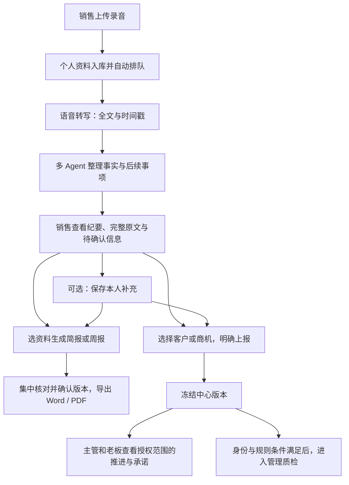
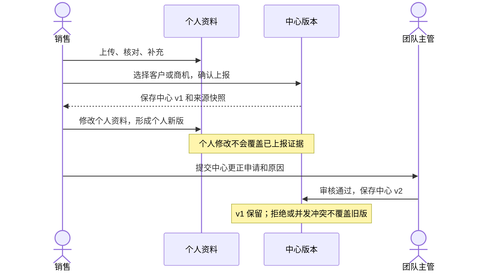
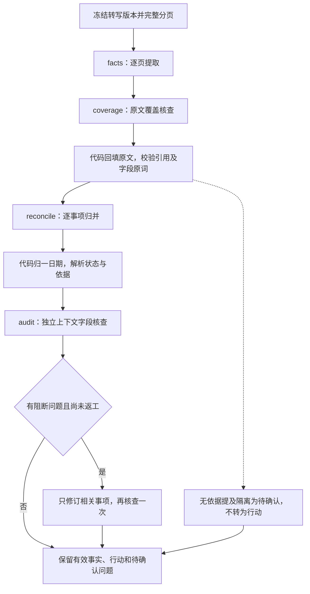
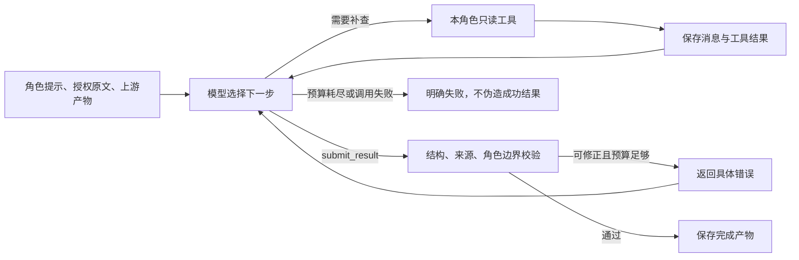
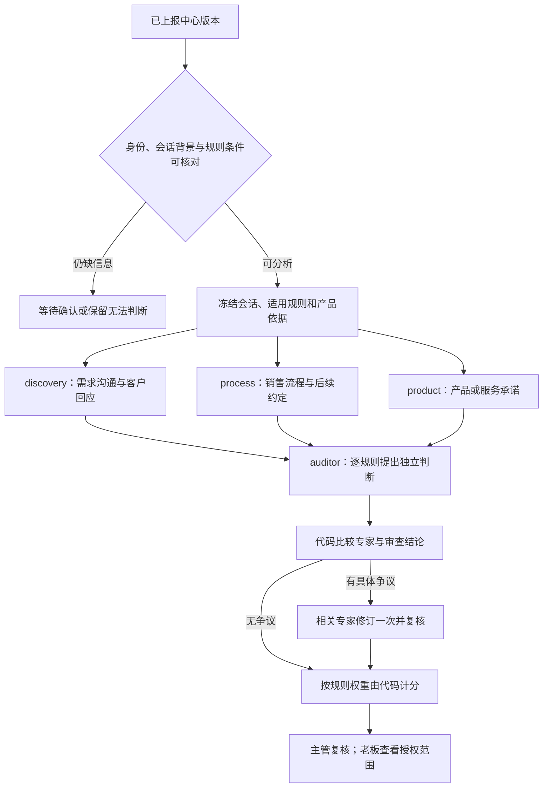
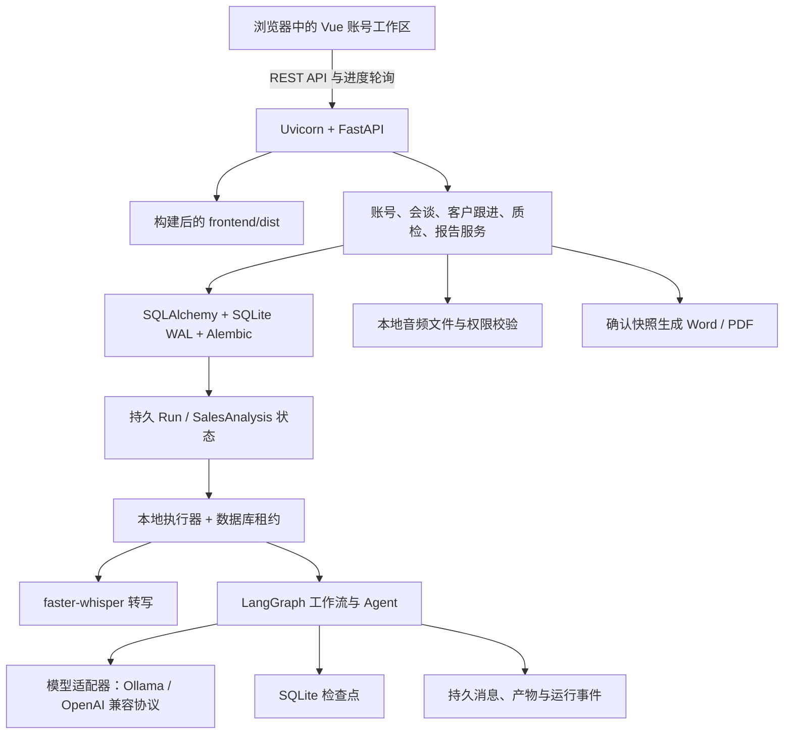
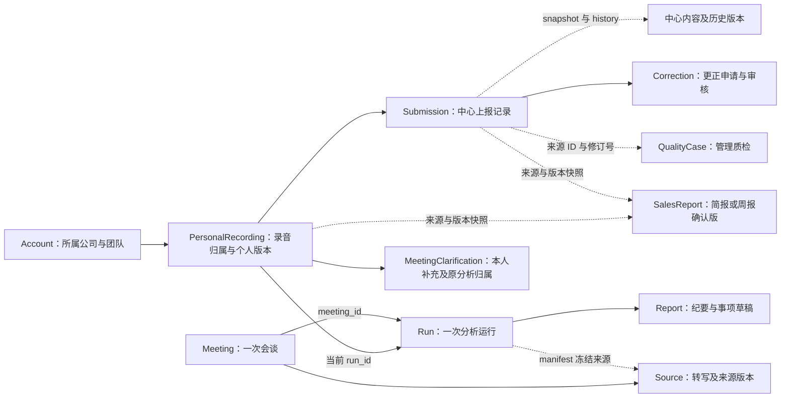

# MeetFlow · 销售会谈多智能体协作系统

**把一次业务录音，变成可核对的会谈资料、可跟进的事项，以及经过明确上报的团队业务信息。**

MeetFlow 面向企业软件／企业服务销售，采用 Python 后端与前后端分离的 Web 界面。销售上传录音后，系统自动转写并整理纪要、需求、决策、后续事项和疑点；销售可以查看完整原文、自行复盘、确认简报／周报并导出。主管和老板在已上报资料上查看客户推进、承诺跟进及独立的销售培训质检。

当前已打通**单机业务闭环和真实 ASR／大模型链路**。生成结果是待核对草稿；独立真实业务效果、生产音频容量及最新浏览器交互验收仍有未完成项，详见[验证结果与边界](#验证结果与边界)。本文整理于 **2026-11-16**，实测数字来自 **2026-11-14 及此前留存批次**，不是本次重新跑分。

[使用闭环](#使用闭环) · [权限与版本](#权限与版本) · [多-Agent-协作](#多-agent-协作) · [系统架构](#系统架构) · [数据关联](#数据关联) · [本地运行](#本地运行) · [代码导航](#代码导航) · [验证记录](#验证结果与边界)

## 需求与已实现范围

目标验证场景是一家公司、约 20–100 名销售，业务阶段包括需求沟通、产品演示、方案报价和决策签约。这是需求规模，**不代表已经验证可承载该规模的音频处理量**。

| 使用者 | 需要解决的问题 | 当前提供的功能 |
|---|---|---|
| 销售 | 会谈信息难整理、承诺易遗漏、重复填写汇报 | 录音上传、完整转写、结构化纪要、引用回看、本人补充、跟进反馈、简报／周报与 Word／PDF |
| 主管 | 不清楚团队谈了什么、进展在哪里、哪些客户需介入 | 团队已上报中心、客户／商机时间线、阶段依据、临期承诺、关注线索、培训流程质检与更正审核 |
| 老板 | 需要公司范围的客户进展与团队表现 | 公司已上报范围的汇总、客户推进及质检信息；不替代团队主管处理更正 |
| 管理员 | 账号和规则配置不能依赖销售手动维护 | 团队与员工配置、邀请码、培训规则配置；不是销售业务审核身份 |

会议资料是主线，人员质检是独立管理模块。**销售通过整理后的信息自行复盘，销售页面不提供人员质检评分或扣分评价。**

## 使用闭环

### 从录音到可使用的结果



日常使用以三个动作为主：

1. **上传**：支持 WAV、MP3、M4A、FLAC、OGG、WebM，默认上传上限 100 MB。标题可留空，系统按上传时间命名；客户和实际会谈日期不要求在上传时填完。上传后自动处理，页面读取状态并反馈进度。
2. **核对**：整理信息与完整转写是并列入口。引用可定位到原文；有音频时间点时可回听。日期、负责人或条件不能确定时保留待确认，录音归属销售不等于每段发言人的身份已识别。
3. **使用**：个人使用可选择资料生成简报／周报、集中核对并导出；需要进入公司管理范围时，再补选客户／商机并确认上报。

### 减少重复操作的具体处理

| 场景 | 系统行为 |
|---|---|
| 只有录音，没有标题 | 使用上传时间生成默认标题，不把它当作实际会谈时间 |
| 实际会议日期不清楚 | 先生成其他内容；报告确认时补日期，或明确单列为时间待确认 |
| 想补充原文没有说清的信息 | 保存“本人补充”，不再重复调用 AI；注明未经客户确认，自动带入报告 |
| 更正转写或实际会谈日期 | 创建新的分析版本；旧转写与原始录音保留，手改文字不自动重新对齐音频时间点 |
| 新分析里出现同名问题 | 旧答案不会自动填到新问题中；历史补充保留并标注适用性 |
| 生成报告 | 模板映射已有信息和本人补充，销售确认后固定内容；来源后来更正不覆盖已确认报告 |
| 维护录音 | 支持查询、筛选、编辑、软删除／恢复、停止与重试，以及上传防重；中心证据有独立维护规则 |

## 权限与版本

### 谁能看、谁能改

权限由后端根据公司、团队、账号和资料来源校验，前端隐藏入口之外还保留接口范围检查。

| 操作／范围 | 销售 | 主管 | 老板 | 管理员 |
|---|---|---|---|---|
| 个人录音、全文、本人报告 | 仅本人 | 不读取销售私人区 | 不读取销售私人区 | 不作为业务浏览入口 |
| 已上报中心 | 本人上报资料 | 负责团队 | 全公司 | 不作为业务审核身份 |
| 人员质检分数、原因、证据 | 不可访问 | 负责团队 | 全公司 | 配置规则，不作业务评分查看身份 |
| 提出中心更正 | 来源销售 | 审核负责团队申请 | 查看授权范围结果 | 不替代主管审核 |
| 撤下中心资料 | 不可直接执行 | 负责团队并记录原因 | 不代替主管操作 | 不替代主管操作 |
| 邀请码／团队／规则配置 | 注册使用邀请码 | 非管理员配置入口 | 非管理员配置入口 | 配置与发码 |

管理员创建指定团队的邀请码，销售自行注册后加入该团队。质检的“负责销售”绑定上报账号，不从转写姓名、当前查看者或审核者推断。

### 个人修改怎样进入中心



个人删除不级联删除中心证据。中心更正申请冻结候选内容及基准版本，主管审核后生成新中心版本；已确认报告也保持自己的历史快照。

## 多 Agent 协作

系统有两条独立工作流：**面向销售的信息整理**和**面向管理的培训质检**。权限、输入和输出分别控制。

### 会谈整理：按判断任务分工

当前本地真实 AI 配置使用 `evidence_v1`／`refs_v1`／`state_v2`。ASR、日期计算、版本控制和报告模板由服务或代码完成；模型 Agent 分别处理召回、归并和核查问题。

| Agent | 输入与职责 | 结构化交接 |
|---|---|---|
| `facts` 证据提取 | 逐页读取转写，区分事实、决策、风险、建议及事项提及 | 摘要、提及、原文片段 ID |
| `coverage` 覆盖核查 | 对照本页原文与初次提取，补缺并提交修订后的完整提取结果 | 修订后的提及与事实；保留未解决的信息 |
| `reconcile` 事项归并 | 根据同一事项的多次提及，选择负责人、当前日期和条件的来源 | 引用提及 ID 的事项结果，而非凭空生成姓名或日期 |
| `audit` 字段审查 | 核对解析后的事项、原文及归并依据，逐字段提出支持、反证或未知 | 负责人／日期／条件／状态／事项依据的核查结果 |



每页先提取再核查覆盖，各事项再归并与审查；无事项时无需执行空的归并／审查。提取和覆盖只选择本页证据 ID，服务器从冻结来源回填原句；负责人、日期原词、条件仍须通过原文约束。日期计算和状态解析由代码执行。引用合法只是必要条件，不能代替语义正确。

这套划分希望解决“提取遗漏”“跨发言改期／条件归属”“结果缺乏支持”三类不同错误。角色的上下文、提交契约和校验目标各不相同；当前会谈链路按页、按事项串行执行，不能写成三路并行推理。

LangGraph 父图负责分析、人工确认和结束；四类会谈 Agent 在分析节点内编排，**不是四个父图节点**。原 `dynamic` 协调者／专家图保留用于旧运行恢复和实验对照，历史图见[原 README](README_HISTORY.md)。

### 一个 Agent 内部怎样工作



Agent 有独立消息上下文和产物，可在授权范围内补查原文、读取分页，归并／审查阶段可调用日期工具。角色结果经 Pydantic 与业务规则校验，调用受步数、模型／工具次数、时间和上下文预算约束。会谈角色保存已收到的模型响应及消息，恢复时可复用已保存步骤。

实现入口：[evidence_pipeline.py](backend/meetflow/evidence_pipeline.py)、[providers.py](backend/meetflow/providers.py)、[orchestration.py](backend/meetflow/orchestration.py)。

### 管理质检：规则专家、审查和代码计分



按适用规则分派专家，审查者提交独立建议状态，由代码与上游比较，存在具体分歧才返工。模型输出规则判断、原因和证据 ID，数字分数由代码计算。产品依据缺失、会话不完整或身份不明时，不凭“没看到”就认定销售未执行。

管理工作流可逻辑分派多个专家；当前本地 Ollama 限制单个模型请求同时执行，不能据此宣称并行加速。管理图保存父图检查点与完成产物，尚不承诺每个内部工具步骤均可恢复。

界面按**评分与扣分简题 → 具体原因 → 原文依据**逐级展示。实现入口：[quality_workspace.py](backend/meetflow/quality_workspace.py)、[sales_workflow.py](backend/meetflow/sales_workflow.py)、[sales_domain.py](backend/meetflow/sales_domain.py)。

## 系统架构



| 层次 | 当前实现 | 职责与边界 |
|---|---|---|
| 前端 | Vue 3、TypeScript、Vite | 账号工作区、状态轮询、全文与引用、中心、报告和管理质检 |
| 接口与契约 | Python、FastAPI、Pydantic | 鉴权、数据范围、输入输出约束、下载接口 |
| 业务存储 | SQLAlchemy、SQLite WAL、Alembic | 账号／归属／版本／审核／跟进／报告；留存批次业务库含迁移版本表共 37 表 |
| 后台处理 | 数据库持久任务、本地 ThreadPoolExecutor、WorkLease | 会谈与质检各一个本地执行器；启动及周期扫描恢复待处理工作 |
| 多 Agent | LangGraph、结构化工具调用、持久消息／产物 | 限定输入与工具、字段校验、有限返工和人工确认 |
| 语音与推理 | faster-whisper；已测本地 Whisper-small CPU、Qwen3.5-4B | 默认保留未知说话人；真实 AI 与规则演示明确标记 |
| 导出与维护 | python-docx、ReportLab、离线备份恢复 | Word／PDF 使用同一确认内容，音频与数据库一起纳入备份 |

当前未接入 PostgreSQL、Redis、Celery 或独立消息代理；账号页进度使用 HTTP 轮询。上图描述已运行的单机实现，分布式队列、对象存储和多机部署需要单独实现及验收。

### 任务为什么能在重启后继续

任务先入业务数据库，再由本地执行器处理。执行器负责调度，数据库状态负责恢复依据：

- 数据库租约包含拥有者、代次和到期时间，运行中续期；过期任务允许接管。
- 写入业务结果时校验租约，旧执行者失去所有权后不能继续发布；检查点代次隔离过期执行过程。
- 已保存消息、模型响应及完成产物可复用；完成后的任务不会因服务重启再次推理。
- 模型请求已经发出但响应尚未保存的窗口，仍可能重调，不承诺外部调用的 exactly-once。

实现入口：[leases.py](backend/meetflow/leases.py)、[store.py](backend/meetflow/store.py)、[api.py](backend/meetflow/api.py)。

## 数据关联



这是**核心关联示意，不是完整物理 ER 图**。实线表示主要归属／外键路径，虚线表示 JSON 快照或逻辑引用；全部表和约束见 [database.py](backend/meetflow/database.py)。

- `PersonalRecording` 指向当前分析运行，原始会谈及旧运行继续留存；`Run.manifest` 固定本次输入来源。
- `Submission` 同时固定资料内容、来源销售、团队和证据。中心修订保留旧快照，不跟随个人区静默更新。
- `MeetingClarification` 记录补充时的资料版本及原分析归属。补充是本人陈述，不能改写转写为客户原话。
- `SalesReport` 保存选择的来源／修订号和确认内容。来源更新使草稿需要重新核对，已确认版本保持不变。
- 客户、商机和跟进由 `Customer`、`Opportunity`、`Followup` 管理；业务推进依据可回到授权的中心版本。

## 本地运行

### 1. 首次准备与账号

已验证开发环境为 **Windows PowerShell、Python 3.12、Node.js 24**。下面的安装步骤只需首次执行；本地数据和模型不随仓库上传。

```powershell
git clone https://github.com/thehappysky/meetflow.git
cd meetflow
py -3.12 -m venv .venv
.venv\Scripts\python.exe -m pip install -r requirements.lock
.venv\Scripts\python.exe -m pip install --no-deps -e .
npm.cmd --prefix frontend ci
npm.cmd --prefix frontend run build
if (-not (Test-Path -LiteralPath .env)) { Copy-Item .env.example .env }
.venv\Scripts\python.exe scripts/bootstrap_access_demo.py
.\scripts\start.ps1 -SkipInstall
```

浏览器打开 [http://127.0.0.1:8765](http://127.0.0.1:8765)。初始化脚本创建独立合成测试公司、两支团队及管理员／老板／主管账号，随机密码只写入本机 `data/access-demo.json`，不会重置已有账号。用管理员账号创建团队邀请码，销售再自行注册加入指定团队。不要提交账号文件。

### 2. 启用真实音频与本地多 Agent

未配置模型时，默认入口提供明确标注的规则演示；不能用它评价真实 AI 效果。以下入口要求提前准备好音频依赖、本地 Whisper 权重、便携 Ollama、4B 权重与匹配分词器：

```powershell
.venv\Scripts\python.exe -m pip install -r requirements-audio.lock
.venv\Scripts\python.exe scripts/prepare_local_inference.py
.venv\Scripts\python.exe scripts/prepare_modern_model.py --tag 4b-q4_K_M
.venv\Scripts\python.exe scripts/prepare_tokenizer.py qwen35-4b
# 在 .env 中将 MEETFLOW_ASR_MODEL 配置为已下载的本地 Whisper 模型目录
.\scripts\start-local-ai.ps1 -SkipInstall
```

先结束已有的 8765 服务，再启动另一入口。已准备好模型的本机只需最后一条命令。该入口在启动进程中设置真实 AI 配置，使用隔离的 11435 推理服务，保留原 `.env`；权重准备、文件哈希及 Whisper 下载说明见[详细运行说明](docs/35-backend-runtime-acceptance.md#怎样启动和复验)。录音识别或模型调用失败会明确报错，不自动替换为规则纪要。

### 3. 验证与维护

```powershell
.venv\Scripts\python.exe -m pytest tests labs/backend_agent_audit -q
.venv\Scripts\python.exe -m ruff check backend tests
npm.cmd --prefix frontend run build
```

真实链路验收脚本包括 `accept_backend_runtime.py`、`accept_main_live.py`、`accept_supplement_runtime.py`，各自准备条件与数据范围见[运行验收](docs/35-backend-runtime-acceptance.md)。部分脚本需要本机已建立的合成账号，不能当作无前置条件的通用命令。

离线备份使用 `python -m meetflow.operations backup --data-dir data --output <新备份目录>`；恢复使用 `restore --bundle <备份目录> --destination <新空目录>`。先停止相关服务，保留音频、业务库及检查点，不覆盖现有工作区。详见[维护实现](backend/meetflow/operations.py)。

## 代码导航

后端采用**一个应用进程内按业务模块拆分**的组织方式；接口、服务和存储协作，不是微服务部署。`database.py` 定义关系模型，`store.py` 管理会谈运行、来源与产物；业务模块负责账号范围和具体业务规则。

```text
.
├── backend/meetflow/
│   ├── api.py                         # 应用入口、服务装配、启动恢复
│   ├── auth.py                        # 账号、会话、团队与邀请码
│   ├── workspace.py                   # 个人录音、上报、中心与更正
│   ├── business.py                    # 客户／商机、跟进与岗位汇总
│   ├── evidence_pipeline.py           # 当前会谈四类 Agent 的证据交接
│   ├── orchestration.py               # 会谈父图、调度与恢复；保留旧图
│   ├── providers.py                   # 模型适配、工具调用与用量
│   ├── quality_workspace.py           # 管理质检的权限、来源与复核
│   ├── sales_workflow.py              # 质检专家／审查／返工工作流
│   ├── sales_domain.py                # 质检契约与代码计分
│   ├── reports_workspace.py           # 简报／周报来源映射与确认
│   ├── report_export.py               # 同一确认内容生成 Word／PDF
│   ├── database.py / migrations/      # SQLAlchemy 模型与 Alembic 升级
│   ├── store.py / leases.py           # 运行存储、消息、租约与写入隔离
│   └── audio.py / maintenance.py / operations.py
├── frontend/src/                      # Vue 账号界面及各业务面板
├── tests/                             # 功能、权限、版本与故障恢复检查
├── scripts/                           # 启动、依赖准备与实际链路验收
├── labs/                              # 框架／多 Agent 方案实验与公开计数
├── docs/                              # 需求、设计、研究和逐批验收记录
├── .github/workflows/ci.yml            # 回归与构建；旧界面 smoke 单列
├── PROGRESS.md / CHANGELOG.md          # 开发进度与变更留痕
└── README_HISTORY.md                  # 重整前完整 README 归档
```

主要页面到服务的对应：`WorkspaceApp.vue → workspace.py`，`BusinessWorkspace.vue → business.py`，`QualityWorkspace.vue → quality_workspace.py`，`ReportsWorkspace.vue → reports_workspace.py`。`data/`、`test-results/`、模型、数据库、音频、凭据和完整调用日志被 Git 忽略。

## 验证结果与边界

### 功能验收与效果评测分别记录

下表为留存的 **2026-11-14 及此前批次**。功能断言数量、模型开发用例分数和音频诊断不能互相替代，本次 README 重整没有重新执行这些实验。

| 对象 | 已留存结果 | 如何理解 |
|---|---|---|
| 产品／实验回归 | 最终 194 项通过；前端类型检查与构建通过 | 功能及契约回归，不是 194 场真实业务效果评测 |
| 音频与重启 | 50 项真实 TCP 检查通过，ASR → 真实 4B → live 纪要；完成后重启不重复推理 | 含数据库持久化、权限和导出；不是提取准确率 |
| 实际纪要与管理质检 | 30 项检查通过 | 包含真实调用、账号归属、权限及三级披露 |
| 本人补充到报告 | 28 项检查通过；保存前后均 4 次模型调用、1 次分析 | 证明保存补充不再空跑 AI，Word／PDF 固定内容一致 |
| 备份与恢复 | 53 个文件；37 表 3409 行在该次恢复中逐行一致 | 该次离线快照，不代表当前库的实时行数 |
| 元数据并发 | 100 个合成销售账号、5 团队；300 次创建／300 次读取成功，读取 P95 约 0.68 秒 | 每账号仅 3 条私人记录，推理关闭，不能当作音频吞吐或生产 SLA |
| 会谈覆盖消融 | 四角色／三角色同 15 例分别 12/15、11/15，调用 69／49 次 | 覆盖核查有成本和局部退步，不能据此宣称普遍优势 |
| 模型对照 | 同源码 4B／9B 在 15+7 个开发用例上分别 18/22、17/22 | 9B 原关键例退步，保留 4B；不是独立业务金标准 |
| 转写对照 | small／Turbo 在 24 段公开会议上诊断 CER 47.41%／44.02%，耗时 569.05／1211.05 秒 | Turbo 未达预登记门槛，本机默认仍 small；识别质量仍需改善 |

成功与失败均保留。V3 自由分组／盲审、V4 事件指针等候选发生退步，已移出当前运行时，源码仍可从历史提交与本地实验快照追溯。9B 部分计时受同机功能测试争用影响，不作为纯模型速度排名。小样本反复用于开发后，不再称独立留出评测。

### 尚未通过的部分

- 仍有暂停／取消误审、同句多个事项负责人遗漏等失败；没有独立真实销售录音的人工金标准，不应把草稿直接当成无须审核的正式结论。
- 自动说话人区分效果未达标，默认保留未知身份。公开远场会议 ASR 诊断误差较高，不能宣称达到商用转写准确率。
- 长文本有分页与跨页修订检查，但真实模型的 1370 字／3 页案例不能证明任意长会议稳定处理。
- 未验收企业级日音频吞吐、多机消费和高可用。按短片 CPU 转写实测投影，100 场 × 30 分钟仅 ASR 约需 19.46 等效计算小时；这仍是投影。
- 前批有本地浏览器角色／邀请码操作记录，最新一轮浏览器控制工具初始化失败；最新 HTTP 验收不冒充新的界面点击验收。
- Word／PDF 实际文件均已渲染检查；Word 使用 LibreOffice，不宣称完成 Microsoft Word 客户端兼容验收。

### 进一步阅读

| 内容 | 入口 |
|---|---|
| 完整交付范围与验收计划 | [docs/32](docs/32-completion-plan.md) |
| 后端实际栈、准备条件与真实链路证据 | [docs/35](docs/35-backend-runtime-acceptance.md) |
| 多 Agent 改进、否决候选与模型比较 | [docs/36](docs/36-state-identity-continuation.md) |
| 转写候选、固定权重与同片段比较 | [docs/37](docs/37-asr-turbo-comparison.md) |
| 脱敏指标与代码／配置追溯 | [续验汇总](labs/backend_agent_audit/results/continuation_summary.json)、[运行汇总](labs/backend_agent_audit/results/runtime_summary.json)、[覆盖消融](labs/backend_agent_audit/results/coverage_ablation.json) |
| 原设计、动态工作流与阶段性结果 | [README 历史快照](README_HISTORY.md)、[原设计](BLUEPRINT.md) |
| 开发留痕与日期说明 | [PROGRESS](PROGRESS.md)、[CHANGELOG](CHANGELOG.md)、[提交元数据说明](docs/COMMIT_METADATA.md) |

Git 提交元数据中的回填日期不等于真实开发或实验周期；实验与阶段文档保留实际记录日期。外部 CRM／派单、支付计费、自动销售竞品分析等不在当前交付范围。
