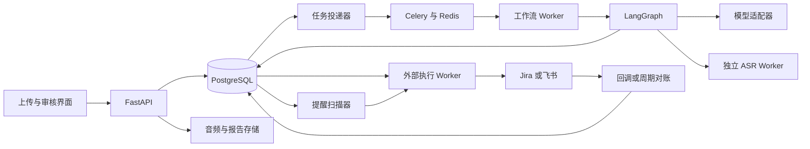

# MeetFlow 新版完整项目设计

> 状态：面向 Python 实施的设计稿。文中的模块和机制需要按实施路线完成并验证，不能直接宣称已经上线。

## 1. 项目背景与业务目标

研发团队的例会、需求评审与复盘通常会产生三类信息：当前事实、已经确认的决策、后续需要执行的任务。这些信息混在讨论里，包含插话、改口、否定和条件约束。普通摘要容易遗漏这些区别；直接把抽取结果写入任务系统，则可能把建议变成任务、把候选方案变成既定决策。

MeetFlow 接收录音或已有转写，通过专业化语义节点整理信息，再将结果与原文绑定。组织者在一个草稿中核对纪要、处理缺失字段、确认发布范围。外部系统同步和提醒由持久化任务执行，系统保留每次投递的结果。

业务目标：

- 会后尽快获得可编辑草稿，区分讨论、决策、行动项与风险。
- 每个重要结论都有原文依据，能定位到具体发言和录音时间。
- 负责人、日期和执行条件不明确时保留歧义，便于审核。
- 任务被确认后可靠地进入外部系统，并能追踪同步与完成状态。
- 能量化测量输出质量、延迟和成本，比较不同方案。

## 2. 使用场景与产品范围

首个使用场景定位为 3～10 人的研发会议，先支持文字输入，再支持会后录音上传。这个范围是实现和测试的约束，不代表已经验证的系统容量。

| 使用者 | 主要操作 | 期望产物 |
|---|---|---|
| 会议组织者 | 上传资料、核对草稿、发布结果 | 可追溯的纪要及待办 |
| 参会人 | 查看原文、修改自己的行动项、更新进度 | 清楚的任务与截止日期 |
| 项目负责人 | 查询未解决问题和历史决策 | 风险列表、任务进展 |
| 维护者 | 查看运行状态和失败详情 | 可定位的错误、耗时与成本 |

MVP 包括：会议元数据、文字输入、结构化产物、证据引用、三路并行、人工修订和固定评测。

第二阶段包括：持久化恢复、录音转写、一个外部适配器、可靠投递与提醒。先把一个适配器做完整，再接入第二个。

历史会议 RAG 和实时字幕单独验收；它们不会因引入向量库或 WebSocket 就自动成立。

## 3. 项目价值与简历重点

这个项目可以体现 AI 应用开发的四项能力：设计模型输入输出、编排复杂流程、处理 AI 与业务规则的边界、用评测验证改动。

最有价值的展示材料是：一场有改口和歧义的会议、带原文的草稿、一次失败恢复演示、一次外部创建超时后的对账，以及一份版本固定的对比评测。

技术栈和 Agent 数量应服务于这些材料。ASR、权限检查、时长统计、数据库写入是服务或确定性节点；语义抽取、证据判断和歧义澄清才需要模型参与。

## 4. 五类业务职责与新增治理层

| 业务职责 | 新版模块 | 输入 | 输出 | 主要验证 |
|---|---|---|---|---|
| 转写 | ASR 与分段服务 | 录音、语言设置 | 带版本的转写片段 | 时间范围、输入来源、失败状态 |
| 摘要 | Summary 节点 | 片段与会议元数据 | 议题、讨论、确认决策、未决问题 | 内容是否有依据、是否把建议写成决策 |
| 行动项 | Action 节点 | 原文片段、参会人目录 | 任务、负责人、日期、条件、取消/修订关系 | 委派是否明确、最新状态是否正确 |
| 洞察 | Insight 节点 + 统计服务 | 转写、时间戳 | 风险、分歧、缺失信息、发言统计 | 风险引用、统计口径 |
| 跟进 | Follow-up 计划与执行服务 | 已审核报告与行动项 | 发布计划、投递结果、提醒记录 | 审核范围、投递幂等、完成状态 |

新增 Evidence Validator：先检查引用、数据类型和身份一致性，再用模型检查关键语义是否受到证据支持。对明确可修复的候选项定向重提取；仍不明确的项留给用户编辑。

Follow-up 的任务创建、消息发送和提醒执行由固定服务负责。若消息文案需要模型润色，只允许改变表达，不允许修改任务事实、收件人和执行范围。

## 5. 架构与组件职责

该图表示可靠性阶段的部署形态。MVP 可以只启动 API、一个工作进程和 PostgreSQL，不必同时引入所有基础设施。

| 组件 | 职责 | 边界 |
|---|---|---|
| FastAPI | 认证、上传、查询、审核、状态通知 | 不在请求处理中持续运行长任务 |
| LangGraph | 节点依赖、状态更新、路由与人工中断 | 不替代业务数据库与远端幂等处理 |
| PostgreSQL | 会议、版本、行动项、审核、运行、投递与提醒 | 业务事实的权威来源 |
| Celery + Redis | 工作任务分发、重试和 worker 分组 | 按可能重复投递设计，队列结果不是业务事实 |
| 对象存储 | 录音、导出报告和大体积产物 | 图状态只保存对象引用 |
| LLM 适配器 | 结构化调用、超时、能力检查、调用元数据 | 模型不能直接调用外部写入接口 |
| ASR Worker | 重计算与模型生命周期 | 与 API 进程隔离，受容量限制 |

建议 Python 3.11 作为实施基线，语音依赖单独安装和锁定。采用 httpx + 协议适配模型供应商，模型 ID 和端点来自配置。输出 schema 的支持情况应通过契约测试验证，不能假定所有兼容接口行为完全一致。

## 6. 一次会议的处理流程

1. 创建会议，保存开始时间、时区、参会人和输入类型。
2. 上传录音或文字并建立输入版本。真实输入与 demo 输入有明确标记。
3. 将输入持久化，创建运行记录与待投递任务；接口返回 job_id。
4. 录音先转写，已有文字直接校验和分段。形成不可变的 transcript_version。
5. 按实际 token 预算构建上下文块，保留原始片段 ID 与跨块关联。
6. 并行生成纪要、行动项与风险；各模块独立保存产物和执行状态。
7. 检查证据、负责人、相对日期、取消/修订关系及跨模块冲突。
8. 对可修复项有限次补充上下文或重提取，形成报告版本。
9. 保存草稿，暂停等待审核。任务不占用一个长期等待的 worker。
10. 用户编辑并批准具体版本和执行范围，系统保存审核记录。
11. 在事务中创建本地发布/同步记录与 outbox，异步投递。
12. 同步状态独立更新；外部失败时可以重试或对账，已审核草稿仍可查看。
13. 根据已确认的任务日期创建提醒记录；任务完成、取消或日期修改会改变提醒计划。

## 7. 转写服务：先建立真实输入与证据

### 7.1 离线音频处理

推荐路径：媒体校验 → 解码与必要重采样 → VAD → ASR → 可选对齐 → 可选说话人分离 → 片段持久化。

实现前对 faster-whisper、WhisperX 的实际输出结构和依赖版本做小样本验证。文字输入提供另一条独立路径，不能把它当成音频识别成功。

转写失败返回失败原因及可重试状态；部分片段无法识别则保留空缺或低质量标记。演示文本仅由显式 fixture 模式加载。

### 7.2 说话人分离与真实身份

`SPEAKER_00` 等聚类标签只表示音频中的声音簇。参会人目录不自动证明某个声音是谁。默认保留匿名 speaker_id，由用户映射到 person_id；多人同名、昵称、代词和重叠发言保留候选与歧义。

“我来做”只有在当前发言人的身份映射已确认时，才能绑定为某位参会人的任务。无法确认时保留 owner_raw 与 needs_review。

WhisperX 官方也列出了重叠发言、对齐和分离的局限，不能直接把说话人标签当作可靠的真实姓名。[WhisperX 官方说明](https://github.com/m-bain/whisperX#limitations-)

### 7.3 转写版本与修订

每个片段保存 segment_id、speaker_id、起止时间、文本、来源和版本。人工纠正术语后产生新转写版本，旧引用仍指向旧版本；重新生成报告时明确使用哪个版本。

没有录音时间戳的文字输入允许 start_ms/end_ms 为空，通过段落 ID 或字符区间追溯，界面不显示虚构的播放位置。

## 8. 长会议上下文：分块但不丢失责任与决策

### 8.1 预算驱动的分块

按模型窗口减去提示词、schema、预留输出和余量得到输入预算。按发言边界分块，以 token 数作为约束，时间长度仅用作辅助。块间保留少量相邻上下文，重叠片段沿用原 ID。

### 8.2 两条独立分析路径

纪要路径：块内提取议题、事实、决策候选和未决问题，保留引用，再按议题归并。过长时继续分层归并，每层仍保留原始证据 ID。

行动项路径：直接从各块原文提取任务候选，之后跨块处理改口、取消与条件。不能只从最终摘要抽取任务，否则摘要遗漏会直接变成行动项遗漏。

### 8.3 跨块修订

识别“刚才那项”“时间改到周三”“先取消上线”等引用关系，形成候选之间的 supersedes/cancels 关系。先结合责任人、任务对象、证据与上下文做候选匹配；多个合理匹配同时存在时留待审核。

语义相似度仅用于寻找候选，不能直接把所有相似任务合并。旧值保留在修订记录中，最终视图显示已确认的最新值。

## 9. Summary：纪要中区分事实、方案和决策

输出包括会议摘要、议题、讨论观点、确认决策、未决问题。每个决策保存证据和决定状态；讨论中尚未接受的建议应放在 discussion/proposal。

典型错误：“如果压测通过，下周五可以发布”被写成“决定下周五发布”。正确结果保留压测条件，并把发布标为候选方案。

处理顺序：块级候选 → 议题归并 → 决策状态校验 → 原文核对 → 草稿。归并时检查数字、版本、时间和否定词，禁止只为了让纪要更流畅而删掉限制条件。

会议日期与参会人首先来自元数据；文本只能补充候选。没有给出的日期不使用模型猜测的“今天”。

## 10. Action：从候选任务到可执行行动项

### 10.1 提取字段

| 字段 | 用途 |
|---|---|
| task / deliverable | 任务与可验收产物 |
| owner_raw / owner_person_id | 原始称谓与经确认的真实身份 |
| due_raw / due_date / due_at | 日期原话、日期或确切时间 |
| conditions | “如果压测通过”等执行条件 |
| candidate_state | proposed / committed / conditional / paused / canceled / superseded |
| evidence | 转写版本、片段 ID、原文范围 |
| resolution_notes | 歧义、补充依据和修订说明 |
| review_state | 待核对、批准、驳回 |

缺失负责人、日期、优先级时保留 null。系统默认值可以用于本地工作管理，但必须区分它与从会议中抽取的值。

### 10.2 时间归一化

相对日期基于 `meeting_started_at + meeting_timezone` 计算，不能基于重新处理的日期。模型负责提取原话和指向关系，规则负责可明确表达的日期换算。

本案例约定：会议日期为 2026-10-09，时区 Asia/Shanghai；“下周三”指下一自然周的星期三，即 2026-10-14。这个约定写入配置与测试。没有明确约定的“月底前”“尽快”“过两天看看”保留原话与待核对状态。

只有日期的截止项保存 date，不自行发明一个精确时刻。提醒时间来自组织配置；外部适配器如必须使用 timestamp，按已配置时区和全天/截止策略转换，并在审核界面展示。

### 10.3 取消、条件与改口

“考虑一下”属于建议；“我来完成”可以是承诺；“如果客户确认就做”属于条件任务；“先不要发”使当前发送行为进入 paused，明确“取消该任务”才记为 canceled。

跨块改期需要保留旧截止日期、修改证据和最终截止日期。一个任务是否可以外部执行取决于候选状态、校验结果、必填字段和审核范围，不取决于模型给出的高置信度。

## 11. Insight：输出可核查的风险与描述性统计

语义洞察集中于未决分歧、任务阻塞、决策前提与缺失信息。每条风险都要指向原文，区分“发言人明确提出的风险”和“模型推断、待确认的风险”。

发言统计使用确定性计算：

- 发言次数按定义明确的发言轮次计算，不能直接把任意 ASR 分段数等同于发言次数。
- 每个人的发言时长合并其重叠区间后计算，避免一个人的重复时间戳被重复计数。
- “发言时长份额”以各说话人累计时长之和为分母，重叠发言分别计入各人。
- “会议语音覆盖率”以所有发言时间区间的并集为分子，以录音时长为分母。
- 匿名说话人照常统计，不能默认为参会人目录中某个真实姓名。

默认展示描述性统计和有证据的风险。若后续尝试情绪或效率评分，需要独立定义用途、标注与评测；没有验证的综合评分不能作为人员绩效结论。

## 12. 证据校验、受控 Agent 与有限修复

### 12.1 三层校验

第一层是结构校验：字段类型、枚举、日期格式、必填项和引用的存在性。

第二层是规则校验：原文范围确实来自指定片段，引用属于当前转写版本，负责人来自允许目录，修订关系可解析，取消项没有进入可执行列表。

第三层是语义校验：用原文检查候选陈述是否被支持、是否遗漏否定或条件、是否把历史信息当成本次承诺。校验模型同样可能出错，结果是辅助判断，不能成为“事实已被数学证明”的保证。

### 12.2 受控澄清 Agent

当问题适合补读上下文时，允许模型在小范围内选择只读工具：

| 工具 | 允许的能力 | 参数约束 |
|---|---|---|
| get_transcript_context | 获取同一会议指定片段邻近原文 | 限定会议与版本，限制片段数 |
| lookup_participants | 查询当前会议参会人及已确认别名 | 不访问其他会议人员资料 |
| normalize_relative_date | 按固定会议基准换算明确时间表达 | 基准时间由服务端提供 |

每次澄清最多执行三个工具调用，最多两轮修复，统一计入调用与 token 预算。工具只返回证据和候选信息。用户未在原文或审核中给出的责任人、日期和决策，不能通过继续调用模型补成事实。

这个子流程体现有限的“观察 → 选择工具 → 根据工具结果调整”的 Agent 行为。主流程仍是显式状态图。若实现阶段只做固定提取和校验，就按工作流描述，不宣称完成自主规划。

### 12.3 修复与停止条件

错误按类型路由：格式错误允许一次约束重生成；引用缺失只补查对应片段；负责人或时间有歧义进入审核；没有原文支持的结论删除或标成待确认。

修复达到预算上限、重复出现同一个错误或需要业务确认时，停止模型迭代并保存草稿。所有轮次保留输入版本、提示词版本、模型、错误和产物，便于回放。

## 13. LangGraph 编排与运行恢复

### 13.1 状态设计

图状态保存会议和运行 ID、转写版本引用、三个模块产物引用、校验问题、修复次数、报告版本与审核记录 ID。音频字节、HTTP 客户端和数据库连接不放入可持久化状态。

各节点只返回局部更新。summary/actions/insights 分别只由自己的节点写入；errors 等共有累计字段设置明确 reducer。全局 phase 由串行路由节点更新，避免多个并行节点竞争写状态。

### 13.2 显式汇聚与模块状态

三个初步分析分支显式汇聚到 validator。每个分支返回成功、降级或失败的模块结果。非必要的语义洞察失败时可以保留统计和其他结果；行动项失败不能被显示成“没有任务”。

ASR 失败是前置输入失败，应停止后续分析。摘要失败可以允许用户查看转写与其他草稿，但不能展示完整生成成功。

分块内容可在节点内部受限并发处理，并将每块产物持久化；重试按块读取已完成产物。这样不需要一开始就引入复杂动态子图，同时避免大节点重跑时重做所有模型调用。

### 13.3 检查点与业务运行记录

使用持久化 checkpointer，`thread_id` 从服务端的 tenant_id / meeting_id / run_id 构造。运行输入绑定固定 transcript_version 和 pipeline_version。用户查询权限不因知道 thread_id 就自动成立。

业务运行表记录阶段和产物；检查点记录图执行进度，两者各司其职。每个需要重放的产物通过 `(run_id, node, chunk_id, input_hash, prompt_version)` 查询或保存，处理“产物已写入但检查点尚未完成”的窗口。

恢复审核节点时，`interrupt()` 前的代码会重新运行，因此不能在中断前无条件发送消息或追加非幂等记录。审核节点读取已存在的草稿和审批，返回审批引用。[LangGraph 人工中断说明](https://docs.langchain.com/oss/python/langgraph/interrupts)

## 14. 审核与外部执行的事务边界

### 14.1 用户审核什么

审核界面展示原文、纪要、任务及歧义，用户可修订后批准发布、任务创建、发送消息或提醒等具体范围。批准记录绑定报告版本、行动项修订、目标系统、目标账户和接收范围。

审批后若内容、目标账户或执行范围发生变化，原批准不能直接套用。后端在提交时验证权限与内容 hash，防止审核旧版本后执行新版本。

人工修订会生成新的报告版本。审核提交与当前可审版本比较，恢复图时只传可信审核记录 ID；审核节点从数据库加载被批准的修订版本，更新图中的报告引用，再生成执行计划。不能继续使用中断前旧草稿的内容。

### 14.2 本地事务与 outbox

在一个 PostgreSQL 事务中保存审核结果和待处理事件，例如 workflow.resume；工作流恢复后在另一个事务中保存已批准的发布计划及投递事件。两个阶段通过稳定 ID 与唯一约束幂等连接。

投递器读取 outbox 并交给队列。数据库已提交但队列暂时不可用时，事件仍能被后续扫描发现。队列消息重复到达时，根据业务唯一键读取已有处理结果。

Celery 的确认与重投递行为需要按 worker 终止、超时等具体配置测试。开启 acks_late 不代表自动获得恰好一次执行；设计上允许重复任务并让处理幂等。[Celery 任务文档](https://docs.celeryq.dev/en/stable/userguide/tasks.html)

### 14.3 幂等键与修订

外部对象映射用 `(tenant_id, target_account_id, action_id)` 唯一确定。投递事件再区分操作和 revision，例如 create/update/cancel。相同本地任务的后续改期应更新原对象，不能用新日期生成另一张任务单。

同一运行恢复时保留 action_id。重新抽取产生的是候选项，通过证据和语义与已有行动项进行匹配；无法确定是否为同一任务时进入审核，不能只依靠任务标题 hash 去重。

### 14.4 创建成功但响应丢失

本地唯一键只能控制本地并发，不能消除跨网络的结果歧义。适配器创建时写入可查询的关联标记，保存请求摘要与尝试记录。

如果明确失败且没有远端效果，可按策略重试。若请求超时且可能已创建，将记录标为 reconciliation_required，先查询远端标记：找到唯一对象则回填映射；找到多个则转人工；没找到但远端索引可能延迟时继续等待对账。

目标系统既不支持幂等创建，也无法可靠查询标记时，保留 unknown 状态并人工处理。不能承诺端到端绝对零重复。经沙箱验证的适配器能力必须写入配置。

### 14.5 远端状态更新

接入一个系统的回调或周期查询，按它的状态映射更新本地 progress_state，保存 observed_at 和 event_id。重复事件去重；乱序事件按可信版本或时间处理，无法排序时重新查询当前远端状态。

本地审批状态、投递状态、远端任务进度分开存储。外部任务完成不会让未成功发送的会议报告自动变成成功。

## 15. 持久化提醒

提醒表保存 task_id、task_revision、scheduled_at、规则、状态与投递事件。调度器定期领取到期记录，通过 outbox 生成提醒消息；worker 重启不会丢失提醒。

领取时可使用事务中的 `FOR UPDATE SKIP LOCKED` 与租约，避免多个调度器同时领取同一条提醒。租约过期后可回收任务；外部消息仍按结果歧义处理。[PostgreSQL 行锁说明](https://www.postgresql.org/docs/current/sql-select.html#SQL-FOR-UPDATE-SHARE)

投递前重新检查任务最新版本、完成/取消状态与接收范围。日期修改后撤销旧提醒并生成新提醒。任务已完成时将未发送提醒标为 skipped，保留原因。

“到期提醒”和“轮询任务状态”分别有记录、预算与频率。没有接入远端状态更新时，只能称为到期提醒，不宣称自动跟踪完成。

## 16. 错误处理、并发与成本

| 故障 | 处理策略 | 用户看到的状态 |
|---|---|---|
| 音频损坏或 ASR 不可用 | 停止分析，保留输入和原因 | 转写失败，可换输入或重试 |
| 模型限流 / 临时网络故障 | 按错误类别限次退避，尊重 Retry-After | 处理中或等待重试 |
| 模型输出格式无效 | 记录无效响应，有限修复 | 模块失败或待审核 |
| 无依据的结论 | 删除或标记待确认 | 草稿中显示不确定项 |
| 洞察语义分析失败 | 保留规则统计，标记降级 | 报告可用，洞察缺失 |
| 外部参数或权限错误 | 停止自动重试，展示修正入口 | 同步失败，需要处理 |
| 外部创建结果不确定 | 先对账，禁止直接循环创建 | 同步结果待核实 |
| worker 重启 | 回收租约，从检查点和产物继续 | 继续原任务 |

避免 HTTP 层、节点层和队列层各自三次重试而放大成大量调用。调用层处理少量明确的瞬时故障；节点层负责格式修复；任务层负责进程失败后的恢复，统一统计实际 attempts。

对模型调用设置全局与租户限流、连接/读取超时、每次运行 token 预算和有限并发。高耗时 ASR 与短外部投递使用独立队列。API 响应时间、排队时间、实际计算时间分别计量。

成本缓存键包括租户、转写版本、输入 hash、模型配置、prompt/schema 版本。删除输入时相关缓存失效。相同内容跨租户不能未经授权共享结果。

## 17. 可观测性与访问控制

一次运行用 run_id / trace_id 关联节点、模型调用与投递事件。日志记录阶段、耗时、错误类别与用量；默认不把整份录音转写、令牌和外部凭据写入日志。

关键指标：排队时间、节点延迟、token 用量、修复次数、模块失败率、等待审核数量、对账积压、提醒延迟。成功率分模块和执行范围定义，不能把返回 HTTP 200 当成会议处理成功。

按会议成员和角色控制查询、编辑、发布、下载与外部投递。tenant_id 来自已认证身份，所有数据与检索查询都受其约束。对象存储路径和播放链接经过权限检查，导出报告正确转义文本。

删除会议时处理音频、转写、报告、向量索引、缓存与检查点，并取消未执行投递和提醒；仅保留项目约定的最小审计记录。审核与凭据变更都保存操作者及时间。

## 18. 后续扩展：历史会议检索与实时字幕

### 18.1 历史会议 RAG

先保存可引用的历史会议片段和决策，再建设检索。历史证据带 meeting_id、版本、发生时间、权限范围与当前状态。

新会议抽取依然以本次转写为依据；历史上下文只用于说明背景或发现冲突，不能把上次任务冒充本次新任务。查询如“上周为什么取消发布”要求返回历史引用和发生日期。

可以评测关键词 + 向量的混合召回，再评估是否需要 reranker。权限过滤必须在候选检索时生效，生成前再次核对；不能先召回其他租户材料再寄希望于提示词过滤。

### 18.2 实时字幕

建立独立的增量 ASR 流程：明确音频编码、采样率、序号、断线续传、有界缓冲和背压；对同一片段发布 partial/final 与 revision。低延迟字幕可暂时匿名，会后再做完整对齐与说话人修订。

实时阶段只生成可修订草稿，不从临时字幕直接创建远端任务。会议结束后冻结转写版本并运行正式分析。上传的 WebSocket 传输与模型的实时推理是两个分别需要验证的环节。

## 19. 示例贯穿：如何证明这些设计有用

示例会议在 2026-10-09 召开，输入见 [meeting-fixture.json](../examples/meeting-fixture.json)。

| 原文情形 | 正确行为 | 展示的设计能力 |
|---|---|---|
| 李明承诺下周二交付，后来改为下周三 | 最终日期为 2026-10-14，保留两次发言 | 跨片段修订与会议时间基准 |
| 先取消本周五上线 | 保留取消状态，不产生本周五发布任务 | 否定与取消处理 |
| 压测通过才考虑下周五发布 | 标为条件候选，不能称为确定发布决策 | 条件约束与决策区分 |
| 王芳承诺补验收用例但未给日期 | 保留负责人，日期为空，草稿提示补充 | 缺失字段保留 |
| 让“老王”通知客户，随后要求先不要发 | 保留身份歧义和禁止发送状态 | 身份消歧与执行控制 |
| 验收数据规模由一万改两万 | 最终采用两万并引用修改依据 | 数字改口与事实追溯 |

用户确认李明的任务后，创建一次本地行动项与投递记录。重复提交同一审核不能重复生成创建事件；远端超时进入对账；任务日期更改后更新原对象并撤销旧提醒。上述路径共同组成完整的展示闭环。
