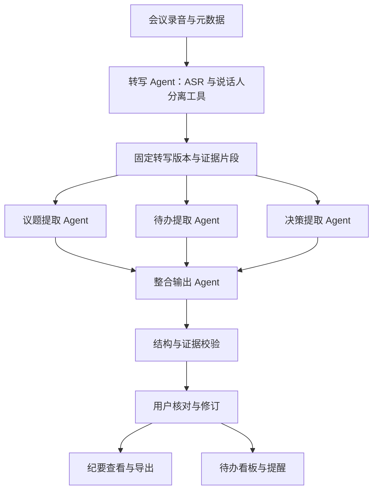

# MeetFlow 项目定位与毕业设计要求对齐

更新日期：2026-10-23。依据：用户新增选题介绍、七项基本要求及七篇参考文献。本文补充并调整此前的 LangGraph 方案；目前仍是需求与架构分析，没有新增完整服务代码。

## 1. 对用户目标的理解

用户希望完成一个以 Python 为业务后端、前后端分离、能够部署演示的会议语音纪要与待办追踪系统。系统需要同时支撑三个交付目标：毕业设计验收、论文中的设计与实验、AI 应用开发岗位的项目介绍。

正式定位建议为：**MeetFlow——基于多智能体协作的会议语音纪要生成与待办追踪系统**。

目标是基于成熟 Agent 框架实现可靠的办公应用，研究重点放在角色协作、上下文传递、多实例隔离、记忆与技能复用，以及它们对质量和效率的影响。Rust 核心或协议等底层机制首先属于框架原理调研；是否需要改动底层，应以正式任务书为准。

## 2. 新信息对旧方案的调整

| 方面 | 之前讨论的重点 | 新增要求下的定位 |
|---|---|---|
| 输入 | 先做已转写文字的核心流程 | 音频上传、真实转写、说话人区分属于最终核心功能 |
| 界面 | API 和简单审核界面可起步 | 完整 Web 页面、进度、纪要、导出、待办看板 |
| 五类 Agent | 转写、摘要、行动项、洞察、跟进 | 转写、议题、待办、决策、整合输出 |
| 框架 | LangGraph 作为预选编排框架 | 材料重点要求 Hermes，需先核对其指定仓库与版本，再确定技术栈 |
| 跟进 | 强调 Jira/飞书等外部集成 | 先完整实现本系统看板与提醒，外部集成为增强项 |
| 工程重点 | 证据、检查点、审核、可靠投递 | 增加实例池、Profile 隔离、上下文协议、记忆和 Skills 管理 |
| 研究交付 | 简历与评测材料 | 至少 12 篇文献、综述、需求/架构文档、测试报告、8000 字以上论文 |

文字版依然适合作为开发阶段，但不能作为最终音频系统的全部交付。实时进度推送指后台处理事件及时通知浏览器，不自动等同于会议进行中的实时字幕。

## 3. 用户应能完成的完整流程

1. 创建会议，填写主题、会议日期、时区与参会人。
2. 上传会议录音，系统校验格式并建立处理任务。
3. 页面显示排队、转写、议题/待办/决策分析、整合、完成或失败等真实阶段。
4. 查看带时间戳、说话人标签的转写，必要时将匿名说话人映射为真实姓名。
5. 查看议题、关键论点、决策、行动项及原文依据，修订错误与歧义。
6. 按模板导出纪要，进入系统内待办看板。
7. 更新负责人、截止日期和任务状态，查看到期或逾期任务与跟进记录。
8. 处理失败时能查明模块与原因，按允许范围继续或重试。

建议界面包括：会议列表、新建/上传、处理详情、纪要详情与审核、待办看板。实例池及运行日志提供一个简洁的维护页面，用于演示工程机制。

## 4. 与任务书一致的五个 Agent



| Agent | 职责与输出 | 行为边界 |
|---|---|---|
| 转写 | 调用 ASR 与说话人分离服务，产生文本、时间戳、speaker_id 和质量信息 | 工具失败明确报告，不用演示文本替代真实输入；声音簇不直接等于真实姓名 |
| 议题 | 识别讨论主题、关键论点、相关发言与未决问题 | 不将每句发言机械变成新议题，不把观点当事实 |
| 待办 | 识别工作内容、责任人、交付物、时间表达、条件与修订关系 | 明示与推测分开，歧义保留待确认，取消或暂停项不直接执行 |
| 决策 | 提取已达成的决策、依据、前提和被否决/替代方案 | 候选方案和条件提议保留相应状态 |
| 整合输出 | 按统一模板汇总三个分析结果，关联议题与任务，整理引用与冲突 | 汇总已有依据，缺失信息不靠润色补造；重排后引用仍可回溯 |

风险可以作为议题和决策中的字段，待办跟进由业务服务承担。它们不必占用这五个指定角色中的独立名额。

转写 Agent 的职责可以通过受控工具实现；研究对象是服务集成与协作，不要求自行训练语音识别模型。三路分析在初步提取时直接读取同一转写；需要跨结果关联的逻辑放在整合阶段。

## 5. “推测时间节点”的实现边界

任务书允许推测时间，但系统需要区分三种情况：

- 明示时间：“下周三交付”，保留原话并基于会议日期归一化。
- 可解释估计：“开发两天，测试一天，周一开始”，可以生成估计日期，同时保存推导依据、规则和待确认状态。
- 无依据时间：“尽快处理”，保留原话，日期为空；如有组织默认时限，标明该日期来自管理规则。

建议字段为 due_raw、due_value、due_source（explicit/inferred/policy/unknown）、reason、review_state。用户确认推测日期后才进入正式计划；评测分别报告明确日期提取与推测日期的可接受性，不能混成同一个正确率。

## 6. 系统架构与组件责任

```text
Web 前端
  ├─ 音频上传、处理状态、纪要查看/修订/导出
  └─ 待办看板与状态更新
        ↓ REST API / WebSocket
Python 业务后端
  ├─ 会议、文件、转写、纪要、待办、用户与审核
  ├─ 任务队列调度、事件发布、错误恢复
  └─ AgentRuntimeAdapter
        ↓ 实际框架支持的接口
Agent 运行层
  ├─ Profile / 实例池与会话生命周期
  ├─ 五类 Agent 及协作执行
  └─ 上下文、记忆检索、Skills 加载

存储：业务数据库、音频/导出文件、框架会话与记忆、进度事件
```

Python 后端与前端技术方案可以独立于 Agent 框架先确定。FastAPI 提供接口和 WebSocket；Celery/Redis 用于后台任务与事件分发；PostgreSQL 保存业务结果和任务状态。框架特有会话、记忆和配置通过适配层接入，不把其内部文件直接当作完整业务数据库。

前端可选 Vue 或 React，最终选择与用户现有能力、部署条件一致；目前没有依据替用户锁定一个前端框架。

WebSocket 推送使用阶段事件和稳定事件 ID。未知总工作量时显示阶段和已完成分块，不显示凭空估算的精确百分比。重连后可通过事件序号补取状态，后台任务不依赖浏览器连接存活。

## 7. 多 Profile 与实例池应该解决什么

三个概念分别定义：角色是业务职责；Profile 是框架持久配置与状态命名空间；实例是实际执行任务的运行资源。五个角色不必机械对应五个并发进程。

应用层池记录实例 ID、Profile/home、角色能力、运行状态、租约、占用任务和最后活动时间。生命周期为创建/预热、领取、执行、归还、异常回收。并发超过资源上限时排队，并通过租约与心跳处理进程退出。

以已查到的 NousResearch Hermes 官方文档为例：Profile 拥有独立配置、记忆与会话；默认 delegate_task 子 Agent 的上下文是临时独立的。二者需要分别建模。[Profile 官方说明](https://hermes-agent.nousresearch.com/docs/user-guide/profiles)、[委派官方说明](https://hermes-agent.nousresearch.com/docs/user-guide/features/delegation)

不能假定默认委派会自动选择另一个持久 Profile。跨 Profile 路由需要核对锁定版本的实际能力与接口。独立运行实例避免并发写同一 home；跨会议复用时明确清理临时会话和文件，长期记忆按项目/组织作用域隔离。

验收应包含：同时提交会议 A、B，验证资源排队、结果分别归属各会议、上下文不串用；实例失效后可回收，任务能够按约定继续或明确失败。

## 8. Agent 间上下文与数据 Schema

统一任务信封建议包含：meeting_id、run_id、input_version、role、schema_version、task_goal、context_refs、output_contract、deadline/budget。结果包含 module_status、artifact_ref、evidence、usage 与 error。

传递的是完成任务所需的事实和片段，不是不断累积的聊天全文。大文件保存引用，需要时通过有权限范围的工具读取。子 Agent 不能假定天然继承协调者此前看到的内容。

整合 Agent 读取议题、待办与决策的固定产物，检查引用、缺失和冲突；任何补读或修复都有预算、版本与日志。Agent 的自然语言结尾不能直接当作已通过验证的 JSON，业务端继续做 schema 与证据检查。

## 9. 分层记忆与技能复用如何进入业务

### 记忆

第一层为当前会议：转写、已确认身份、候选议题与任务，按会议和运行版本隔离。

第二层为同一项目历史：历史决策、未完成待办、固定术语及已确认人物别名。检索结果带发生时间、来源与权限，用于识别任务延续和决策变化。

第三层为稳定偏好：组织模板、纪要粒度、日期约定与提醒策略。偏好不是新的会议事实。

上述层次是本项目的应用设计，不应直接写成框架内置实现。Hermes 的 curated memory、session search 或其他记忆提供者需要在锁定版本后逐项映射；引入向量库不是“分层记忆已经完成”的充分条件。[Hermes 记忆说明](https://hermes-agent.nousresearch.com/docs/user-guide/features/memory)

### Skills

把可重复使用的会议处理方法封装成技能，例如需求评审纪要、周会纪要、行动项检查和导出模板。按会议类型与角色选择并加载，记录实际调用的 skill_id/version。

第一阶段实现人工编写、运行时自动选择和复用；增强阶段再由审核纠错记录提出技能改进候选，经过评测和版本发布后使用。保存、验证、启用、停用、更新和回滚形成生命周期，不让单场会议的个人信息被写入通用模板。

Hermes 官方将 Skills 定义为按需加载的知识文档。具体的自动生成、更新和管理能力需要按目标版本核对。[Skills 官方说明](https://hermes-agent.nousresearch.com/docs/user-guide/features/skills)

## 10. 框架选择与此前 LangGraph 简历的关系

目前材料明确点名 Hermes，但还未提供对应仓库与版本。当前检索确认 NousResearch/hermes-agent 有 Profile、委派、记忆和 Skills；尚未核实“Rust 核心与 Uplink 协议”对应其哪一实现，不能把它作为已确认架构事实。

若正式要求实际使用 Hermes，则将其作为 Agent 运行框架，Python 负责编排与业务集成；LangGraph 可作为独立对照或在确有需要时承担明确外层职责。两套机制的作用必须分别说明，避免重复管理状态和重试。

若 Hermes 仅作为调研参考，则可以保留 LangGraph 主方案，但论文中的技术概述、系统实现和简历要与实际框架一致。这个选择需要依据导师任务要求或指定仓库确定，不通过七篇会议相关论文反推。

## 11. 必做、增强与实施阶段

最终必做：音频上传与真实转写、说话人区分、五 Agent 协作、实例/会话管理、上下文契约、前后端分离、WebSocket 状态、纪要查看导出、待办看板与跟踪、容错、测试与论文。

任务材料重点涉及的记忆与 Skills 至少应有可运行的受控示例与评估，而不是仅在论文中列名词。

增强项：复杂外部平台双向同步、全自动技能自修改、多人实时会议字幕、视频分析和自训练模型。是否纳入取决于时间与真实需求。

实施可分为：文字原型 → 五角色与结构输出 → 音频/身份映射 → 前后端完整闭环 → 实例池/记忆/技能 → 容错和实验。评测样本和日志从原型阶段开始积累。

## 12. 论文可以验证的研究问题

| 研究问题 | 对比设计 | 主要观察 |
|---|---|---|
| 专业化分工的效果 | 综合调用与角色分工，相同输入与模型 | 纪要人工评分、决策质量、待办 precision/recall |
| 并行调度的效果 | 相同角色、提示词、输入，串行与并行 | 计算时延、排队、调用量与失败率 |
| 上下文策略的效果 | 全文、分块、引用补读 | 跨块任务遗漏、改期/取消识别、成本 |
| 历史记忆的效果 | 无历史与受权限约束的历史检索 | 人名/术语一致性、旧任务误当新任务的比例 |
| 技能复用的效果 | 通用提示与会议类型技能 | 格式一致性、人工修改量与调用开销 |
| 实例池与隔离的效果 | 并发任务和进程故障注入 | 吞吐、等待、恢复、数据归属与串扰 |

语音单独测 CER/WER、说话人分离 DER 或定义清楚的其他口径；纪要采用固定量表进行人工评估；端到端时延拆分上传、排队、转写、分析和整合。声音聚类正确率与真实姓名映射正确率分别记录。

这些是待验证问题，不预设多 Agent、记忆或技能一定优于简单方案。没有真实运行的数据不写成研究结论。

## 13. 毕业交付物与简历表达

交付物包括：文献阅读与综述、需求规格说明、架构/详细设计、前后端代码、角色与技能配置、部署说明、固定测试样本与报告、至少 8000 字论文及答辩演示。

用户当前给出七篇参考文献，阅读要求至少十二篇。后续还应补充 ASR、说话人分离、LLM Agent 协作、记忆/技能与会议评测等直接相关资料；官方框架文档用于实现依据，能否计入学校要求的篇数需按学校规范处理。

简历最终围绕真实完成的音频处理、五 Agent 编排、结构化证据、实例隔离、记忆/技能和评测展开。outbox 或外部平台同步只有在实现后才保留为亮点。技术栈中 Hermes 与 LangGraph 的名称待实际框架方案确定后更新。
