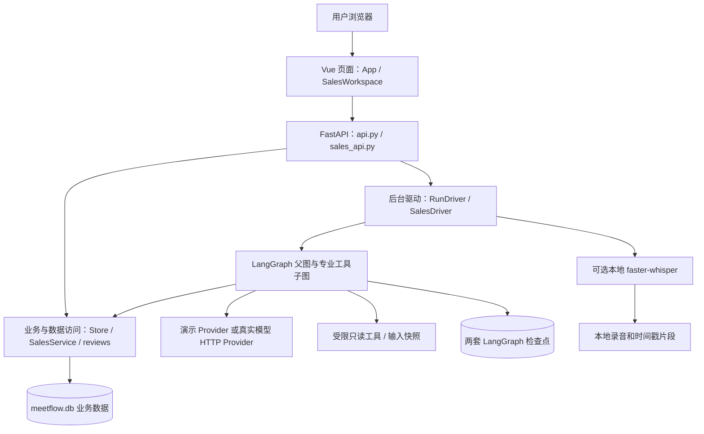
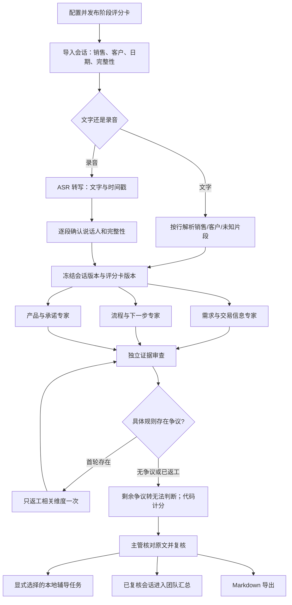
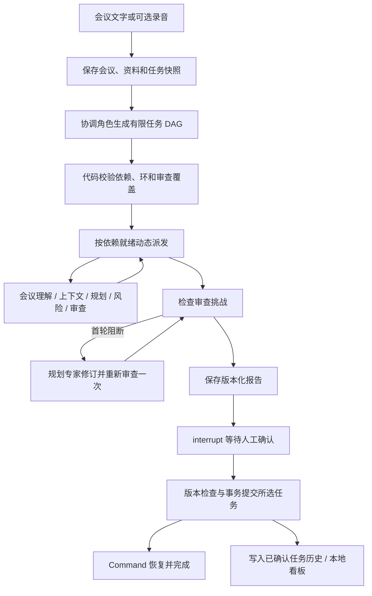

# MeetFlow v0.2：文件地图、代码架构与演示手册

这份手册依据当前可执行代码整理。阅读目标是知道文件在哪里、一次请求怎样处理、如何启动，以及如何实际演示。`BLUEPRINT.md` 是完整目标，不能把其中全部内容当成已实现功能。

## 1. 先认识当前成品

当前有两条业务线：

| 业务线 | 输入 | 处理 | 输出 |
|---|---|---|---|
| 销售质检（方案 A） | 阶段评分卡、销售/客户信息、会话文字；可选录音 | 身份核对、冻结输入、专业分析、证据审查、代码计分、主管复核 | 有依据的评价、覆盖率、辅导任务、团队描述统计、Markdown 报告 |
| 会议协作 | 会议文字/可选录音、实际会议时间、项目资料与既有任务 | 协调委派、会议理解、上下文调查、执行规划、风险检查、证据审查、人工确认 | 纪要、任务变化、风险、待确认问题、本地任务与 Markdown |

共用项目、数据库、任务看板、审计及模型传输，但并非同一个工作流。销售评分卡及产品资料从销售模块配置；“项目资料”中的历史/需求材料主要用于会议工作流，销售专家目前不会自动检索那些资料。

实际技术栈：Python 3.12+、FastAPI、Pydantic、SQLAlchemy、LangGraph、SQLite、Vue 3、TypeScript、Vite；可选 faster-whisper。

当前没有登录和成员权限、CRM 自动接入、自动说话人分离、Redis/Celery 队列、PostgreSQL 检查点或多实例故障接管。它是本地单用户版本。此前 UI 风格比较是独立原型，没有替换当前 Vue 页面。

## 2. 工作空间与仓库的区别

```text
E:\chatgpt\jianli\
├─ meeting-assistant-python-v2\  ← 真正的 MeetFlow Git 仓库，在这里启动
├─ _references\                 ← 阅读用源码副本，不是应用依赖
│  ├─ multi-agent-meeting-assistant\  原参考项目
│  └─ langgraph\                     框架源码参考
└─ ui-references\               ← UI 参考截图、独立方向比较预览
```

`_references` 里的 Java/Go/Python 目录属于原项目，不是本系统的多语言后端。应用安装时使用锁文件中的 LangGraph 包，不从旁边的源码副本加载。`ui-references` 的页面不是产品入口。

## 3. 仓库按什么方式组织

这是一个前后端共仓库的、按技术职责分层的单体应用。销售业务采用 `sales_*` 文件前缀集中区分，尚未拆成独立服务或独立业务包。

```text
meeting-assistant-python-v2/
├─ backend/meetflow/          Python 应用包
├─ frontend/                 Vue 前端工程
├─ tests/                    后端行为与接口测试
├─ scripts/                  启动、浏览器验证与提交辅助
├─ examples/                 合成会议输入资料
├─ labs/framework_spike/     独立框架机制实验
├─ docs/                     设计、研究、实现范围和使用说明
├─ .github/workflows/        GitHub 自动检查
├─ data/                     本机业务数据与工作流检查点，忽略上传
├─ test-results/             本机验证截图与导出文件，忽略上传
├─ .venv/                    当前 Python 环境，忽略上传
├─ .venv-framework-lab/      旧研究环境，启动不依赖它
├─ .venv-legacy-313/         保留的旧环境，启动不依赖它
├─ .pytest_cache/            测试缓存
├─ .ruff_cache/              代码检查缓存
└─ .git/                     Git 对象、分支、索引与历史
```

源码、文档和配置逐文件说明如下。依赖、构建及缓存目录按生成物类别说明，不把第三方依赖内部数千个文件当成本项目编写的功能。

### 3.1 Python 后端：每个文件做什么

| 文件（均在 backend/meetflow） | 作用与关键入口 |
|---|---|
| `__init__.py` | 标记 Python 应用包，无业务逻辑。 |
| `api.py` | 应用入口 `app = create_app()`；组装配置、数据库、两个后台执行器，注册会议/项目/任务 API、销售路由、异常处理、SSE，以及构建后的网页静态文件。 |
| `config.py` | `Settings` 从环境变量和根目录 `.env` 读取数据位置、模型配置、调用预算、上传限制、ASR 与 worker 开关。 |
| `database.py` | SQLAlchemy 表定义、数据库连接和 session 工厂；SQLite 外键/WAL 设置；`create_all` 建立缺失表。不是完整数据库迁移系统。 |
| `domain.py` | 会议领域 Pydantic 契约：片段、资料、会议、委派、事实、行动、问题、挑战、审核请求；公共 ID、时间、hash、`DomainError`。 |
| `store.py` | 会议与共用持久化服务：项目/资料/会议创建、分析输入快照、事件、调用预算、角色产物、报告版本、证据映射。兼有业务和数据访问职责。 |
| `orchestration.py` | 会议父图：协调规划、验证 DAG、`Send` 动态调度、汇聚、审查返工、报告、`interrupt` 等待审核；`RunDriver` 负责后台运行、检查点恢复、取消及失败记录。 |
| `agents.py` | 六类会议角色提示词；`AgentRunner.run()` 为角色创建独立消息状态的推理/工具子图；校验结构、角色权限、证据和目标任务版本。 |
| `tools.py` | 会议只读工具网关：列资料、读原文、关键词查证据、读冻结任务、读上游、解析相对日期；限定项目/运行/角色范围并记事件。当前不是向量检索。 |
| `providers.py` | `LiveProvider` 调用兼容 Chat Completions function tools 的 HTTP 服务；`DemoProvider` 用规则模拟会议工具调用和结果；`tool_call()` 生成协议消息。 |
| `reviews.py` | 会议 `approve()`：报告版本/hash、幂等键、阻断问题及任务版本检查；事务内提交选中任务、审批、历史与审计。`render_markdown()` 导出纪要。 |
| `audio.py` | 可选 ASR 可用性检查、缓存加载 faster-whisper、会议录音转写和时间戳片段入库。销售转写复用模型加载，但自身处理在销售工作流文件里。 |
| `demo.py` | 读取合成评审 JSON，建立示例项目/资料/任务，再创建规则演示会议；不把 fixture 的预期答案交给 Agent。 |
| `sales_domain.py` | 销售评分卡、会话片段、判断、客户信号、挑战、审核与身份编辑契约；文字前缀解析、评分卡模板、确定性计分和逐项得分/扣分计算。 |
| `sales_api.py` | `/api/sales` 路由：评分卡、文字/录音导入、身份修订、开始分析、进度详情、取消/重试、主管复核、统计、导出、示例。 |
| `sales.py` | `SalesService`：评分卡版本发布、会话版本、冻结分析输入、持久产物/预算/事件、幂等复核、本地辅导任务、团队统计、导出、合成示例。 |
| `sales_workflow.py` | `SalesDriver`：销售父图与专业工具子图、维度派发、独立审查、一次定向返工、剩余争议降级、检查点/重试、销售录音转写。含清楚标记的 `SalesDemoProvider`。 |

业务表集中在 `database.py`，提示词集中在两个工作流相关文件，并没有额外的 `prompts/`、`repositories/`、`services/` 空目录。修改时应按现有文件定位，避免照着早期设计中的推荐目录寻找不存在的实现。

### 3.2 前端：每个文件做什么

| 文件 | 作用 |
|---|---|
| `frontend/index.html` | 网页 HTML 外壳，提供 `#app` 和 `src/main.ts` 入口。 |
| `frontend/src/main.ts` | 创建 Vue 应用，加载全局 CSS，将 `App` 挂载到页面。 |
| `frontend/src/App.vue` | 页面外壳、导航、项目切换；会议列表/导入/详情/审核、SSE、任务看板、项目资料；挂载 `SalesWorkspace`。没有单独的 Vue Router 或 Pinia。 |
| `frontend/src/SalesWorkspace.vue` | 销售会话、评分卡、分析详情、证据侧栏、身份确认、主管复核、辅导选择、团队概览；执行中每 1.5 秒读取进度，卸载时清理定时器。 |
| `frontend/src/api.ts` | `fetch` 包装：统一 `/api` 前缀、JSON/表单处理、错误转换；`post()` 是快捷调用。 |
| `frontend/src/style.css` | 共用布局、会议页面、导航、按钮、表单和响应式样式；销售还有组件内样式。 |
| `frontend/public/favicon.svg` | 浏览器页签图标。 |
| `frontend/package.json` | 前端依赖和 `dev` / `build` 命令。 |
| `frontend/package-lock.json` | 锁定 npm 安装结果，供 `npm ci` 复现。 |
| `frontend/tsconfig.json` | TypeScript 检查配置。 |
| `frontend/vite.config.ts` | Vue 插件、开发服务器；开发时 `/api` 代理到本机 8765。 |

`frontend/node_modules/` 是安装的第三方库，`frontend/dist/` 是 `npm run build` 生成的 HTML/CSS/JS。不要直接修改 dist 来实现页面功能，重新构建会覆盖它；修改 `src` 后再构建。

### 3.3 测试、启动、实验与示例

| 文件 | 作用 |
|---|---|
| `tests/test_core.py` | 6 项：日期基准、项目/快照隔离、预算、时间限制、不可变产物、未配置真实模型的拒绝。 |
| `tests/test_workflow.py` | 10 项：会议闭环、审核旧版本/冲突回滚、幂等、无资料运行、重建恢复、等待时间、DAG、失败恢复、定向返工。 |
| `tests/test_boundaries.py` | 5 项：模型 HTTP 工具 ID/token、服务错误、未配置录音、ASR 测试适配器时间戳、SSE 游标重连。 |
| `tests/test_sales.py` | 14 项：销售闭环、评分分母、版本/项目/阶段隔离、改判原因、幂等、旧版本、缺失身份、定向返工、重试、预算、统计、录音替身、模型协议、取消。 |
| `scripts/start.ps1` | Windows 一键安装/构建/启动；`-SkipInstall` 复用已有环境与构建；`-Port` 更换服务端口。 |
| `scripts/smoke_browser.py` | 对运行中的服务执行会议浏览器流程，生成明确标记的示例、截图和导出。 |
| `scripts/smoke_sales_browser.py` | 对运行中的服务执行销售浏览器流程，覆盖复核、任务、导出、概览、标准版本、文字导入、身份修订及手机布局。 |
| `scripts/commit.ps1` | Git 提交辅助；人为日期元数据约定见 `docs/COMMIT_METADATA.md`，与应用运行无关。 |
| `examples/meeting-fixture.json` | 早期会议文字设计样例，不是真实录音，也不是 ASR 数据集。 |
| `examples/project-review-scenario.json` | 当前会议示例读取的合成评审场景：历史/需求/任务/成员、改期、身份歧义、条件等。 |
| `labs/framework_spike/README.md` | 独立实验的范围及复现方法。 |
| `labs/framework_spike/verify_runtime.py` | 6 项框架实验：Send 隔离、并行冲突、reducer、显式汇聚、中断恢复和审批版本；脚本节点，不调用真实模型。 |
| `labs/framework_spike/requirements.txt` | 框架实验直接依赖。 |
| `labs/framework_spike/requirements-lock.txt` | 框架研究环境锁定结果，与根目录应用锁文件用途不同。 |
| `.github/workflows/ci.yml` | 推送/PR 时运行后端检查、框架实验、前端构建和会议/销售两条 Chromium 流程。 |

后端测试用临时数据库。浏览器脚本连运行中的服务，因此会在该服务数据库新增明确标记的测试资料；不要把它当成完全无副作用的单元测试。

### 3.4 根目录配置和文档

| 文件 | 作用 |
|---|---|
| `README.md` | 安装、入口、主要能力、限制与文档导航。 |
| `AGENTS.md` | 仓库开发约定，要求留痕、验证、保护数据、区分演示与真实效果。 |
| `PROGRESS.md` | 当前完成状态、阶段进度、下一步和恢复开发入口。 |
| `CHANGELOG.md` | 按逻辑批次追加的变更与验证记录。 |
| `BLUEPRINT.md` | 会议多智能体系统总体目标，含尚未实现的增强方向。 |
| `DESIGN.md` | 早期按数据流讨论的设计快照，保留追溯，不能替代当前实现说明。 |
| `pyproject.toml` | Python 包元数据、版本、直接依赖、可选依赖、pytest/Ruff 配置；包源码在 backend。 |
| `requirements.lock` | 本地应用依赖锁文件，安装优先用它。 |
| `.env.example` | 服务端配置模板，不含真实密钥。 |
| `.gitignore` | 排除本地数据、密钥、环境、依赖、构建与测试产物。 |
| `.gitattributes` | 文本换行约定，PowerShell 脚本单独配置。 |

| docs 文件 | 内容与当前阅读定位 |
|---|---|
| `01-source-review.md` | 原 GitHub 项目的思路、源码问题和重写动机。 |
| `02-project-design.md` | 早期完整技术设计，含未实现模块。 |
| `03-python-contracts.md` | 早期推荐目录、数据/API/持久化契约；当前目录以代码为准。 |
| `04-evaluation-roadmap.md` | 早期质量指标、数据标注和实施路线。 |
| `05-resume-interview.md` | 早期简历/面试素材，包含条件性模板；使用前按当前能力删改。 |
| `06-requirements-alignment.md` | 与毕业设计参考要求的对齐分析。 |
| `07-literature-check.md` | 用户提供文献的检索与阅读状态。 |
| `08-framework-research.md` | 框架选型、执行语义与固定版本源码研究。 |
| `09-cooperation-contracts.md` | 委派、证据、上下文、分歧、版本及执行协议设计。 |
| `10-evaluation-and-delivery.md` | 系统基线/消融、数据、故障与交付计划；不是已取得的质量结果。 |
| `11-user-experience.md` | 历史体验设计，头部注明与当前版本的关系。 |
| `12-implementation-status.md` | 会议实现范围和 v0.2 销售补充，区分已实现/待完成。 |
| `13-sales-quality.md` | 销售方案 A 的业务契约、使用路径、接口、计分及边界。 |
| `14-code-map-and-demo.md` | 本文：当前全部自有文件用途、架构、启动和演示。 |
| `COMMIT_METADATA.md` | 人为提交日期元数据的事实说明。 |

### 3.5 本机生成文件是什么

| 位置 | 内容 | 使用注意 |
|---|---|---|
| `.env` | 用户本机模型/数据/ASR 配置；本轮核对时尚不存在 | 不提交密钥；从模板复制后自行填写。 |
| `data/meetflow.db` | 业务数据库，保存两条业务线数据和审计 | 不能为了启动而删除。 |
| `data/checkpoints.db` | 会议 LangGraph 父图检查点 | 与业务数据库职责不同。 |
| `data/sales-checkpoints.db` | 销售 LangGraph 父图检查点 | 支持分析执行恢复。 |
| `data/*-wal`、`*-shm` | SQLite 运行时日志/共享内存辅助文件 | 正在运行时不要手动清理；备份推荐停服务后复制整个 data。 |
| `data/audio/` | 配置 ASR 后上传的会议录音 | 按需生成，本轮本机尚无该目录。 |
| `data/sales-audio/` | 配置 ASR 后上传的销售录音 | 按需生成，本轮本机尚无该目录。 |
| `backend/meetflow.egg-info/` | 可编辑安装元数据：PKG-INFO、requires.txt、SOURCES.txt、top_level.txt、dependency_links.txt | 不是功能代码，由 Python 安装生成。 |
| 各处 `__pycache__/` | Python 字节码缓存 | 不属于源码。 |
| `test-results/browser/` | 原会议自动验证截图与 Markdown | 不提交。 |
| `test-results/sales-browser/` | 销售自动验证截图与 Markdown | 不提交。 |
| `test-results/walkthrough/` | 本次手动演示的证据及团队界面截图 | 不提交；截图不是质量评测结果。 |

三个 `.venv*` 目录内部是解释器、库与启动脚本，不是三个服务。本机现用 `.venv` 为 Python 3.12.6；另外两个是保留环境，旧基础解释器路径可能已不可用。

## 4. 运行架构：页面、业务、Agent 和数据库怎样连接



层次可以这样理解：

1. **页面层**：收集输入、展示阶段/报告/原文、发起审核；不在浏览器保存模型密钥或执行计分权威逻辑。
2. **接口层**：解析请求、校验契约、调业务服务、安排后台任务、返回数据。
3. **业务层**：决定评分卡怎么版本化、报告能否复核、任务何时写入、统计哪些数据。
4. **协作执行层**：安排专业角色、工具循环、审查和有限返工；模型只交建议或判断。
5. **基础设施层**：SQLAlchemy/SQLite、检查点、HTTP 模型传输、ASR 和文件。

这是职责分层，尚不是严格的整洁架构。`api.py` 仍直接操作部分 ORM，`Store` 同时承担业务与数据访问，销售专家循环和父图写在同一文件。当前规模方便定位，继续扩大后再按职责拆分更合适。

### 4.1 部署时为什么只打开一个端口

`start.ps1` 先构建 Vue，再启动 `uvicorn meetflow.api:app`。`create_app()` 把 `frontend/dist` 挂载到 `/`，API 在 `/api`。浏览器由同一个 8765 服务获取网页和数据。

前后端在代码上分离，默认发布方式是单服务托管网页，并不是必须开两个服务。开发时才可以另开 Vite 5173，通过代理访问 8765。

### 4.2 并发和持久化的真实边界

- 会议和销售各有一个进程内 `ThreadPoolExecutor(max_workers=1)`；各自逐个执行提交的工作，提交队列本身在内存中。启动时会扫描数据库中的待处理状态恢复调度。
- 一次会议图内部最大并发为 2，一次销售图内部最大并发为 3。这是角色节点并行，不能解释为已经实现跨机器 Agent 集群。
- 两类 driver 可各自工作，但都在本地应用进程中。默认应按单进程启动，不加多个 uvicorn worker 来冒充横向扩容。
- 父图持久化；已完成角色产物可重用。专业子图没有独立持久化每一步工具消息，角色中途失败时可能重跑该角色，不能承诺每次模型调用只执行一次。
- 审核等待是持久业务状态。会议通过 `interrupt/Command` 恢复父图；销售图在产出报告后结束，主管复核由业务 API 事务另行完成，两者实现不同。
- 修改 `.env` 里的数据库地址，不会自动提供 PostgreSQL 驱动、PG 检查点或分布式任务接管。

## 5. 销售质检：沿一份输入追踪到最终输出



三个维度并不是无条件全部调用：父图按评分卡中实际存在的维度派发，当前基础卡含三个维度。协调与汇总由代码负责，没有另造一个“整合 Agent”。ASR 也只是工具服务。

### 5.1 点击“导入并质检”时的调用链

| 环节 | 代码位置 | 输入与结果 |
|---|---|---|
| 表单与上传 | `SalesWorkspace.vue → importCall()` | 组装会话元数据及选中的评分卡；文字模式先导入，再请求分析。 |
| 创建会话 | `sales_api.py → SalesService.create_conversation()` | `ConversationInput` 校验，`parse_transcript()` 将每行变成 s1/s2 等片段并保存。 |
| 开始分析 | `sales_api.py → SalesService.analyze()` | 检查项目、阶段、状态、模式；冻结会话及评分卡，创建 `SalesAnalysis`。 |
| 后台执行 | `SalesDriver.submit() → process() → graph()` | 使用 analysis_id 作为检查点 thread_id，开始或恢复父图。 |
| 专家处理 | `dispatch → expert → SalesDriver.expert()` | 专家有各自消息列表、规则范围；`reason → tools` 循环，读上下文并提交结构化结果。 |
| 校验和审查 | `validate_sales_result()` / `audit` 节点 | 查规则覆盖/重复、引用和身份；审查者读取上游，挑战具体 rule_id；只允许一次定向返工。 |
| 计分 | `report → scored_decisions()/score()` | 模型返回状态和理由，Python 计算数值；报告 hash 与快照绑定，转待复核。 |
| 页面进度 | `SalesWorkspace.vue` 的定时器 | 执行中每 1.5 秒读取 `/api/sales/analyses/{id}`，不是 WebSocket，也不是销售 SSE。 |
| 人工提交 | `saveReview() → /review → SalesService.review()` | 校验 hash、会话版本、幂等键和改判原因；事务内保存复核及显式选择的辅导任务。 |
| 汇总/导出 | `SalesService.dashboard()/export()` | 统计已复核记录，模式隔离、会话去重、规则版本分组；Markdown 保留依据。 |

### 5.2 多 Agent 真正协作在哪里

销售模块是受控工作流中的多专业角色：各自有独立消息状态、角色提示词、分配规则、只读工具循环及输出契约；审查者读取上游后提出具体挑战，被挑战的专家读取反馈再修订。它不是开放聊天，也没有角色自由增加工具和改评分规则的权力。

当前首轮专业分析是分工并行，跨角色信息主要在审查和返工阶段交换；不能把它描述成已实现无限自主讨论或复杂长期记忆。是否比单 Agent 更准确/更省钱，仍需用真实标注数据做对照评测。

### 5.3 为什么有得分还要有覆盖率

基础卡三项权重是 30、40、30。当前合成示例在规则模式下：前两项字面命中为“部分达标”，产品资料不足为“无法判断”。

```text
已得权重 = 30×0.5 + 40×0.5 = 35
可评权重 = 30 + 40 = 70
适用权重 = 30 + 40 + 30 = 100
得分 = 35 / 70 × 100 = 50
覆盖率 = 70 / 100 × 100 = 70%
```

“无法判断”不当零分，“不适用”移出适用分母；没有可评项时得分为空。示例的 50 分只说明规则演示链路及计分口径，不代表模型评价能力。

## 6. 会议协作：另一条工作流



调用顺序为 `App.createMeeting/loadDemo → api.py → Store.create_meeting/create_run → RunDriver → build_graph → AgentRunner → ToolGateway/Provider → report → reviews.approve → driver.resume`。

协调者、会议理解、项目上下文、执行规划、风险、审查共六类角色；上下文角色是否出现由计划和资料决定。实际依赖图由合法计划决定，不应把示例路径当成永远固定的执行顺序。

会议进度由 `/api/runs/{id}/events` 的 SSE 发送；事件先持久化，重连使用游标。前端收到事件后合并频繁读取，刷新详细数据。审核前 Agent 只提出任务候选，正式写任务在 `reviews.py` 的事务中完成。已确认的任务变更可成为后续会议的历史资料，当前没有自动跨会议事件重分析。

## 7. 数据保存在什么表

| 数据类别 | database.py 中的类 | 作用 |
|---|---|---|
| 共用项目 | `Project` | 项目隔离边界。 |
| 会议输入 | `Meeting`、`Source` | 会议元数据、原文/需求/成员/历史资料及片段。 |
| 会议分析 | `Run`、`Artifact`、`RunEvent`、`Report` | 输入快照、运行预算、角色产物、进度事件、报告版本。 |
| 共用任务 | `Task` | 经确认的会议任务或销售辅导任务；含状态、负责人、证据和版本。 |
| 会议执行留痕 | `Approval`、`ProjectEvent` | 审批、任务变更与项目事件。 |
| 共用审计 | `Audit` | 项目、资料、审核等操作日志。 |
| 销售规则 | `SalesPlaybook` | family_id + version 唯一的不可变评分卡。 |
| 销售输入 | `SalesConversation` | 会话、片段身份、完整性、版本与录音位置。 |
| 销售分析 | `SalesAnalysis` | 冻结会话/规则、角色产物、事件、预算、报告和 hash。 |
| 销售复核 | `SalesReview` | 主管最终判断、说明及任务 ID；每份分析一份复核，幂等键唯一。 |

当前业务数据共用一个 SQLite 文件；JSON 字段保存结构化内容。LangGraph 检查点另外存放在两个数据库，不要把检查点当业务报告或统计表。

## 8. 本机怎样启动

### 8.1 现在就能打开

本轮已实际执行启动脚本，健康检查为 v0.2.0，网页返回 HTTP 200。服务监听 `127.0.0.1:8765`，浏览器访问：

**http://127.0.0.1:8765/**

当前运行属于本机服务，不是已部署到公网的网站。页面没有登录步骤。若之后电脑重启、服务进程关闭或端口不再可用，按下面命令重新启动。

### 8.2 已装好依赖且前端未变

打开 PowerShell：

```powershell
Set-Location 'E:\chatgpt\jianli\meeting-assistant-python-v2'
.\scripts\start.ps1 -SkipInstall
```

看到 `Uvicorn running on http://127.0.0.1:8765` 后打开网页；保留终端运行，前台终端按 Ctrl+C 停止。不要在已经运行时再开第二份相同端口的服务。

本机默认的裸 `python` 曾指向旧版本，操作本项目优先用 `.venv\Scripts\python.exe`。无须手动激活环境，也无须启动 Docker。

### 8.3 首次安装或要重建前端

```powershell
Set-Location 'E:\chatgpt\jianli\meeting-assistant-python-v2'
.\scripts\start.ps1
```

脚本检查 Python 3.12+，必要时新建 `.venv`，按锁文件安装 Python 依赖，执行 npm 安装和 Vue 类型检查/构建，再启动。需要可用网络，Node.js 要求 22.12+（本机为 24.14.1）。

仅改了前端源码且依赖已安装，也可以先在 frontend 运行 `npm.cmd run build`，再重启后端并刷新网页。`-SkipInstall` 不会构建新页面。

### 8.4 想一边改页面一边看

终端一按 8.2 启动后端，终端二：

```powershell
Set-Location 'E:\chatgpt\jianli\meeting-assistant-python-v2\frontend'
npm.cmd run dev
```

开发页访问 **http://127.0.0.1:5173/**，API 代理仍指向 8765。使用 `-Port 8766` 改后端端口时，单服务网页访问新端口即可；若同时使用 Vite，需要同步改代理配置。

### 8.5 健康检查与常见卡点

```powershell
Invoke-RestMethod 'http://127.0.0.1:8765/api/health'
```

| 现象 | 处理 |
|---|---|
| 网页打不开 | 确认启动终端仍运行、地址和端口一致；GitHub 仓库地址不是应用地址。 |
| 提示端口占用 | 如果原服务能打开，直接使用；其他程序占用时改 `-Port`，不要随意结束未知进程。 |
| 虚拟环境不可用 | 当前 `.venv` 已恢复可用；将失效环境保留到另一个未占用目录后再重建，别删除 data。 |
| 提示先构建前端 | 去掉 `-SkipInstall` 运行，或手动执行前端构建。 |
| 页面还是旧样式 | 改的是 src 才有效；重建 dist，并刷新浏览器。 |
| 真实模型选项不可用 | 尚无服务端模型配置，不是网页操作问题。 |
| 录音入口不可用 | ASR 依赖及模型尚未配置，先用文字/示例演示。 |
| 概览没有示例统计 | 先保存复核，再切换到“规则演示”并“应用筛选”；确认当前项目。 |
| 设置日期筛选后示例消失 | 合成销售示例未提供实际日期，未知日期不进入有时间范围的统计。 |
| 切换项目后资料不见 | 数据按项目隔离。顶部重新选择对应项目。 |

## 9. 销售功能怎么演示：建议 5—8 分钟

### 9.1 演示前准备

在“项目资料”里的“新建项目”创建一个含“演示”字样的项目，避免与实际资料混淆。顶部选择这个项目，再进入“销售质检”。本轮已经创建 **使用演示 · 合成销售资料**，含一份已复核销售示例和一项辅导任务，可直接查看。

| 步骤 | 页面操作 | 需要看到的结果与讲解重点 |
|---|---|---|
| 1. 展示输入标准 | 销售质检 → 评分标准 | 每条标准有阶段、维度、权重、适用条件及达标锚点；规则先定义，评分不是模型自由编分。 |
| 2. 产生一份新结果 | 点击“体验销售示例” | 自动创建基础卡和合成会话，后台分析后进入待主管复核；明确这次是规则演示。 |
| 3. 解释分数 | 看得分、覆盖率和逐项理由 | 当前基础示例为 50 分、70% 覆盖率、1 项无法判断；产品资料缺失不会被强行打分。 |
| 4. 核对证据 | 某条规则点“核对原文” | 侧栏展示冻结版本和真实片段 ID；文字示例没有录音，所以不能演示回听。 |
| 5. 展示人工改判 | 按需更改“主管判断”，填写“改判原因” | 改判须给理由，原机器判断仍保留；也可保持原判断，以辅导演示为主。 |
| 6. 创建辅导 | 勾选“确认双方下一步”的“创建此项辅导任务”，保存复核 | 出现“主管复核已保存”，只创建选中的任务。 |
| 7. 看任务跟进 | 左侧“任务看板” | 看到“销售辅导：确认双方下一步”；把状态从待开始改为进行中。 |
| 8. 看管理视角 | 销售质检 → 团队概览 | 数据模式选“规则演示”，点应用筛选；看到已复核样本、人员、覆盖率、规则问题和客户信号。 |
| 9. 导出 | 会话与复核 → 打开示例 → 导出质检报告 | 浏览器下载 Markdown，含模式、规则版本、判断、复核说明和原文。 |
| 10. 解释协作 | 会话详情 → 处理记录与协作产物 | 看专业分工与审查产物；没有触发争议的示例不会凭空展示返工。 |

点击“体验销售示例”会新增示例和评分卡，不会重置旧数据。重新打开已复核记录可查看结果；想再演示保存复核，应创建新示例或新分析版本，而不是重复编辑已完成复核。

### 9.2 不用内置示例，演示自己导入文字

先确保已有需求访谈阶段评分卡。点击“导入销售会话”，填写标题、销售人员、客户/商机标识，选择对应评分卡和规则模式，粘贴下面的合成文字：

```text
销售：您目前怎么整理采购需求？
客户：现在用表格，经常重复录入，审批要等两天。
销售：重复录入影响审批效率，我理解对吗？
客户：对，不过你们价格比另一家高。
销售：下一步安排产品演示，时间再一起确认。
客户：可以先发资料，具体时间我还不能确认。
```

实际日期可空；只有确实是完整记录才勾完整性。每行使用 `销售：` 或 `客户：`，其他前缀保留未知，不会自动理解姓名身份。点“导入并质检”后走同样审核流程。规则模式不能可靠理解所有语义变化。

### 9.3 展示评分卡版本

进入“评分标准”，选择“以此为基础修订”，改标准或产品依据后点“发布新版本”。看到 v2，再回看旧报告仍引用 v1。这说明后改规则不会偷偷改变过去的评分。若要按新卡分析，必须新建分析并选新版本。

### 9.4 本轮实走结果

本轮在浏览器实际完成：独立演示项目 → 销售示例 → 原文侧栏 → 保留机器判断、勾选下一步辅导 → 保存复核 → 下载报告 → 团队规则模式统计 → 看板任务改为进行中。

结果：该演示项目已复核 1 场，50 分、70% 覆盖率，生成 1 项本地辅导任务；导出包含原文依据。截图保存在 `test-results/walkthrough/`。这些是功能链路验证，不能作为真实销售质量或业务收益结果。

## 10. 原会议功能怎么演示：约 3—5 分钟

1. 左侧“会议” → “体验示例”。会自动创建新的合成发布评审项目并切到该项目。
2. 结果页看“会议纪要”，点击结论的原文依据。
3. 到“待确认”，处理“老王”身份；合成案例可填写“王宁”。
4. 到“任务与变化”，核对任务标题、负责人、日期、旧值/新值和条件，只选择愿意提交的变化。
5. 点击“确认所选变更”，看到“本次确认已留痕”，再进看板修改状态。
6. 点击“导出”下载 Markdown；“查看协作记录”展示角色、工具和审查链路。

本轮也实际执行了会议示例，完成身份澄清及两项任务确认，状态为已完成。会议示例与销售示例项目不同；切回销售需在顶部选“使用演示 · 合成销售资料”。

## 11. 要演示真实 AI / 录音还缺什么

### 11.1 真实模型

不要在聊天或源码里粘贴密钥。在仓库根目录复制配置模板：

```powershell
Copy-Item -LiteralPath '.env.example' -Destination '.env'
```

仅首次且 `.env` 不存在时复制，避免覆盖已有配置。编辑 `.env` 的 `MEETFLOW_MODEL_BASE_URL`、`MEETFLOW_MODEL_API_KEY`、`MEETFLOW_MODEL_NAME`，重启服务。健康检查 `live_available=true` 后可选择真实模型。

当前接口是 `/chat/completions` 的 function tools 往返，供应商需支持工具调用和当前请求字段。配置完整只表示可尝试调用，不保证供应商兼容或结果准确。真实失败明确显示失败，不替换成规则成功。本轮没有配置或调用真实模型。

### 11.2 录音

在根目录使用当前解释器安装可选依赖：

```powershell
.\.venv\Scripts\python.exe -m pip install -e '.[audio]'
```

再配置 `MEETFLOW_ASR_MODEL` 为本地 faster-whisper 模型目录或支持的模型名，重启。模型名可能首次下载权重；未验证前不要把正式演示依赖于临时下载。支持 WAV、MP3、M4A、FLAC、OGG、WEBM，默认上传上限 100MB。

销售录音转写后必须先确认每段是销售、客户还是未知，以及记录完整性，再开始分析。当前没有自动说话人分离；真实录音识别率、速度和身份核对便利性都尚未实测。文本与音频通路分开验证，不能用文字示例宣称已经展示了语音效果。

## 12. 推荐的代码阅读顺序和后续修改位置

先读 `README → 本文 → docs/13-sales-quality.md`；了解销售再按 `sales_domain → sales_api → sales → sales_workflow → SalesWorkspace` 读。需要会议协作机制时按 `domain → store → tools/providers → agents → orchestration → reviews → api/App` 读。

| 想修改什么 | 优先看哪里 |
|---|---|
| 评分规则字段或计分口径 | `sales_domain.py` 及 `test_sales.py` |
| 客户需求/流程/承诺专家行为 | `sales_workflow.py` 中角色提示、上下文和结果校验 |
| 专家并行、审查和返工 | `SalesDriver.graph()`；会议为 `build_graph()` |
| 主管审核、幂等或统计 | `sales.py`；会议为 `reviews.py` |
| 模型供应商协议 | `providers.py` 的 `LiveProvider` |
| 数据字段和表 | `database.py`，同时考虑迁移；`create_all` 不自动修改旧表字段 |
| 销售界面布局与交互 | `SalesWorkspace.vue`；共用导航和看板在 `App.vue` |
| 会议证据工具或日期 | `tools.py` 与 `test_core.py` |
| ASR 接入 | `audio.py` 与 `SalesDriver.transcribe()` |
| 一键启动或部署检查 | `scripts/start.ps1`、CI |

当前值得后续拆分的部分：较大的 Vue 组件可拆为表单、报告、证据、复核、概览组件；`api.py` 可继续拆路由；销售工作流可拆专家执行、父图、ASR；数据访问与业务规则可逐步分离。这里说明现状与演进方向，本轮没有为讲架构而重排业务代码。

## 13. 本轮核验与恢复工作

- 当前入口实际启动成功，网页 HTTP 200，健康检查 v0.2.0；真实模型和 ASR 可用标记均为 false。
- `.venv` 为 Python 3.12.6，Node 为 v24.14.1；复用现有前端构建，没有修改产品源码。
- `pytest -q` 本轮 35 项通过。手动浏览器走通销售与会议闭环，包含销售 Markdown 下载和团队统计。
- 新增本手册、README 导航及进度/变更记录。未将旧设计中的 PG/Redis/Celery、长期记忆、CRM、说话人分离或质量评测写成已完成。
- 服务不是开机自启；恢复使用的命令是根目录 `.\scripts\start.ps1 -SkipInstall`。本地数据留在 data；已复核演示可重新打开，不必删除数据库重来。
