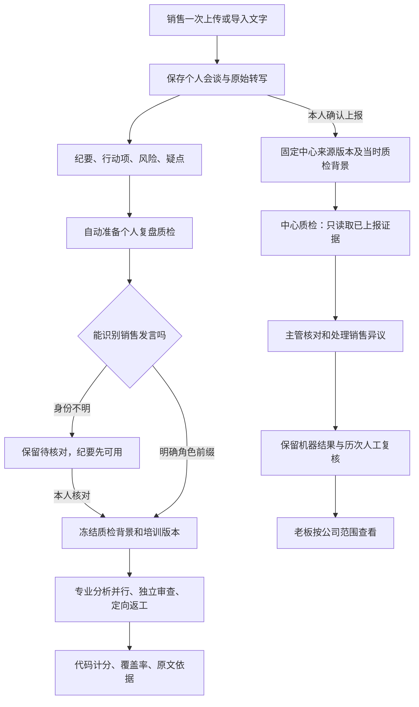

# 第一批交付：同一会谈的纪要、疑点与销售质检

历史交付更正：本篇记录当时实现，销售质检／异议及个人自动评分已在 [docs/24](24-role-boundary-and-disclosure.md) 撤销。销售仅获取整理后的事实信息自行复盘；主管／老板在已上报范围查看管理质检，按评分、原因、证据逐层展开。旧测试通过不代表旧角色设计正确，当前以更正代码与 88 项检查为准。

本批完成需求缺口清单中“共用会谈完成复盘与质检”的本地闭环。默认账号页面已有实际入口，不再要求关闭认证或使用旧 `/api/sales`。真实模型尚未配置，当前分析明确标注规则演示，不能把分数当作真实销售评价。

## 用户现在能做什么

| 身份 | 实际入口 | 操作与结果 |
|---|---|---|
| 销售 | 会谈录音 → 查看本场复盘质检；或复盘质检 | 同一转写自动准备质检，查看规则、得扣分、覆盖率、改进建议；个人区仅本人可见 |
| 销售 | 复盘质检 → 核对说话人与背景 | 调整明确发言的身份；业务阶段不明时用通用复盘，可补指定阶段和录音完整性；保存后继续分析，不重传录音 |
| 销售 | 我的上报质检 → 反馈这条判断 | 选原文、写异议，交给负责团队主管；已复核后仍可提出新异议，历次处理保留 |
| 主管 | 销售质检 | 只看团队已上报来源；按原文核查，改判须说明依据和原因，处理销售异议，生成复核记录 |
| 老板 | 质检概览 | 看公司已上报质检、分组统计、原文与主管处理；没有主管复核和背景更正权限 |
| 管理员 | 销售培训规则 | 修改示例培训要求、权重、适用条件、达标／部分达标依据和已确认产品资料，发布新版本 |

纪要详情增加讨论结论／决策、风险、疑点、核查提醒和来源按钮。点击依据会展开标记原文；存在片段时间时定位录音。疑点可以暂时留空，填写的补充保存后创建新分析运行，不改原始发言或已上报中心。补充记录明确为销售本人陈述，不等于客户确认。

## 数据流及权限

- 纪要完成后由现有 RunDriver 回调启动质检；质检失败不抹掉已完成纪要。旧会谈在服务启动时补齐缺少的质检来源，不重复上传和转写。
- 新增质检适配层复用原 SalesDriver：需求与交易信息、流程与下一步、产品与承诺三个专业角色协作；独立审查者检查证据，可定向返工一次；工具只读冻结快照。
- 自动从明确的“销售：／客户：”等转写角色前缀读取身份，未做真实声纹或自动说话人分离。没有任何明确销售身份时先不调用评分，等核对；不完整／未知身份不用于推断“销售未执行”。
- 不推测会谈阶段。默认通用复盘，另提供需求沟通、产品演示、方案报价、决策签约四套有不同阶段侧重的示例。每套五维权重为 25/20/20/15/20，总权重 100；示例不是企业实际制度。
- 产品资料为空时相关评价无法判断。规则代码按达标／部分／未达标计分，未知和不适用有独立分母规则；无可评项时分数为空，不显示假零分。
- 个人和中心质检有独立来源与背景；上报固定当时角色／阶段／完整性。销售后续改个人背景不改变中心。中心背景由负责主管更正并留原因，原分析保留。
- 规则发布不覆盖历史；背景调整会创建新分析；纪要补充或中心来源更正生成新来源版本的质检。旧版仍能通过来源历史查看，旧版禁止改判。旧版待处理异议明确标为来源已修订，保留而不冒充已解决。
- 销售异议可附本场发言，主管复核保留机器原始报告和每次人工判断；请求 hash、来源／背景版本和事务处理防止重复复核或旧版本覆盖。
- 搜索、列表、详情、历史、背景修改、异议、复核和重试都服务端鉴权。音频走原有本人／中心权限接口，不公开磁盘路径或在网址中携带令牌。
- 汇总按规则版本、分析模式、待复核／已复核分开，不把演示和真实数据、不同规则混成销售排名。不产生收入、成交率或真实业绩推断。

## 真实浏览器验证

使用本地 Chrome 中三个独立真实账号，保留销售、主管、老板标签页，另临时登录管理员验证配置后关闭该页。

1. 销售可见本人个人资料，包含公开音频样本；主管仅可见二组 1 场中心质检，老板可见两组共 2 场。新建未上报合成会谈不会进入管理端。
2. 销售将个人背景改为方案报价，生成新分析、保留旧分析；中心仍保持此前通用复盘背景。
3. 销售对“决策条件了解”字面演示判断反馈，主管对照 s5，将部分达标改为无法判断并写处理说明；老板可见已复核、异议已处理和主管原因。原机器结果保留；没有可评项时分数为空，覆盖率 0%。
4. 管理员实际发布通用规则 v2，历史分析仍绑定 v1；后续合成会谈使用 v2。四个阶段示例也经管理员认证接口发布校订版，不覆盖历史。
5. 新建“本地验收 · 需求复盘与质检联动（合成）”，一次文字导入生成纪要、风险、疑点和质检；补充“老王指谁”后生成新运行／来源版本，原话保留，补充不标为客户确认。演示规则不保证理解并消除该疑点。
6. 复用已有真实 ASR 公开样本，审听页加载原录音，时长 58.875 秒；点击“10 秒”后播放器定位 10.05 秒，无媒体错误。身份仍保持未知，没有将非销售会议伪装成销售评分样本。这是回听复用验证，不是新的 ASR 准确率评测或浏览器文件上传验证。
7. 三个标签页检查未捕获页面错误；截图已保存并查看，修复旧全局 main 样式导致证据区偏移的问题。未做本批手机实机验证。

证据保存在忽略的 `test-results/quality-workspace`：三角色截图和可见页面快照。密码、录音、数据库、测试输出不入 Git。

## 检查与代码

全量 65 项后端检查通过，本批新增 11 项；包括跨公司／团队、直接访问历史、说话人背景、中心独立性、规则不可变、异议／复核／再次异议、并发重复复核、旧来源拒绝改判、失败明确显示／重试累计预算和疑点版本。失败模型测试为注入测试替身，不是实际供应商可用性结论。最后来源修订异议路径再次复测通过。

前端类型检查及生产构建、Ruff、Git 差异检查通过。

| 文件 | 职责 |
|---|---|
| backend/meetflow/quality_workspace.py | 账号质检适配、示例规则、冻结背景、历史、复核和统计 |
| backend/meetflow/database.py | 追加质检来源、组织规则、反馈、人工复核及会谈补充记录表 |
| backend/meetflow/orchestration.py | 已完成纪要触发独立质检的回调 |
| backend/meetflow/workspace.py | 上报固定质检背景、来源更正、版本化疑点补充 |
| frontend/src/QualityWorkspace.vue | 会谈列表／原文与音频／规则依据三栏审听工作台 |
| frontend/src/TrainingRules.vue | 管理员规则编辑发布 |
| frontend/src/WorkspaceApp.vue | 真实角色入口、完整纪要内容、疑点补充、依据定位 |
| tests/test_quality_workspace.py | 新链路的权限、版本、并发、失败行为测试 |

## 恢复与剩余边界

启动仍用 `.\scripts\start.ps1 -SkipInstall`；首次安装用 `.\scripts\start.ps1`。现有数据库通过新增表保留，不清空旧数据。本机已配置 ASR；真实模型须在服务端配置后重启，没有密钥则明确演示，不在真实请求失败时偷偷转演示。

本批没有完成客户库／商机、跨会谈推进、承诺提醒、完整主管／老板业务首页、Word/PDF 报告、转写／纪要正文更正、删除恢复、上传去重和日期重算。疑点补充是新增资料与重新分析，不是改写原文。管理员页面目前编辑预设场景的五维规则，不是任意流程设计器。

质检首版限制 400 段／50000 字、单段 4000 字，超限明确提示、保留纪要，不静默截断；仍需真实模型和授权销售样本评测。现阶段单进程 SQLite／本地工作线程，没有集群或商业部署验收结论。后续按 docs/19 第二批继续建立客户、商机与承诺，再完成岗位首页与报告。
