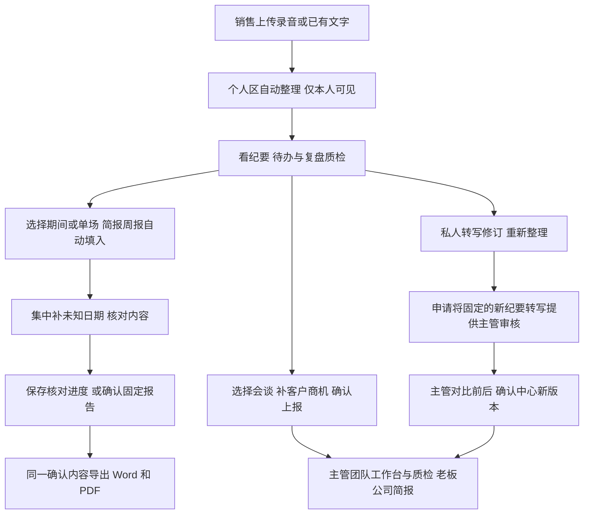

# 第三批 个人报告与日常维护交付

接续 docs/20、docs/21。本批补齐默认账号系统的报告、转写更正、批量上报、恢复和上传防重等核心链路；保留所有旧数据。下列实测是功能行为验证，不是大模型准确率或多 Agent 架构优劣的证明。

## 用户怎样使用

### 销售报告

- 导航“简报与周报”：默认最近 7 天，可调整期间。会谈简报选一场，销售周报最多 50 场，均从已整理的本人资料映射，不再调用模型编造汇报内容。
- 同一会谈的个人和中心副本不重复列入；个人副本移除后可选本人已上报资料。跟进字段标明个人或已上报反馈。
- 草稿自动准备摘要、后续安排、责任说明、约定日期、反馈、风险疑点和原文；允许销售核对修改及补充计划。中途可点“保存核对进度”，尚未保存的编辑有明确说明。
- 未知会议日期集中补在本报告，不擅自写回个人会谈或中心。补充日期须在报告期间内；不补则明确勾选同意单列“时间待确认”，不按上传日充当期间活动。
- 确认前校验来源和跟进版本；变动后须重新生成。确认后只读，Word/PDF 共用同一内容编号和文字块。相同确认重试不会重复确认，修改请生成同期间／同模板后续版本，旧版继续可查。
- 报告仅本人可读、确认和导出，不自动进入中心。来源移除不级联删除个人已确认报告，历史快照与当前来源变化提示分别展示。

### 更正和维护

- 个人文字转写可修订：另存 Source 版本和冻结分析运行，旧 Source、旧运行及原录音保留。新运行只使用最新转写，不把两版拼在一起。修订文字未重新对齐音频时保留为空时间点，不伪造定位。
- 销售申请中心更正时可明确选择提供个人最新纪要／转写，申请立即固定候选内容。主管能对比原版／拟替换纪要与原文；审核后生成中心新版本。申请之后的私人修改不替换等待审核的候选。
- 中心页面可读旧版纪要、动作和原文。更正带动新的质检和后续事项准备，旧结果不静默覆盖。
- 列表支持本人搜索／状态与日期筛选，管理中心支持销售、团队及日期组合；实际会议日期、上传／上报日期和未知日期分开选择。
- 多选上报最多 30 场，只要求补缺少的客户商机，一次确认。逐场返回成功／失败；成功项已进入中心，失败项可补充重试，不用重传，也不重复增加成功记录。
- 主管撤下前可看关联质检、后续事项及影响，需原因和版本检查。个人回收站由本人恢复，中心由负责团队主管恢复；没有自动永久清除。私人副本、中心和已确认报告不级联删除。
- 失败会谈可由本人恢复，同一运行从检查点继续，累计预算不清零。停止是协作式停止，在途 ASR／模型请求不承诺立即中断；不自动转为规则成功。
- 上传请求重试保留请求标识；会谈、来源、运行、个人记录和上传回执在同一数据库事务保存。音频按本人范围的 SHA-256 防重，重复文件不再创建和转写，输入的新元数据不会覆盖原记录。历史录音启动时补本人指纹，原文件和旧重复记录不被清理；回收站中的同文件应先恢复。
- 操作时间入口展示上传／上报、个人修改、文字修订、移除／恢复、处理恢复及中心更正操作。新增操作记录执行人，历史缺失的执行人不猜造。

## 实际验证及边界

| 检查 | 结果与限制 |
|---|---|
| 后端功能回归 | 全量 87 项通过；第三批新增 15 项，含报告权限、并发确认、来源变动、草稿保存、日期、回收站、预算、上传竞争／防重、历史文件索引、批量部分成功及冻结转写候选 |
| 静态检查与前端 | Ruff、类型与构建通过；最终批量选择状态问题修复后再次构建并在本地 Chrome 勾选／取消复测，无新增页面错误 |
| 本地 Chrome 报告 | 三场明确标注的合成资料，含两场已知日期、一场未知日期；保存核对进度、确认固定、实际下载 Word 与 PDF。两个文件实际文字去除排版空白后完全一致，内容编号一致 |
| PDF 排版 | 最终导出 3 页，逐页渲染检查过中文、换行和边界；不含原始内部 UUID 的大段堆砌，时间转为北京时间。可通过 MEETFLOW_REPORT_FONT 配置嵌入的中文 TrueType 字体 |
| Word 验证 | 文件结构、段落、中文内容、只读确认和权限已验证；本机依赖包没有 LibreOffice，标准 render_docx.py 明确因缺少 soffice.exe 失败，尚未完成 Word 逐页视觉验收，不把 PDF 排版检查当作 Word 排版通过 |
| 转写及批量实操 | 两场新增合成会谈由认证 HTTP 预置；Chrome 批量上报，再私人修订其中一场、申请采用新转写、主管对比确认中心 v2，销售读取中心 v1 原文成功 |
| 维护实操 | Chrome 主管撤下再恢复合成中心来源、销售移除再恢复私人副本；中心及已确认报告未被级联删除；未知日期筛选正确只显示未知资料 |
| 真实音频防重 | 再次提交本机已有 58.875 秒公开样本，经认证上传接口返回原会谈，个人数量不增加、未启动重复转写。本项不是浏览器选文件测试，也不构成新的 ASR 精度评估 |
| 页面范围 | 最终保留销售报告、主管三栏质检、老板公司简报三个独立登录标签页；正常 1536px 视口无横向溢出。本批未做手机实机验收 |

截图、文件、原始检查记录及已确认内容快照在忽略目录 `test-results/report-workspace/`。最初批量勾选出现两条 version 未初始化错误；已改为先准备快照再加入选择，且渲染防护不读取未初始化条目。日志保留旧错误，最终复测按时间过滤无新增错误，不删除失败记录冒充全程无错。

浏览器下载页本身被 URL 策略拒绝，未绕过该限制；正常应用的下载按钮成功，已从默认下载目录拿到实际文件校验。浏览器音频选文件的扩展限制仍见 docs/18，未擅自修改权限。

## 代码和恢复

- `reports_workspace.py`：本人报告、来源映射、草稿／确认／后续版本和下载权限；`report_export.py`：共用内容生成 Word/PDF。
- `maintenance.py`：回收站、影响、活动记录和本人处理控制；`workspace.py`：上传事务、防重、转写版本、批量上报、固定更正候选；`store.py`：新运行选最新转写。
- `database.py` 仅追加报告和上传回执表；原数据不重置。新依赖 python-docx／reportlab 及其依赖同时固定进 requirements.lock，避免首次启动漏装。
- 前端新增 ReportsWorkspace、MaintenanceWorkspace、RecordingFilters，共用控件样式明确覆盖子工作区。
- 当前服务保留于 `http://127.0.0.1:8765`。本机恢复 `scripts/start.ps1 -SkipInstall`；新检出执行 `scripts/start.ps1` 安装固定依赖。账号密码只在忽略的 `data/access-demo.json`。

## 尚不能据此宣称完成的部分

没有真实语言模型配置，纪要／质检及关注线索仍按页面标记为规则演示。跨会谈目前为文字差异、显式阶段和人工关联旧约定，没有成熟语义推进分析。没有自动说话人分离、ASR 大规模准确率结论、CRM 收入／成交率、外部提醒或生产级上传断点续传。组织转组／离职、复杂共享客户、恢复保留期限仍需明确业务政策；不擅自新增派单系统。移动端、Word 分页兼容与更大资料规模仍需后续验证。

用户追加的多 Agent 协作指标、资料调研、不同架构与实现比较、完整实验留痕及按指标选型已记录为后续独立工作。按用户最新顺序，本批先交付上述功能；87 项测试不被写成该研究已完成，规则结果也不充当真实模型基线。
