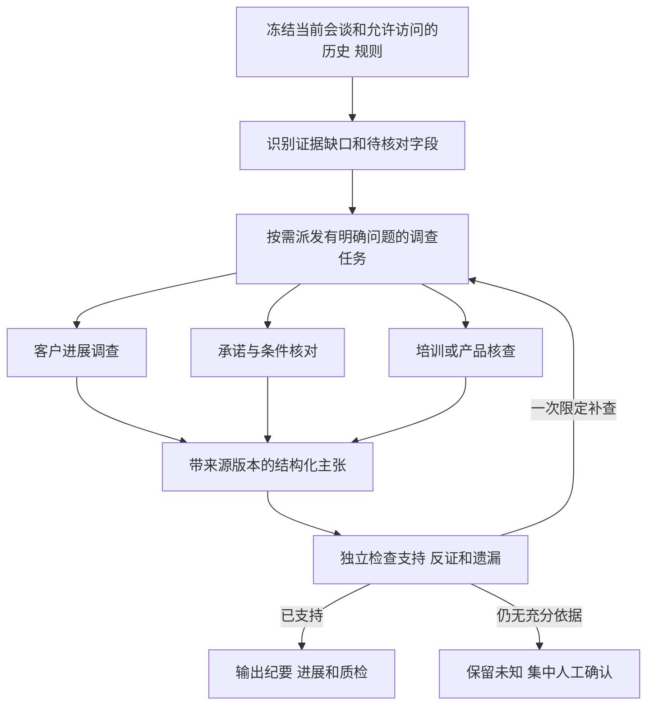

# 多 Agent 协作研究与候选方案

后续已完成首轮实际审计和本地真实模型对照，最新见[架构与数据审计](25-backend-architecture-audit.md)、[量化结果及失败](26-quantitative-experiments.md)。下文“尚未运行”描述本研究方案登记时的历史状态；本轮没有证明B/C胜出，不能把早期推荐当实测结论。

后续研究须遵守 [docs/24 的角色边界](24-role-boundary-and-disclosure.md)：会谈事实整理服务销售自行复盘；管理质检协作只处理已上报资料，输出只供主管／老板。不能以研究架构为理由恢复销售评分入口，过程指标与业务测试仍分别记录。

资料核查日期：2026-11-12，按用户客户端时间。本文是资料研究、候选设计与实验口径，尚未运行真实模型对照实验，不宣称某方案已胜出。承接 docs/04、docs/10，并以现在的企业服务销售产品为评测对象；不重新引入暂缓的派单功能。

## 1 先说本次建议

建议保留 LangGraph，把“固定专家协作＋独立证据审查”作为当前候选 B，再实现小范围的“按需调查＋争议驱动返工”候选 C，与有相同资料和工具权限的单 Agent 基线比较。框架是否要换与协作结构是否有效是两项不同实验，先只改变协作结构。

这是结合现有代码和公开研究的工程判断，尚不是实测选型结论。用户现在可以选择先做 B 的稳定性与成本优化，或把 C 作为下一阶段研究重点；已有网页和业务链路保持可查验。

## 2 现有实现到底处于哪里

| 部分 | 代码核对结果 | 不能据此宣称 |
|---|---|---|
| 会谈整理 | orchestration.py 有协调委派、依赖校验、Send 派发、专家工具循环、产物合并、独立审查、最多一次规划返工、持久化人工审核 | 动态方案已比强单 Agent 更准确 |
| 销售质检 | sales_workflow.py 按适用规则派发 discovery/process/product，最多三路并发；独立 auditor 提出具体 rule_id 争议，只返工有关专家一次；代码计分 | 任意开放式 Agent 团队；系统能自动补齐企业未知产品能力 |
| 上下文 | 账号适配绑定个人／中心来源版本，专家读冻结资料，产物保留；复核不能直接修改业务状态 | 已有高质量的跨会谈语义记忆、自动检索路由或最优上下文压缩 |
| 运行与评测 | 已有累计模型／工具调用、token 和事件等基础记录；87 项功能检查，另有框架机制与 ASR 实验 | 已有按架构、数据集、每个调用配置可重现的真实模型实验台账 |
| 并发 | 当前运行执行器为单 worker；单次图内部有并发限制 | 支持多公司高吞吐分布式调度，或并行一定能降低用户排队时间 |

现在确有专家间产物交接、争议反馈和受控返工，超过单纯“换五个角色提示词”。但多 Agent 的收益必须由后续实验验证，不能用框架名或流程图代替。

## 3 建议优先阅读的原始资料

下列为论文原文、作者机构材料或框架官方文档。每条区分资料本身的结论与本项目的采用建议。

| 编号 | 资料 | 能借鉴什么 | 本项目应用与边界 |
|---|---|---|---|
| R1 | [Towards a Science of Scaling Agent Systems，v3](https://arxiv.org/html/2512.08296v3)，2026-04-08 修订 | 在控制工具、提示和计算条件下比较不同协作拓扑；观察协调开销与错误传播 | 借鉴公平对照和过程指标，不能把其他任务上的百分比当本系统提升。v3 为 260 配置／6 类基准，早期作者博客为 180／4，引用时不混用 |
| R2 | [Why Do Multi-Agent LLM Systems Fail?，v3](https://arxiv.org/abs/2503.13657v3)，2025 | MAST 将失败分为系统设计、Agent 间不一致、任务验证等，给出 14 类模式 | 给失败轨迹分类，定位重复调查、前后矛盾、无效返工和过早结束；不是只记一次总分 |
| R3 | [How we built our multi-agent research system](https://www.anthropic.com/research/multi-agent-research-system)，2025 | 分离上下文、明确委派范围、并行探索、评测与运行追踪；同时报告更高 token 消耗 | 借鉴委派契约和有界并发；该文是开放式研究任务，不能直接套用其增益或 token 倍数 |
| R4 | [Building effective agents](https://www.anthropic.com/research/building-effective-agents)，2024 | 区分固定工作流与动态工具循环，介绍路由、并行、协调者和评估修订模式 | ASR、日期解析、权限和数值计分继续用确定性代码；需要调查和补读证据的部分才由 Agent 决策 |
| R5 | [ExplainMeetSum](https://aclanthology.org/2023.acl-long.731/)，ACL 2023 | 为摘要句提供人工证据句标注，关注证据提取及支持关系 | 设计“每条结论对应哪些原话”的 gold；公共英文会议不直接充当中文销售 SOP 标准答案 |
| R6 | [What's under the hood: Investigating Automatic Metrics on Meeting Summarization](https://aclanthology.org/2024.findings-emnlp.393/)，2024 | 检查自动指标与人工错误标注的关系，指出部分指标掩盖会议特有错误 | ROUGE 等只作辅助；负责人、条件、取消和无依据承诺单独评分 |
| R7 | [What's Wrong? Refining Meeting Summaries with LLM Feedback](https://aclanthology.org/2025.coling-main.143/)，2025 | 区分找错和修订两个阶段，提供带错误类别的会议摘要资源 | 比较证据审查是否真修好错误，以及是否改坏原本正确的条目 |
| R8 | [Judging LLM-as-a-Judge with MT-Bench and Chatbot Arena](https://arxiv.org/abs/2306.05685v4)，2023 | 分析评审模型的位置、冗长及自身偏好等偏差 | 评审模型只辅助筛查；关键错误人工核查，随机输出顺序，检查与人工标签一致性 |
| R9 | [Large Language Models Cannot Self-Correct Reasoning Yet](https://arxiv.org/abs/2310.01798)，ICLR 2024 | 在所研究推理设置中，仅凭自身再想一遍并不可靠，可能改坏答案 | 审查必须读原文／企业规则并指出具体证据，不能把“再检查一下”当可靠性保证；不是证明所有会议自我修订都无效 |
| R10 | [QMSum](https://aclanthology.org/2021.naacl-main.472/)，2021 | 按问题定位长会议相关讨论再生成摘要 | 验证角色关注不同信息的定位能力；不包含本产品全部跨会谈承诺或销售评分标签 |

以上均为方法与边界参考。没有把论文里的单一结果移植成本项目实测，也不照搬把文本不相似当作逻辑矛盾等近似口径。

## 4 协作结构的候选

### 对照 A 单 Agent 多工具

一个 Agent 在同一工具循环里读取会谈、历史、培训标准和产品说明，生成相同 Schema 的输出；允许合理次数的补读和工具并发，不能故意做成弱的一次调用。

它必须保留，才能判断多 Agent 是否值得。另加“一次结构化调用”作为最简单基线，以及“单 Agent＋独立审查”的控制组，以区分收益来自专业分工还是仅来自多一次审查。

### 候选 B 固定专家团队 加独立证据审查

各专家依据不同职责与局部规则处理同一冻结来源，能自行补读授权证据；审查接收结构化产物并核对原话。发现问题时指向具体字段／规则，只允许有关专家返工一次；未解决则明确未知或交给人工。不是五个 Agent 自由聊天。

优点是职责和消融清楚，与现有质检结构接近，适合作为稳定基准。代价是简单会谈也可能启动多个专家，重复上下文和审查开销较大。优先测“串行／并行”“整份上下文／按需证据”“总是审查／条件触发”三组差异。

### 候选 C 按需调查团队 加争议驱动协作

先识别本次缺少的证据和存在争议的字段，再只派发需要的调查者。角色按不同证据责任分工，例如客户进展、承诺演变、培训流程、产品承诺核查，而不只是把摘要的几个栏目拆开。

产物统一表达主张、状态、来源版本和支持／反对证据；出现“销售表示下周交付，但产品资料要求安全评审通过”这类冲突时，协调者生成具体问题，指定专家补读，再由审查者决定保持、修订或交人工。调度可先用确定性规则，复杂个案再实验模型路由；不能把未经校准的自评分数直接当可靠概率。



它的研究价值是“何时需要另一个专家、沟通增加了什么有效信息、何时应该停止”。潜在收益是把成本集中在难例；潜在风险是漏派专家、漏审简单外表下的严重错误。必须专门测路由漏检，不能只展示平均成本下降。此方案尚未实现。

### 候选 D 多轮互相讨论或辩论

让专家反复互读、批评、投票或协商。可以做研究对照，但暂不作为首选：本产品许多问题缺的是具体原话、产品资料或确定的责任人，增加讨论轮数未必带来新证据。若要试，限制轮数并与同等 token 的 A/B 比较，同时检查相互附和及正确答案被改坏的情况。

### 当前参考选择

| 用户希望优先获得 | 建议选项 | 需要证明的关键点 |
|---|---|---|
| 保持产品可用，先跑出可信对照 | B 作为主候选，A 作强基线 | 分工／审查质量收益能否覆盖成本，简单场景是否浪费 |
| 更深入研究协作机制 | C 作为研究重点，同时保留 A/B | 调度召回、争议解决、净修复收益及长会谈成本是否更好 |
| 研究自由沟通本身 | D 仅实验支线 | 相同预算下是否真正增加正确证据，而不是多轮同意 |

我的暂定建议是 B 稳住，C 做下一轮创新；最终用验证集选配置、留出集复验，不能提前把 C 写成优于 B 的结论。

## 5 框架实现另外选择

| 选择 | 官方核查入口 | 本项目判断 |
|---|---|---|
| LangGraph | [工作流与 Agent](https://docs.langchain.com/oss/python/langgraph/workflows-agents)、[持久化](https://docs.langchain.com/oss/python/langgraph/persistence) | 保留为首选承载 A/B/C。现有图、冻结来源和审核可以复用；框架持久化不替代应用权限、版本约束或外部副作用幂等 |
| Pydantic AI | [多 Agent 应用](https://pydantic.dev/docs/ai/guides/multi-agent-applications/) | 可作为类型化 Agent 与委派循环的候选实现；官方有委派、共享用量限制等模式。只有需要减少自写工具循环时才做小范围原型，不先整体迁移 |
| Microsoft Agent Framework | [官方概览](https://learn.microsoft.com/en-us/agent-framework/overview/) | 有 Python Agent 与显式工作流，可作为框架对照；当前项目没有必须依赖其生态的需求，迁移价值需由实现成本、故障恢复及相同策略的运行结果证明 |

不采用“框架 A 更先进，所以质量更高”的推理。框架对照必须保持 Agent 角色、提示、模型、工具和调度策略相同，先比较执行开销、恢复行为、可观察性与维护复杂度；它与架构实验分开做。

实验记录可选“本地 JSONL＋SQL 汇总”和“自托管 Langfuse”。[Langfuse 评测文档](https://langfuse.com/docs/evaluation/overview)提供数据集、实验与评分方式，[自托管说明](https://langfuse.com/self-hosting)列出部署选项及部分附加功能许可要求。建议先保证原始记录可导出，再选择是否增加平台，避免平台界面代替指标定义。本文没有安装平台或把会谈资料发往云服务。

## 6 衡量是否做得好的指标

以下是拟议口径，不是本项目已有数值。先对结论／任务进行一对一语义匹配并人工核对争议；不能只按措辞相似打分。

| 维度 | 主要指标 | 必须解释的口径 |
|---|---|---|
| 纪要和行动项 | 决策／行动项 precision、recall、F1；完整字段正确率 | 完整字段要求责任人、日期、条件和状态均正确；未知留空有独立 gold，不能瞎填 |
| 证据 | 引用有效率；人工判定的支持率；无依据事实率 | 引用存在、引文相符和语义真正支持是三件事 |
| 跨会谈演变 | 改期／取消／条件变更识别 F1；最终有效承诺正确率 | 按时间处理，不读取未来会谈或后来主管答案；不能把已暂停承诺继续算作有效 |
| 销售质检 | 规则状态 macro-F1；各状态混淆；分数 MAE；可评覆盖率 | 达标、部分、未达标、不适用、无法判断分别评；只比较同规则版本的有效样本，覆盖率和误判一起报 |
| 路由和补查 | 必需专家／证据召回率；不必要派发比例 | C 不能通过少派专家降低费用却漏掉严重问题；记录触发原因 |
| 审查 | 找错 precision/recall；错变对／对变错数量；净修复收益 | 净收益按固定评测单元统计正确率变化，保留修订前后；不能只算挑出来的成功返工 |
| 协作过程 | 冲突识别／解决率；错误向最终结果传播的比例；重复读取量 | 需要主张 ID 和证据链映射。重复读取可能服务独立验证，不能一概算无效；与质量一起解释 |
| 成本和时延 | 每场及每小时音频的 token／费用；P50/P95；队列等待与执行分开 | 包含路由、审查、修复和失败调用，记录缓存 token／价格版本。并行能否加速必须实测 |
| 可靠性 | 故障恢复成功率；重复副作用；超预算停止；版本错用／越权读取 | 按预定故障注入案例统计，模拟环境标明。关键失败作为门槛而非被平均分抵消 |
| 用户便利 | 纪要可用率；每场修改字段数／补问次数；周报确认耗时 | 同一销售完成相同任务的配对比较；“少点击但改错信息”不算便利性提升 |

ASR 的 CER/WER、RTF 和说话人 DER 单列；当前没有自动说话人分离，不编造 DER。先用同一人工转写比较协作，再用固定 ASR 输出比较，最后再做完整音频端到端测试，防止把转写错误误归因于 Agent。

实验实现时固定下列分母，不在看到结果后改变：

- 抽取 precision 为正确匹配预测数／预测数，recall 为正确匹配数／gold 数，匹配一对一；空预测、无 gold、允许多个解释的情形预先规定并分别统计，不能全部塞成 100%。
- 语义支持率按被检查的结论计算，不按引用条数计算；同一结论粘贴十条引用不会让分数自动提高。另报引用定位是否正确。
- 审查净修复率为“错变对数量减对变错数量”／全部被复核的固定评测单元；同时给出两类数量和复核覆盖率。跨方案最终正确率另作配对比较，避免只评审模型自己挑出的容易样本。
- 错误传播率为能追溯到上游错误、并进入最终输出的错误主张数／被标注的上游错误主张数。需要人工或经验证的语义归并；零上游错误时记不适用，不凭关键词重叠计算。
- 原文上下文重复读取量可以用跨调用累计发送的证据 span token 数／发送过的唯一证据 span token 数作描述；记录 tokenizer／估算方式及缓存情况，不把它等同于供应商实际 token 账单或无效工作。
- 时延给出每个案例墙钟时间，成功和失败／超时分别统计，并同时列失败率。小样本 P95 只作为样本分位数，不能宣称稳定线上服务水平。

不建议把全部指标随意加权成唯一总分。先检查关键事实／权限／版本门槛，再比较质量、费用、时延与人工修订量的折中。若两个方案差异不稳定，保留更简单者或继续补样本，不只挑最好的一次。

## 7 怎样公平比较并留下完整记录

1. 先固定真实产品的任务与 gold：需求、演示、报价、签约四阶段，覆盖身份不明、无任务、条件承诺、会中改期、跨会谈取消、缺产品资料和长转写。初轮用小规模难例试跑计量是否正确，再扩大数据；样本数量在实际采集后填写，不用计划数冒充已有数据。
2. 公共数据用于摘要定位和证据子任务；本产品中文销售、企业 SOP 和商机序列需要另标。合成难例与真实资料分开报告。按完整客户／商机序列分开发、验证和留出集，避免同一序列的改写泄漏。
3. 同一案例使用同一模型版本、参数、Schema、工具语义、授权资料和业务时间快照。单 Agent 允许访问同等资料、充分工具调用与合理提示优化。总预算包含全部专家与协调审查成本。
4. 做两组比较：相同总预算上限下的质量；达到事先约定质量门槛时的实际费用和延迟。不能单 Agent 限一次请求，多 Agent 却免费增加十次。
5. B 的串行／并行只变调度，专家输入和互相可见的结果不变；增加上游信息属于另一个实验。再分别开关审查、定向返工、检索上下文和路由，每次尽量只改一个因素。
6. 关键对比同案例重复运行，建议至少三次作为起步，报告分布和所有失败。验证集选择设置，冻结后才看留出结果；按客户序列做配对统计，少量组时明确不确定性，不能只靠漂亮平均数。
7. LLM judge 辅助筛查，关键业务标签优先人工核对；两名独立标注者及仲裁是建议资源，实际只有一人就如实说明。模型输出顺序随机化，记录评审提示／版本和与人工的一致性。

每次实验至少保存下列材料；这是待实现的实验产物约定，本轮未创建伪运行或空指标填充值：

```text
experiment_id/
  manifest.json       # 代码提交、数据及 split hash、模型、提示、规则、策略、工具、预算、时间和环境
  cases.jsonl         # 案例及来源版本、gold 版本、真实／合成标志
  trace.jsonl         # Agent/任务/父调用、输入产物引用、工具与回执、输出、状态、耗时、usage
  predictions.jsonl   # 每案例每重复的原始输出与修订前后结果
  judgments.jsonl     # 代码校验、人工／模型判定、争议和仲裁记录
  metrics.json        # 分子分母、分组指标、不确定性；缺失值为 null 并写原因
  failures.jsonl      # 全部失败／取消／超预算及 MAST 分类，不删除失败运行
  decision.md         # 哪个设置被采用或保留、依据、限制和可复现命令
```

没有供应商返回的 token 或准确单价时记缺失，不把字符数估算当实际计费；缓存、网络重试、失败调用也保留。研究用数据、原始 trace 和录音放忽略目录；只提交脱敏案例、配置、脚本及可公开的汇总。

## 8 本轮完成与下一步

本轮完成真实三个身份重新登录，核查当前两条协作实现，阅读并链接上述原始资料，给出 A/B/C/D 架构、框架候选、指标和实验留痕口径。没有修改正在验收的产品功能，没有新增真实模型成绩或重复运行无关功能测试。

下一步根据用户偏好，先实现公平基线与原始追踪，再做 B/C 最小对照。当前服务未配置真实模型；正式效果比较需要可用模型、冻结评测资料、标注和调用预算。准备好这些之前，不把规则演示测试包装成架构胜负。
