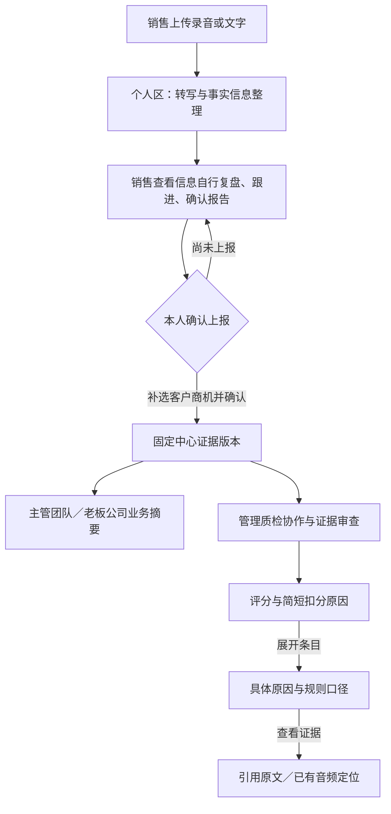

# 销售信息整理与管理质检：角色边界及渐进披露更正

本次按用户明确纠正实施；不是新增销售评价需求。开发记录按客户端日期 2026-11-12，Git 日期另见 COMMIT_METADATA.md。此文覆盖 docs/16—23 中与本次角色边界冲突的旧描述；旧交付／测试记录保留为历史。

## 1. 错在哪里，正确目标是什么

此前把“销售利用资料自行复盘”推导成了“系统给销售一份质检复盘”，并将“销售只能看自己”误当成“可以查看自己所有类型的数据”。因此出现了销售质检入口、个人录音自动评分及销售异议流程。这些是设计错误，不能以早先文档把它写进表格为依据，反推成用户确认。

销售需要的是经过分析提取和整理的信息：谈了什么、需求和条件、讨论结论／决策、后续安排、风险／疑点及来源。由销售自己阅读和比较这些信息进行复盘。可选建议应清楚标为建议，不构成评分、扣分、人员评价或强制复盘结论。简报／周报按事实资料映射，销售确认后导出。

管理质检是另一种业务输出：依据企业培训规则评价销售行为，由主管／老板查看。多 Agent 的内部职责不直接等同于用户的页面栏目，内部生成的数据也不能无差别返回所有角色。

## 2. 同时检查岗位功能与资料范围

| 内容／操作 | 销售 | 主管 | 老板 | 管理员 |
|---|---|---|---|---|
| 个人会谈整理、原文、本人报告 | 本人 | 不读取未上报资料 | 不读取未上报资料 | 不因管理身份获得读取权 |
| 中心会谈及客户进展 | 自己已上报部分 | 负责团队已上报部分 | 全公司已上报部分 | 组织配置与业务读取分开 |
| 管理质检分数、评价、依据、历史 | 无权限，包括本人 | 负责团队已上报部分 | 全公司已上报部分，只读 | 无业务评分读取权 |
| 质检背景核对、版本化复核与失败恢复 | 无权限 | 负责团队主管 | 无编辑入口 | 无业务复核权 |
| 企业培训规则发布 | 无权限 | 不发布 | 不发布 | 本公司配置／发布 |

上传、提取和个人报告不需要先评分。只有确认上报，中心才复用该次固定资料准备管理质检；不重复上传、不把管理判断回流至销售报告。

## 3. 已实施的更正

### 销售与后台边界

- 移除销售“复盘质检”导航、会谈质检按钮和异议提交表单；保留纪要／待办／客户跟进／报告及原文核对。
- 质检路由先检查角色，销售即使持有实际 case／analysis 编号，读取分数、详情、历史、规则或操作接口均返回 403。业务方法再次限制主管／老板；其他团队／公司不能读取。
- 个人录音不创建质检案例、不启动管理评分；服务启动时停止历史私人案例尚未完成的分析，再恢复中心任务。旧案例、原始分析和录音保留审计，但不开放读取，不清空数据库。
- 新上报不继承私人质检背景；更正文案返回销售前移除内部 quality_context。删除影响接口也不向销售返回质检版本数量。事实信息和中心更正申请仍可正常使用。
- 会谈 Agent 提示词明确限制为事实整理，建议需标识，不能生成销售评分／人员绩效判断；管理质检协作仍只读取已上报的冻结证据与企业规则。

### 管理端三级展示

1. **概览**：总分、覆盖率、自动／人工状态、各项扣分及短标题；首次详情请求使用 `view=summary`，不返回详细判断、原文、证据列表或复核正文。
2. **原因**：点开某条才请求 `view=details`，展示具体解释、原始权重点及规则口径；该响应不含原文片段。真实模型提示词要求短标题不抄原话，详细原因解释判断逻辑，证据另用片段 ID 引用。
3. **证据**：再点“查看证据与回听”才请求完整证据并显示面板，初始只显示该项引用的原文；完整会谈另行展开。只有原资料带对齐时间才提供对应回听，不伪造时间点。

接口的三个视图都要求同样的管理权限；折叠是信息展示层级，不是以 CSS 代替权限。现有管理接口保留默认 full 以兼容历史调用，但正式页面首次明确请求 summary。

评分使用原有代码口径，不重写历史评分：总分按可评权重折算至 100 分；概览扣分用同一分母折算。例如本地演示总分 50，原始扣分 12.5／10、可评权重 45，对应概览扣分 27.8／22.2。无法判断不扣分，不适用不进分母，四舍五入可有尾差。原始权重点放第二层说明。

“通用复盘”的旧枚举保留以兼容不可变历史，面向用户显示“通用质检（阶段待确认）”。规则演示只显示“演示仅字面命中，原因待核对”，不能为旧演示数据编造真实扣分理由。主管改判后清除失效的机器标题，优先显示主管解释，原自动解释保留在进一步展开的历史说明中。

### 同类错误排查

| 排查项 | 发现／处理 |
|---|---|
| 功能权限被“本人范围”替代 | 已修复销售质检全路由与方法鉴权；管理员规则配置不等同业务评分读取 |
| 上传即向管理流程提供私人资料 | 已改为确认上报后才进行管理评分，停止历史私人待处理任务 |
| 从维护／更正附属响应暴露管理信息 | 已移除销售删除影响中的质检数量、销售更正候选中的内部质检背景 |
| 信息一次铺开 | 会谈结论／风险／原文按需展开，摘要与后续事项保留；已确认报告逐场折叠，核对草稿仍展开待编辑字段 |
| 点开证据却留在视野之外 | 浏览器发现并修复：证据面板展开后获取焦点并定位，宽屏滚动时保持可见 |
| 机器判断覆盖人工判断 | 改判后失效标题不复用；主管原因优先，自动原文说明保留历史 |
| 把未知写成失误／业务结论 | 继续保留未知、覆盖率、规则建议、销售补充与客户确认的区分；未做真实模型质量达标声明 |
| 文档将推导当成已确认需求 | 更正 docs/16 的 C1／C7、角色表、上报处理路径、权限表与验收场景；旧交付加历史更正提示 |

## 4. 验证和留痕

全量功能回归最终 **88 项通过**（95.86 秒），Ruff、Vue 类型检查及生产构建通过。本模块 12 项行为检查覆盖：个人不评分、所有销售质检入口拒绝、团队／公司隔离、管理员配置边界、旧私人待处理取消、上报和撤下、三个响应视图、来源历史、人工改判／并发幂等、规则版本和重试预算。原始机器结果不被人工结果覆盖。

后续在同一权限测试内补充了管理员不能读取评分、历史更正候选只对销售隐藏内部背景而不改写原记录的断言；该测试单独再次通过（1 项，3.38 秒），Ruff 再次通过。未因此再次运行无改动的全部业务测试。

测试过程保留：首次全量 88 通过；补充“改判后清除旧标题”断言时误放入未发生复核的测试，出现 1 失败／11 通过；将断言放回实际复核场景后本模块 12 通过，最后再次全量 88 通过。该失败来自测试编辑位置错误，未用忽略断言或放宽权限处理。

本地 Chrome 三个真实独立会话实际核验：

- 销售 `qa.sales.b`：本人 6 场会谈，无质检入口／按钮；事实纪要与后续事项可用，确认报告逐场内容默认折叠，Word/PDF 入口保留。
- 主管 `qa.manager.b`：只列本团队 5 场已上报会谈。概览没有长原因／原文；首次展开有原因无原文；再次点击只出现所选规则引用的一段原文，完整原文仍需展开。
- 老板 `qa.boss`：全公司 6 场，包括另一团队；可读原因及证据，无背景修改／复核按钮。
- 最终页面错误日志为空，三个身份标签页已保留，服务在 8765 继续运行。无新注册、上传、删改业务资料或修改浏览器权限。

截图保存在本地忽略目录 `test-results/role-disclosure/`：sales-information.png、manager-score.png、manager-reason.png、manager-evidence.png、boss-score.png。历史合成会谈标题中“需求复盘与质检联动”属于原测试资料名称，未改写成新的销售功能名称。

## 5. 当前限制与恢复开发

本轮确认的是功能权限与信息展示行为。当前仍无真实语言模型配置，页面明确为规则演示；自动质检原因质量、说话人分离、多 Agent 选型收益均未因此得到验证。不把 88 项功能测试当评分准确率或架构效果指标。真实模型、Word 分页及移动设备等原有限制继续见 docs/22—23。

恢复启动：仓库根目录运行 `scripts/start.ps1 -SkipInstall`，在用户本地浏览器访问 `http://127.0.0.1:8765`。不要重复创建账号、清库或把旧单用户模式用于三角色验收。下一阶段研究按新的事实整理／管理质检边界划分输出和标注集，不再引入销售质检复盘入口。

## 6. 后续更正：评分对象必须在评分旁明确显示

用户指出分数旁看不到负责人。原 QualityCase 已从中心 Submission 的 owner_id／team_id 继承上报归属，姓名仅以无标签小字出现，评分卡则只有数字，导致关联不清。

现列表与评分卡明确标识“负责销售（上报人）”、销售姓名和来源团队，详情保留客户、来源会谈及版本。管理接口新增 subject（account_id、name、team_id、team_name），原 owner 保持兼容。账号用中心所属销售的稳定 ID，姓名沿用该质检案例快照，团队 ID 沿用中心所属团队；团队名称为该 ID 对应的当前显示名称，不按主管或销售当前团队重新归属。无数据库迁移、不重算旧分数。

当前仅支持销售本人上传并本人上报，因此上报人与负责销售相同；这是业务归属，不是声纹身份识别。录音原文或后续事项提到其他人的名字不会自动改变被评销售，主管复核也不会成为质检对象。将来若支持代传／多人共同会谈，须分别定义上传者、上报者与被评销售，不能直接沿用本次同人假设。

验证：本模块 13 项通过（37.50 秒），Ruff、前端类型及构建通过。新增检查管理列表与 summary／details／full 均返回同一上报账号及来源团队，已有复核检查补充主体不变。未重复无关业务全量测试。本地 Chrome 主管评分卡为“二组销售乙／企业服务二组”，老板另选一组会谈为“一组销售甲／企业服务一组”，姓名与分数同卡可见；页面和截图 quality-owner-manager.png／quality-owner-boss.png 已保留。销售质检禁读边界不变。
