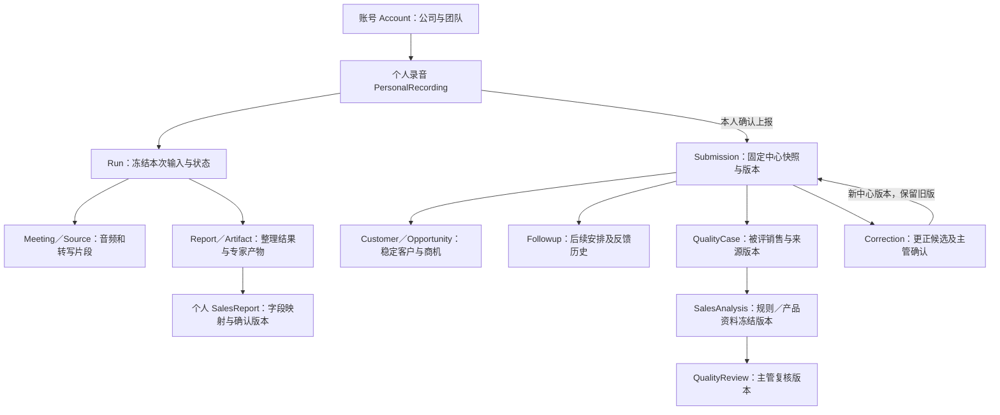
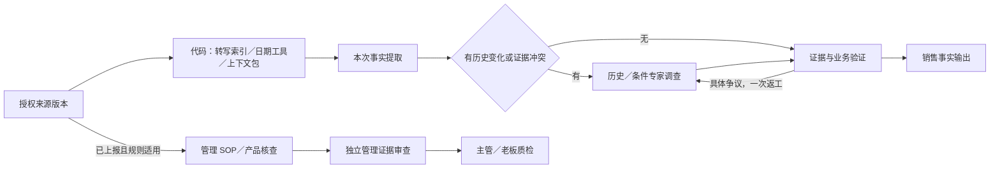

# 后端与多 Agent 架构审计

审计日期：2026-11-12（Asia/Shanghai）。实施基线 e0fa85a，后续修改与实验逐批留痕。此文描述代码现状、业务约束及候选，不把原简历技术栈当已实现。本轮数据见 [量化实验记录](26-quantitative-experiments.md)、[实验代码与预登记](../labs/backend_agent_audit/PLAN.md)。

## 1. 先确定系统要服务什么

用户本轮确认：**单家公司，20–100 名销售，每日几十到几百场录音**；录音时长暂不确定，必须按不同长度测算。不是先建设多公司大规模 SaaS。已有公司／团队隔离继续保留，不因此引入微服务或放开销售质检。

输入是销售账号上传的录音／已有转写及可选的真实会谈日期、标题；上报时再补客户商机。销售得到完整转写、纪要、需求／决策、后续事项、疑点和可确认的简报周报，自行复盘。主管／老板只在已上报范围获得推进信息及独立管理质检。系统不得把未知信息变成确定事实，不因记录更新丢失旧证据。

日常使用需要自动保存和失败可恢复，而不是销售操作模型或 Agent。架构深度要体现在授权证据、跨版本变更、协作净收益和恢复上，不体现在无条件启动多少个角色。

## 2. 当前实际技术栈

| 层 | 已在代码中使用 | 当前边界 |
|---|---|---|
| API／契约 | Python 3.12+、FastAPI、Pydantic、HTTPX | 模块化单体，不是微服务 |
| 数据 | SQLAlchemy 2、SQLite WAL、外键和唯一约束 | 34 张表、70 个外键、17 个唯一约束；并非 PostgreSQL 已落地 |
| 工作流 | LangGraph 1.2.16、SQLite checkpointer 3.1.2 | 冻结输入、产物缓存、中断／恢复；不保证外部副作用 exactly-once |
| 执行器 | 两个 ThreadPoolExecutor，各 1 worker | 会谈整理与质检各自单任务执行；不是 Celery／Redis 队列 |
| 语音 | faster-whisper small、CTranslate2、PyAV，本机 CUDA | 有真实 ASR，无自动说话人分离；准确率仍需改善 |
| 文件／报告 | 本机受保护音频文件、python-docx、ReportLab | 没有分布式对象存储，Word 分页视觉限制仍见 docs/22 |
| 页面状态 | 账号界面定时轮询，质检每 5 秒刷新 | 旧开发接口有 SSE，不把它说成账号界面已实现 WebSocket 推送 |
| 研究实验 | 本地 Ollama，冻结模型摘要、Schema、案例、原始请求响应与指标 | 与产品默认规则演示隔离；没有把本次模型接入用户正在查看的业务数据 |

**Redis、Celery、PostgreSQL outbox、远端 CRM 创建超时对账都不能写成当前已完成。** 用户已暂缓派单／外部任务系统。旧简历设想与现在的实际实现要分别说明。

## 3. 数据怎样关联，从输入走到输出

| 关联／状态 | 当前依据 | 必须保留的含义 |
|---|---|---|
| 销售归属 | 认证 Account.id → PersonalRecording.owner_id → Submission.owner_id → QualityCase.owner_id | 当前本人上传／本人上报；不是从转写姓名或复核人推断，代传与多人归因尚未实现 |
| 公司／团队 | company_id、team_id 及服务端范围检查 | 数据范围与功能权限同时满足；销售不能读自己的管理评分 |
| 一次分析 | Run.id、manifest、来源 ID／版本／hash | 固定“当时看到了哪些资料”，恢复时不偷换最新输入 |
| 原文追溯 | Source 中稳定片段 ID；结果中的 evidence 引用 | 引用存在与引用真正支持结论分别验证，不把引用检查当语义正确 |
| 上报后更正 | Submission.revision、Correction.base_revision、候选快照、history | 销售个人修改不暗改中心，主管确认后形成新版本 |
| 客户推进 | Customer.id／Opportunity.id、来源会谈及人工确认 | 名称用于显示，不能仅凭客户同名合并；文字差异不等于语义推进 |
| 后续安排 | Followup.scope_key、来源版本、人工反馈与历史 | 尚无完成反馈不等于失约；不是主管派单系统 |
| 简报周报 | 销售本人范围、来源版本／指纹、确认后的固定内容 | 导出不自动上报，源数据变化不能悄悄覆盖确认报告 |
| 时间 | 上传、实际会谈、上报、生成、修订等分别记录 | 上传时间不能冒充会议时间，相对日期依实际会议日期归一化 |

表间关系不是全部由 ORM relationship 自动维护：不少关联用显式外键和查询；Followup 的多态来源以及 JSON 内引用主要靠应用检查。70 个外键不等于已经具有完整的跨公司组合约束。上述范围检查不能因为“看起来重复”就删除。

### 当前数据结构的主要代价

Source、Run.manifest、Submission.snapshot、QualityCase.body、SalesConversation、SalesAnalysis.snapshot 之间存在转写及上下文的重复冻结。冻结本身有业务必要，但**冻结不等于每层都必须复制全文**。候选是不可变来源版本＋内容 hash＋授权引用，角色只保存输入引用及自己的产物。

该候选尚未迁移：必须先证明旧版追溯、个人删除不影响中心、审批 hash 与权限均保持等价，再比较数据库体积、读取内存及恢复时间。不能为了省 JSON 把历史资料变成可变链接。现有 history JSON 随版本增长、缺少正式 Alembic 迁移链，也是后续数据库工程工作。

## 4. 本轮查到的问题和已处理项

| 问题 | 依据 | 本轮处理 |
|---|---|---|
| 质检列表 N+1 查询 | 旧实现先取全公司案例，再逐条查中心来源、分析、复核、反馈和团队 | SQL 内限定公司／负责团队／未撤下／当前版本，以 CTE、窗口函数和字段投影一次读取。500 场两轮严格返回等价，性能准入通过后纳入代码 |
| 私人质检残留路径 | 管理质检已改为仅中心，但内部仍保留私人来源读取分支和空回调 | 删除已不可达的私人读取分支、空 on_run_ready；保留明确拒绝非中心来源的边界 |
| 双层派生异常包装 | API 包装回调已经捕获，RunDriver 还捕获同一派生工作 | 直接绑定业务派生回调，统一在 worker 边界留一处失败记录；故障注入证明纪要保留且错误只记一次 |
| 大结果截断但缺少结构化分页 | ToolGateway 超 24000 字符返回 preview；读取接口不能指定片段窗口 | 记录为检索架构缺口，候选为按稳定片段 ID／范围分页。不能把截断当作已经解决长会议上下文问题 |
| 管理质检整场 400 段／50000 字保护上限 | QualityWorkspace.spans 的明确限制 | 不是完整长会谈方案。需改为分段分析、跨段状态归并及总预算；本轮未盲目放大上限或要求销售手工拆录音来伪装支持 |
| 动态协调者调度已知任务 | 普通短会谈仍调用模型生成并校验任务 DAG | 模拟当前图有 14 次模型协议往返；真实本地旧模型协调失败。固定 DAG 已做隔离诊断，不凭一次结果更换生产流程 |
| 两套手写 Agent 工具循环 | agents.py 与 SalesDriver.expert 分别维护模型／工具／提交／返工逻辑 | 候选共享传输／计量内核，但保留两种业务验证。未经等价测试不合成巨型带开关基类 |

**保留的必要校验**：授权来源白名单、实际片段引用、当前版本／审批 hash、复核权限、唯一请求键、数值代码计分、共享调用预算、超时和取消。它们分别处在 API、事务与模型输出的不同边界，不能只看相似条件就认定冗余。具体取舍与失败证据见 docs/26。

## 5. 为什么需要这些 Agent，为什么不是一直分五个

当前会谈图有 coordinator、meeting、可选 context、planner、risk、auditor；质检图是按规则分派 discovery／process／product，再独立审查与一次定向返工。ASR 实际是代码服务，不需要因为题目叫“多 Agent”就套一个只能调用识别接口的聊天角色。数值计分与模板填表也不应交给模型猜。

角色只有在它有**不同的证据责任、工具或需要独立纠错**时才有意义：

| 需求 | 合理职责 | 何时值得多一个 Agent | 应怎样证明 |
|---|---|---|---|
| 本次谈了什么 | 本次事实抽取 | 单个模型在长文本或混合目标上遗漏明显时再分工 | 相同来源下需求／决定／条件召回，幻觉率与成本 |
| 本次是否改了上次安排 | 承诺与历史变更核对 | 有授权历史、责任移交、改期／暂停／取消冲突 | 变更关联准确率、错改旧任务数、真实新增有效证据 |
| 销售承诺是否符合企业规定 | 管理 SOP／产品核查 | 已上报且有适用规则／产品依据，且必须对管理角色隔离 | 规则级 precision／recall／macro-F1、无法判断、错误扣分率 |
| 判断是否有支持与反证 | 独立证据审查 | 高影响字段或有具体争议，审查能读到可验证依据 | 错变对减对变错、漏检率、审查开销；不能只统计修好的案例 |
| 把结果排成纪要／周报 | 确定性映射和模板 | 通常不需要再设整合聊天 Agent | 字段映射正确率、源版本一致、导出内容一致 |

候选日常结构是“代码规划＋按需证据专家＋具体争议审查”，不是自由辩论。简单案例保留强单 Agent 基线；难例按证据缺口启动调查。专家交接结构化主张、支持／反证与变更补丁，不复制整段聊天。调度漏派、审查漏检和对变错都必须计入，不能靠看起来像多 Agent 来证明价值。

这是**待对照验证的设计**，不是本轮已经选出的最优架构。本轮组件试验和完整图诊断尚不能证明它达到业务质量门槛。

## 6. 技术候选如何选择，哪些还没资格下结论

| 环节 | 候选 | 当前判断及选择门槛 |
|---|---|---|
| API／业务组织 | 保留 FastAPI 模块化单体；Django；微服务 | 保留现有可运行实现。没有实测证据说明换 Web 框架能解决当前模型或队列问题；不称 FastAPI 全面最优 |
| 数据库 | SQLite WAL；PostgreSQL＋SQLAlchemy＋Alembic | 本轮查询／写入探针只测了 SQLite。用户数量不直接决定数据库；企业部署若需多个工作进程的可靠任务领取、备份／迁移与更强事务治理，PostgreSQL 是重点验证候选。Docker daemon 不可用，未完成同机跨库对照，不能说它已更快 |
| 后台执行 | 当前本地执行器；数据库 jobs＋租约；Celery＋Redis；Temporal／DBOS | 当前没有跨进程领取租约，不能直接增加 Uvicorn worker 宣称扩容。先比较重启丢任务／重复推理、排队等待、重试放大、运维成本；每日几百场不自动要求 Redis／Temporal |
| Agent 运行时 | LangGraph；Pydantic AI；Microsoft Agent Framework；显式 Python 状态机 | 先固定协作策略再换承载框架。比较重放、故障恢复、步数／预算、追踪与适配代码。类型化和 durable 特性只说明可行，不能当本项目质量成绩 |
| 检索／记忆 | 当前范围内词语检索；PostgreSQL FTS／trigram；向量／混合检索 | 先建立中文证据查询标签，测 recall@k、引用精度、跨客户串资料和 token 占用。不为“分层记忆”标题先加向量库 |
| ASR／说话人 | 当前 Whisper；FunASR／SenseVoice；WhisperX／pyannote 组合；云 ASR | 除当前旧抽测外均待对照；必须同音频、同参考，分别测 CER／DER／RTF／显存，缺 diarization 时不能报 DER |
| 音频存储 | 本机文件＋受保护下载；S3 兼容对象存储 | 单服务器可先保留文件，验证备份恢复和配额。多主机才需要共享／对象存储，不把音频交给 Redis |
| 页面进度 | 条件轮询；SSE；WebSocket | 先测 100 会话时请求量与数据库负载；单向状态流可比较 SSE，不因“实时”就必选双向 WebSocket |

官方资料提供的是机制与边界：[SQLite 用途](https://www.sqlite.org/whentouse.html)、[PostgreSQL 行级策略](https://www.postgresql.org/docs/18/ddl-rowsecurity.html)、[Celery 确认与幂等](https://docs.celeryq.dev/en/stable/userguide/tasks.html)、[Pydantic AI durable execution](https://pydantic.dev/docs/ai/capabilities/durable_execution/overview/)。这些都不能代替本系统实验。

## 7. 容量按数据算，不先承诺机器数量

录音时长未确定，先测算 50／100／300 场每天 × 15／30／60 分钟，得到 **12.5—300 音频小时／天**。这只是输入规模换算。

例如 100 场×30分钟＝50 音频小时。若纯 ASR RTF 假设分别是 0.05／0.2／0.5，所需串行计算分别是 2.5／10／25 小时；8小时窗口且按60%利用率规划，分别约1／3／6个等效 ASR worker。这些是假设敏感性，不是本机吞吐。LLM、上传、突发排队和重试另算。

若保留 128kbps 音频，300场×60分钟约17.28GB／天、30天约518.4GB，尚不含备份和转写副本。实际编码、保存期限和上传高峰待业务确认。WAV、压缩音频和原始证据保存不能混算；当前100MB上传上限也要用真实时长／编码验证。

旧24段短片实测的累计端到端比值约0.052包含真实 ASR、规则分析和轮询，**不能当纯 ASR RTF 或含真实模型的线上容量**。可复算敏感性表见 labs/backend_agent_audit/capacity.py。

## 8. 判断好坏的证据顺序

1. 授权、版本、证据与副作用是否正确，是准入条件，不能被平均分抵消。
2. 相同案例、固定 gold 和评测单位，失败纳入分母；分开比较模型、协议、协作策略、检索和执行器。
3. 质量过门槛后比较输入／输出 token、真实计费、P50/P95、排队及人工修改量；没有价格／电耗就记缺失。
4. 先登记规则再运行，保留旧数据、失败、提示修订和未采用方案；开发集改进不冒充留出集结果。
5. 论文、官方文档和 GitHub 实现提供候选。星数、作者自报提升和使用者好评不进入最终选型分数。

预算公平的文献结论也并不一致：[等思考预算下的单 Agent 对照](https://arxiv.org/abs/2604.02460v2)、[多 Agent 的 Pareto 研究](https://arxiv.org/abs/2605.01566)、[协调规模研究 v3](https://arxiv.org/html/2512.08296v3)。不同任务、预算与模型不能互相替代。完整来源和阅读范围见 [sources.json](../labs/backend_agent_audit/sources.json)。
