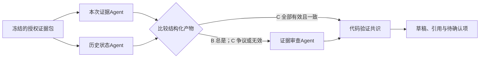

# 固定多Agent方向，比较协作内部设计

用户已明确最终系统采用多Agent。本次决策问题是：**哪些职责需要独立，怎样交接证据，哪些场景审查／返工，实际收益是多少**。单Agent仅为实验参照，不是替代交付方案。以前的204条试验和不利结果保持原样。

## 1. 产品约束与职责

销售事实整理与管理质检是两条授权链：事实链输出需求、决定、承诺、条件及引用；已上报后管理链再依据企业规则／产品资料评价，只供主管／老板。两条链不能通过共享聊天泄露人员评分。

ASR、日期运算、模板填表、分数算术、权限检查仍使用确定性代码；多Agent深度体现在证据职责、相互纠错和受控状态变化，不把每个函数包装成聊天角色。候选角色包括本次事实、历史／状态变更、授权企业规则／产品核查、独立证据审查。每份产物携带来源版本、主张、支持／反证及待确认项；写入业务状态继续经过版本化审核。

## 2. 先隔离比较三个协作机制

| 方案 | 依赖与交接 | 要验证的收益／风险 |
|---|---|---|
| A 串行交接 | 本次证据Agent→历史状态Agent（看到前者产物）→证据审查Agent | 上下文接力是否减少遗漏，还是放大锚定错误 |
| B 独立专家＋必经审查 | 两专家独立读同一冻结包→审查Agent整合 | 独立判断是否提供有效互补，审查是否把对的改错 |
| C 独立专家＋争议审查 | 两专家必经；无效／六类字段不一致才审查，一致则代码采用共识 | 省掉审查是否保持质量；一致但同错有多少 |

图示B/C，A在两专家之间增加串行产物交接。这里“独立”指调用上下文独立，不声称同一模型的错误统计独立。C每例至少两个Agent；无审查不是单Agent。

## 3. 怎样量化，怎样决定

先使用原12例合成开发集做可复核机制诊断，Qwen3:4b每例每方案2次、共72条，固定角色提示／资料／工具日期／Schema／模型和总生成上限。单GPU先串行执行逻辑独立调用，分开记录每次服务时间，不能把它当云端并行效果。本轮没有扩充独立业务gold，不能据此选出最终总架构。

针对上一轮问题，三方案统一增加条件片段字段说明及存在性／日期／引用一致性验证；中间无效产物进入审查，最终仍无效才失败。只比较本轮三个方案，不把新协议和旧单Agent分数直接相减来宣称架构提升。没有用gold决定路由或修补模型答案。

| 层次 | 指标 | 选择规则 |
|---|---|---|
| 业务质量 | 关键字段全对、含支持和条件全对、证据／条件F1、凭空任务、严重状态／归属错误 | 先看分层错误与失败，不用综合分掩盖硬错误 |
| 协作贡献 | 审查错变对与对变错、净修复率、有效共识、未审查同错、审查触发率 | 必须知道谁贡献什么；不能仅统计修好的案例 |
| 效率 | 实际输入／输出token、调用数、P50/P95、重复上下文 | 质量满足要求后再权衡；上限相同不等于实际计算相同 |
| 产品完整性 | 长录音漏片段、跨会议关联、规则适用性、版本／越权、取消恢复 | 组件小基准不覆盖，需要后续完整链路独立验证 |

以B作为必经审查参照，C只有质量不退化且无新增严重错误才讨论减少调用；A也按同一指标比较。若都未过质量门槛，保留多Agent方向，修协议／取证／职责后另开轮次，不硬选赢家。框架暂保留LangGraph，先固定协作策略再比较执行框架，避免把换框架和换提示混为一个变量。

## 4. 实验记录

运行前已追加[预登记](../labs/backend_agent_audit/PLAN.md)。实际轮次为 `test-results/backend-agent-audit/topologies/20261112T141201Z`，72/72条运行结束，未覆盖旧四轮。精确源码、计划、案例、模型digest、参数、请求响应、失败与逐例结果均保留。公开[summary.json](../labs/backend_agent_audit/results/summary.json)新增multi_agent_topologies，不混入旧协议直接排序。

| 实测指标 | A 串行交接 | B 独立＋必审 | C 独立＋争议审查 |
|---|---:|---:|---:|
| 完成（结构及引用有效） | 22/24 | 22/24 | 22/24 |
| 四个关键槽位全对 | 16/24 | 12/24 | 12/24 |
| 含证据／条件完全正确 | 10/24 | 8/24 | 8/24 |
| 支持证据F1 | 0.821 | 0.821 | 0.821 |
| 条件证据F1 | 0.500 | 0.500 | 0.500 |
| 凭空新增事项 | 2 | 2 | 2 |
| P50／P95秒 | 4.020／4.299 | 4.056／4.205 | 2.687／4.107 |
| 模型调用合计 | 72 | 72 | 54 |
| 输入token合计 | 63824 | 60956 | 42406 |
| 输出token合计 | 3816 | 3896 | 2912 |
| 审查触发 | 24/24 | 24/24 | 6/24 |
| 审查相对状态专家：修好／改坏的关键槽位 | 0／0 | 0／0 | 0／0 |
| 未审查共识中的关键字段错误 | 无免审 | 无免审 | 6/18 |
| 未审查共识中含证据条件的错误 | 无免审 | 无免审 | 10/18 |

每方案4份中间产物无效，最终各2次失败，都是suggestion案例把案例名当成片段ID引用；审查没有修好。失败仍在24的分母中，不因其余字段正确就放过非法证据。198次调用均未超过512生成token限制，无模型服务HTTP故障。

### 从逐例轨迹解释差异

1. A在condition与done两个场景保留了正确的日期／状态口径，比B/C多4条四槽位全对；含条件证据仍遗漏，因此完全正确只多2条。重复2次不是4个独立业务场景。
2. B/C中本次证据专家这两类场景原有正确关键字段，但状态专家产生错误，审查继续采用错误判断。事后追踪相对本次专家，共损坏6个关键槽位；4条试验出现“至少一专家四槽位全对但最终错”。A这两项均为0。这是解释性诊断，未拿它更改预登记主指标。
3. C比B少25%调用、约30.4%输入token，中位时延约降33.8%；本轮最终质量相同，表明B的审查没有提供净修复。但是18份免审共识仍有6份关键字段错，包括客户单方承诺混淆、未知身份和原文指令注入。**共识只证明一致，不能当作质量验收。**
4. A同样没有修正客户单方承诺与注入错误，条件证据F1也仅0.5；不能把16/24说成已经满足业务。该开发集上的比较没有置信区间／显著性结论，也没有证明跨会议、完整纪要或管理评分质量。

## 5. 当前采用什么，下一轮具体改什么

**采用为下一轮开发基础的是A的串行证据交接，仍然是多Agent；暂不替换正式产品图。** 理由是在本轮相同模型／上限下质量较好，输入token比B多约4.7%，没有用更多调用换分数。这里是开发优先级，不是最终生产选型或对所有数据的最优结论。B保留为对照，C原有“仅一致即免审”机制不作为最终质量放行依据。旧代码与默认模式未切换。

下一轮在保持多Agent约束下分开做单因素实验：

| 改动 | 对应本轮问题 | 需要测什么 |
|---|---|---|
| 引用类型与按任务可用ID约束／受限解码 | 把案例ID当片段ID | 非法引用率、完成率、证据F1；合法ID不等于证据支持 |
| 本次事实产物与历史变更补丁分开，明确空值保留和覆盖依据 | 后续专家覆盖正确日期／状态 | 错覆盖率、变更召回、同资料token、审查前后变化 |
| 审查输出字段级争议和反证，按ID只读补充依据；必要时有限返工 | 审查重述而没有纠错 | 错变对减对变错、有效新证据、返工成功率与成本 |
| 按风险／缺证据触发审查，一致也可进入核查 | 共识同错及原文指令注入 | 高风险漏审率、共同错误漏检、触发开销；不靠自报置信度 |
| 完整长会谈与授权历史的检索／分页 | 小槽位任务没有覆盖完整产品 | 跨片段／跨会谈变更、漏检、错客户串资料及恢复 |

逐项固定模型／案例／预算；若同时修改提示与Schema则明确为新契约，不能把全部收益归给拓扑。完整产品还要保留事实链与管理评价链的权限隔离，独立业务标注／盲评仍待补齐。下一轮评测必须比本轮12例更接近真实长会谈，不能持续在同一开发集调到高分后称泛化。

## 6. 工程验证和恢复

本轮新增8项拓扑行为检查，连同既有3项统计检查共11项通过；检查门控不读gold、至少两个Agent、独立方案不泄露上游产物、所有字段比较、无效产物触发审查、一致但错误照实计量。Ruff通过。初次静态检查发现循环闭包参数引用，已在开跑前显式绑定后通过；真实试验结果未被修剪。

无产品后端／前端代码改动，无需重启服务、重跑无改动的产品回归或浏览器验收。恢复命令：`.venv\Scripts\python.exe labs/backend_agent_audit/topology_experiment.py --model qwen3:4b --repeats 2`；每次创建新目录，随后运行summarize.py复核汇总。产品服务继续8765、默认规则演示，不把这批实验接入用户录音。
