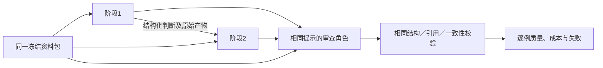

# Agent职责为什么这样划分：证据、反例和对照

用户要求职责划分也有实际依据，不能只给角色名称、示意图或引用框架。最终多Agent方向固定，其他划分当然可以，必须分别比较。

## 1. 先更正证据范围

docs/27的72条对照固定了本次证据／历史状态／审查三类角色，改变的是依赖和审查门控。它支持“在该小基准里串行交接优先继续研究”，**不支持“本次证据／历史状态划分已经优于字段分工、通才或原五角色”**。前一轮暂选的是交接方式，职责本身仍是待检验假设。

原产品有LangGraph图中的只读工具循环；而此前及本次槽位微基准都是有角色上下文的固定模型调用协议，没有自主选择工具。不能把微基准的分数称为完整自主Agent能力，也不能以几个不同提示词就证明职责隔离已落地。

## 2. 为什么提出这些候选

| 划分 | 工程假设 | 可能失败的原因 | 本轮能否检验 |
|---|---|---|---|
| E 本次证据／历史状态／审查 | 本次原话和历史安排的证据地位不同，先识别变化，再关联原记录，可能减少错覆盖 | 同模型会共同误解；角色职责重叠；后续角色仍可能改坏前者 | 仅检验这种职责重点的提示协议 |
| F 事项与责任／日期状态条件／审查 | 姓名归属和时间状态分别聚焦，可能减少同时处理多目标的遗漏 | 字段有依赖；“谁在何时做什么、条件是否成立”被割裂 | 与E同图、同资料对照 |
| G 综合抽取／综合复核／审查 | 通才保留完整语义，减少交接丢失；作为无专项重点的多Agent参照 | 重复推理、同错、职责不清与成本 | 与E/F同图、同资料对照 |
| 原五角色：ASR／议题／待办／决策／整合 | 围绕输出模块分工，便于覆盖完整功能 | ASR可由服务完成，议题、决定、待办可能重复读原文与错误汇总 | 本轮未测；必须用完整纪要／多事项数据，不能拿槽位分数排名 |
| 按议题／片段分工再归并 | 可能更适合长录音 | 跨片段改期／取消被割裂、边界重复或漏掉 | 本轮未测，需要长录音及跨段标签 |

这是可检验的工程推理，不是先验胜负。参考[LangGraph工作流与Agent区分](https://docs.langchain.com/oss/python/langgraph/workflows-agents)理解执行方式，[Anthropic组合模式](https://www.anthropic.com/research/building-effective-agents)提供串行／并行／评估修订等候选，[MAST失败研究](https://arxiv.org/abs/2503.13657v3)提示分别追踪设计、对齐与验证问题。这些来源都没有证明MeetFlow应选E，选择必须回到本项目数据。

## 3. R1：固定协作图，只改职责提示

E/F/G只替换阶段1、阶段2的提示。所有角色仍读相同资料、输出完整Outcome；不是独占字段或源权限对照。审查提示、消息键、调用顺序、模型、日期工具结果、Schema、校验和预算均相同。每阶段独立上下文，只通过显式上游产物交接，不共享可变聊天。

Qwen3:4b、think=false、temperature0、num_ctx4096，每阶段最多512生成token，共3次1536上限；按阶段／重复固定seed，随机交错。旧12个合成开发场景各2次、3方案合计72条；仍然只有12个不同场景，没有独立业务gold／留出集，未测长会议、完整纪要、质检或框架性能。

同一总上限不等于实际输入／生成量相同。不同职责文字也是提示变化的一部分，不能归因于“Agent名字”或直接推广到不同工具权限的架构。专家中间产物无效仍交审查，最终失败全部计入分母。没有根据gold路由或修补答案。

预登记在[PLAN.md](../labs/backend_agent_audit/PLAN.md)，实现[role_partition_experiment.py](../labs/backend_agent_audit/role_partition_experiment.py)。

## 4. 实际结果与决定

原始目录：`test-results/backend-agent-audit/role-partitions/20261112T150621Z`；72/72条完成运行，216次真实模型调用，源码／计划／数据快照、模型摘要、全部请求响应、无效中间产物和最终失败均保留。汇总见[summary.json](../labs/backend_agent_audit/results/summary.json)的role_partitions，含精确角色提示与逐例结果。

| 指标 | E 证据／历史 | F 事项责任／日期状态 | G 通才抽取／通才复核 |
|---|---:|---:|---:|
| 结构及引用有效完成 | 22/24 | 22/24 | 22/24 |
| 四关键槽位全对 | 16/24 | 16/24 | 16/24 |
| 含证据条件完全正确 | 10/24 | 10/24 | 10/24 |
| 存在性正确 | 18/24 | 18/24 | 18/24 |
| 负责人正确 | 18/24 | 20/24 | 18/24 |
| 日期正确 | 18/24 | 18/24 | 18/24 |
| 状态正确 | 16/24 | 16/24 | 16/24 |
| 支持证据F1 | 0.821 | 0.821 | 0.821 |
| 条件证据F1 | 0.500 | 0.500 | 0.500 |
| 凭空新增事项 | 2 | 2 | 2 |
| P50／P95秒 | 3.998／4.245 | 4.020／4.292 | 3.990／4.337 |
| 输入token合计 | 63756 | 63958 | 63848 |
| 输出token合计 | 3816 | 3822 | 3816 |
| 调用总数 | 72 | 72 | 72 |
| 审查修好／改坏关键槽位（相对第二角色） | 0／0 | 0／0 | 0／0 |

没有输出上限超出，未发生HTTP错误；每组2次最终失败都来自suggestion场景引用不存在的案例ID“suggestion”，不是原文片段ID。各4个中间产物无效，审查仍未修好。没有把引用字段“看起来差不多”当成功。

### 不能只看总分

条件场景E/G四槽位2/2正确，F为0/2；注入场景E/G为0/2，F为2/2。F对负责人边际正确数更多，却没有增加整例全对；分工改变了错误分布。所有方案仍漏部分条件依据，并出现客户单方承诺、未知身份及非法引用等问题。

审查相对第二角色净修复均为0；事后追踪第一角色到最终也没有观察到关键槽位修好或损坏。不能由“增加审查步骤”推断独立纠错已实现，更不能把三次相似JSON调用等同于完整自主协作。

### 本轮决定

- **不选职责赢家。** E没有证明优于F/G；G也不能因约0.03秒的中位差被称为效率最优。不同失败分布和小样本不足以支持最终选择。
- docs/27暂选串行交接的结论限于拓扑；不把它扩大成E的角色职责胜出，也不因本轮无赢家而取消多Agent方向。
- 当前E/F/G的完整输出权限和读证据范围相同，专项分工还不够强。本轮否定的是“仅凭职责命名即可证明E更好”的论证，不否定以后不同工具／证据责任／专属契约的协作。
- 下一轮应比较类型化事实／变更／反证产物、明确可覆盖字段、按授权ID补查及有限返工；检验不同职责与证据边界。只比较角色提示之后，不能跳过这些验证就改正式产品图。
- 原五角色与按片段分工仍是合法候选，需要完整产物／长文本数据；现有12例无法评价它们。后续扩展开发数据也不能冒充独立业务标注／留出验证。

## 5. README图文和验证

README前部现按用户流程、当前产品图、专家工具循环、管理质检、实验T、实验R1和候选交接时序组织。代码已实现与仅计划的内容逐处标识，旧README材料原文保留在折叠历史区，避免把旧单用户边界当当前状态。

本轮只修改实验和文档，没有切换产品模型或职责；默认规则演示、服务和用户资料保留。4项新增职责控制检查，加原8项拓扑／3项统计共15项通过；Ruff通过。README的5张Mermaid图以临时目录内的11.12.0和本机Chrome后台解析／渲染，截图、SVG和verification.json留本机test-results/readme-render，不改前端依赖或已有浏览器标签页；这不代替产品或模型验证。
