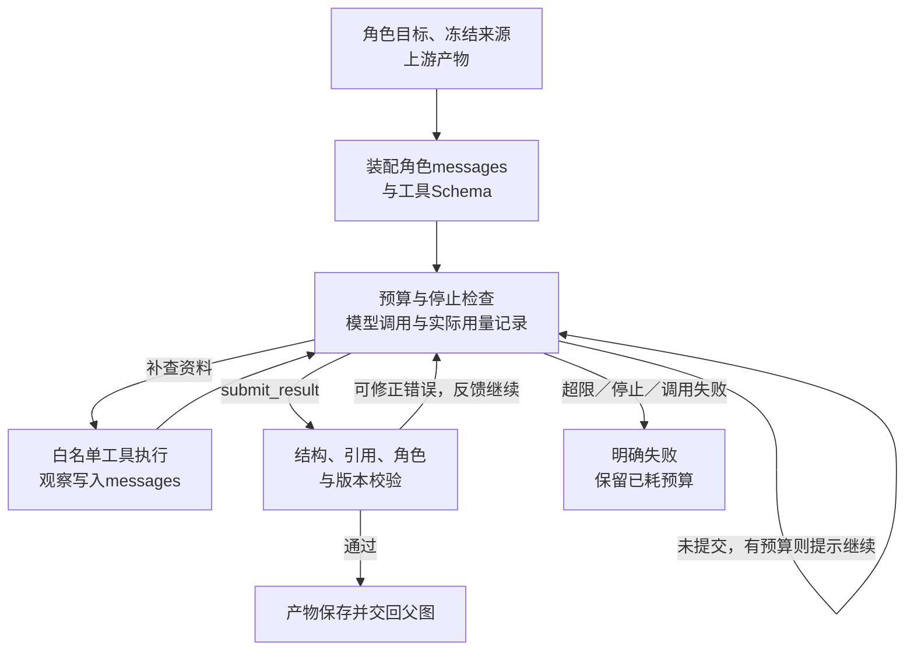

# Agent内部构造、优化对照和范围

本轮日期按客户端为2026-11-13；原始目录名记录运行时UTC时钟，保持原样。最终多Agent方向不变，本轮固定外部分工，检查内部输入、工具循环、提交契约、校验、修复与记忆。

## 1. 当前每个Agent内部实际有什么

会谈专家由[AgentRunner](../backend/meetflow/agents.py)统一装配；管理质检由[SalesDriver.expert](../backend/meetflow/sales_workflow.py)装配。角色不是不同模型权重／物理实例，当前共用模型传输和配置，每次调用各有自己的messages、目标和只读快照。

| 内部部件 | 会谈链当前代码 | 管理质检链当前代码 |
|---|---|---|
| 指令 | 角色提示＋禁止人员质检的事实边界＋资料不是指令 | 角色提示＋规则判断边界 |
| 初始输入 | 目标、实际会谈时间／时区、会谈联系人信息；资料按工具读取 | “评价本次会话”；返工时提示读上游 |
| 可用工具 | 来源清单、读原文、词语检索、读冻结任务、读上游、日期解析；meeting不能读任务 | read_context、read_upstream；上下文中的规则按专家维度裁剪 |
| 提交格式 | 所有角色当前共用AgentResult，服务器再限制actions／challenges／delegations归属 | 专家ExpertResult、审查AuditResult；规则ID和证据再校验 |
| 当前工作记忆 | messages保存系统／用户／模型／工具消息，累计追加 | 相同；不代表长期检索记忆已经实现 |
| 校验与修复 | 结构、来源ID、角色、行动目标与预期版本；可修正错误作为工具反馈继续推理 | 结构、规则范围、引用、身份／完整性与资料依据；失败反馈继续推理 |
| 预算 | 调用前预留共享模型预算、工具另计、累计token；默认每角色最多10步、运行900秒 | 最多min(配置,6)步，额外检查活跃时间与停止 |
| 停止 | 合法submit_result结束；预算／停止／服务错误显式失败 | 相同，不自动伪装为规则成功 |
| 持久化 | 父图检查点、完整角色产物、调用／事件；未给角色内部子图挂checkpointer | 父图及完成产物恢复；不是每个工具步骤都持久恢复 |

**中途恢复的实际边界：**已完成角色可复用产物；某角色中途退出可能重新执行该角色，仍计累计预算。不能声称已经精确恢复到任一模型思考步骤，也不能直接通过增加Web进程扩展本地执行器。

该图是产品现状。后面的固定三调用实验只是内部机制微基准，不把它当成上述全部工具行为已通过。

## 2. 每个角色怎样配置这些部件

| 角色 | 输入重点／工具边界 | 应交付的内容与当前验证 |
|---|---|---|
| coordinator | 授权来源清单与任务依赖 | 委派DAG；父图检查唯一ID、无环、依赖及审查覆盖 |
| meeting | 本次转写；读来源和搜索仅限transcript，禁止read_tasks | 事实、决定、承诺、条件、疑点；引用只能来自本次转写 |
| context | 授权历史、需求、成员与任务快照 | 历史依据及差异；当前无专属输出Schema |
| planner | 原文、上游、旧任务ID／版本、日期工具 | 行动建议；只有该角色可提交actions，不能直接执行正式任务修改 |
| risk | 原文、上游、条件和口径 | 风险／依赖；和planner有重叠，未证明最优拆分 |
| auditor | 原始资料、上游判断和反证 | 对具体行动的challenges；不得直接改正式状态 |
| discovery | 中心会谈＋本维度适用规则 | 客户需求／回应相关判断；客户信号不当人员表现 |
| process | 中心会谈＋本维度流程规则 | 流程／下一步评价；适用性与完整性先判断 |
| product | 中心会谈＋产品规则和授权产品依据 | 承诺是否有依据；资料缺失不能凭常识下结论 |
| 质检auditor | 中心原文＋全部适用规则＋专家产物 | 具体rule_id争议；返工一次仍未解决转无法判断，再由主管复核 |

会谈Agent现有read_upstream范围偏宽，未严格只限声明依赖；引用ID存在也不能证明结论受支持。管理链的分数、扣分和产物不能流回销售事实链，优化上下文不能扩大授权。

## 3. 本轮优化候选与理由

| 候选 | 改哪里 | 要证明什么，不能证明什么 |
|---|---|---|
| 合法引用ID枚举 | 结构化输出format将引用限制为本例片段ID | 减少非法ID；不保证引用支持、完整或无幻觉 |
| 有效产物去重 | 只在下游消息中去掉与prediction重复的raw JSON | 减少输入token；无效产物保留raw和error供修复，完整日志保留 |
| 两者组合 | 两因素同时使用 | 查交互，不能默认收益相加 |
| 产品角色Schema裁剪 | 提交工具只去掉服务器早已禁止本角色提交的字段 | 比较Schema体积及实际工具循环；不靠字符数声称质量／时延提升 |
| 定向错误反馈／片段分页／角色内部检查点 | 尚未实施对照 | 需要分别测修复净收益、长来源漏检与崩溃恢复／重复推理，不能先宣称优化 |

两类契约要区别：微基准Outcome.conditions是条件片段ID；产品Action.conditions目前是可读条件文字。产品Schema探针只约束evidence，不把条件文字错误改成ID枚举。

官方[结构化输出](https://docs.ollama.com/capabilities/structured-outputs)支持Schema约束，[Pydantic动态模型](https://docs.pydantic.dev/latest/concepts/models/#dynamic-model-creation)用于候选Schema生成；接口能力不等于本项目质量提升。服务器原有授权与证据检查全部保留。

## 4. I1：两因素内部机制对照

运行前追加[预登记](../labs/backend_agent_audit/PLAN.md)，使用原12例＋8例明确标为代理编写的开发场景。原gold不改；新增包括拒绝接手、条件撤销、撤回取消、不同目标的日期、撤销旧截止日期等，没有独立人工标注或留出集。

4组×20例×1次，固定E三角色串行＋审查、提示、验证、模型与阶段seed；Qwen3:4b、think=false、temperature0、4096上下文、每阶段512／总1536生成上限。只有format的合法引用约束和成功上游的重复表示不同；动态enum没有同时改系统提示。单次不衡量重复稳定性，没有等实际token／费用的声称。

实际原始目录：`test-results/backend-agent-audit/internals/20261112T162355Z`，80/80条、240次真实模型调用，原始结果／失败／源码／计划／数据均留存。

| 实测 | 原协议 | 仅合法ID枚举 | 仅有效产物去重 | 枚举＋去重 |
|---|---:|---:|---:|---:|
| 有效完成 | 19/20 | 20/20 | 19/20 | 20/20 |
| 四关键槽位全对 | 16/20 | 17/20 | 16/20 | 17/20 |
| 含证据条件完全正确 | 9/20 | 9/20 | 9/20 | 9/20 |
| 支持证据F1 | 0.831 | 0.848 | 0.831 | 0.848 |
| 条件证据F1 | 0.500 | 0.500 | 0.500 | 0.500 |
| 凭空新增事项 | 1 | 1 | 1 | 1 |
| 最终非法ID失败 | 1 | 0 | 1 | 0 |
| 模型调用 | 60 | 60 | 60 | 60 |
| 输入token合计 | 53608 | 53664 | 49627 | 49506 |
| 输出token合计 | 3192 | 3192 | 3192 | 3192 |
| P50／P95秒 | 4.035／4.286 | 4.027／4.432 | 3.919／4.196 | 3.919／4.247 |

### 效果到底来自哪里

- 枚举修好了suggestion案例的非法ID：原来输出案例名而不是原文片段ID。恢复一个原本按失败全错计分的案例，使四槽位全对多1例；**不是证明复杂语义推理改善**。模型仍只给部分支持片段，所以含证据条件完全正确没有增加。
- 去重与各自未去重方案逐例比较，20例的最终prediction字典全部相同，不仅是总分相同。输入token分别减少7.43%（无枚举时）和7.75%（有枚举时）。不把约0.1秒的中位差作显著时延结论；组合没有显示额外质量增益。
- 无枚举时stage1／stage2／审查各1次产物无效，枚举后各0次。无枚举三阶段输入15258／17866／20484 token，去重后15258／16522／17847；第一阶段没有上游，理应不节省，实测也没有变化。
- 每组仍有1次凭空事项、条件F1仅0.5，审查相对第二角色净修复仍0；不能让引用合法掩盖负责人／状态／条件等业务错误。
- **7.43%是实验交接封装中的节省。** 当前产品upstream没有同样的prediction+raw双份封装，不能把这个百分比写成整产品已省的token。若要压缩产品工具消息，应另按真实消息和长会谈取证质量测量。

### 采用决定和留痕

保留“合法ID约束＋有效产物去重”为后续实验协议候选：本开发集改进非法引用且没有额外质量退化。尚不改正式产品契约或宣布上线质量通过；生产大范围ID枚举的成本见下一节。原12例加8例仍是开发代理编写数据、单次运行，无独立gold／留出集或统计显著性结论。

本轮共享runner的manifest.comparison初版沿用“role prompts only”默认描述，实际变量由request_transform、四组相同role_sets与预登记明确。原manifest不覆盖，追加manifest-annotation.json说明，并修正后续脚本的描述参数；没有改变请求、gold或结果。精确运行源码快照保留，不用修订后的脚本冒充旧源码。

## 5. 实际产品角色Schema：体积与真实工具循环

原始目录：`test-results/backend-agent-audit/role-schema/20261112T162936Z`。候选只去掉服务器原已禁止本角色填写的actions／challenges／delegations，保留仍合法的summary／claims／risks／questions；未将新的职责猜想强加为字段禁令。所有引用定义完整，服务器校验仍使用原validate_result。

| 角色 | 共用Schema字符 | 裁剪后字符 | 缩减约 |
|---|---:|---:|---:|
| coordinator | 4099 | 2169 | 47.1% |
| meeting | 4099 | 1548 | 62.2% |
| context | 4099 | 1548 | 62.2% |
| planner | 4099 | 2837 | 30.8% |
| risk | 4099 | 1545 | 62.3% |
| auditor | 4099 | 2199 | 46.4% |

字符量按ensure_ascii=false的JSON计算；不同模型标题长度也占少量字符，字符不当token。质检链已经分别使用专家／审查Schema，本次未测各质检角色的推理效果。

实际AgentRunner、同一冻结来源／目标／初始消息、同Qwen3、temperature0／seed2026，原生8192上下文，每调用512、最多6步：

| meeting单角色诊断 | 共用Schema | 裁剪Schema |
|---|---:|---:|
| 第一次请求输入token | 1449 | 877 |
| 全部请求输入token | 16544 | 12752 |
| 模型／工具调用 | 6／2 | 6／2 |
| 耗时秒 | 89.38 | 80.89 |
| 最终结果 | 迭代超限，无产物 | 迭代超限，无产物 |

首次messages及options逐项相同、只改提交工具Schema，首次输入实测减少39.48%。后续消息轨迹已经不同，总token和耗时不能全归因于Schema；只有按固定顺序做的一例，**不作成功率／时延排名**。两者多次生成触及512上限，仍未提交合法结果。预算低于产品默认，既不能说所有正常配置必失败，也不能猜测加预算必成功；本轮未为了做出成功结果临时放宽限制。

所以只确认“Schema输入开销可缩减”，没有确认“Agent任务完成能力已改善”。候选继续留labs，产品未自动切换。六角色体积测量不等于六角色真实质量全部验证。

### 枚举不能盲目扩大

对meeting角色Schema，加入10／100／1000个合成短ID（span-0000格式）后的字符量是1828／4168／27568；planner的1000ID方案达41867字符。相同ID在多个引用字段重复出现，可能抵消裁剪收益。实际来源ID通常更长，不能把小例子上枚举有效推广为整场长会议全量枚举有效。

生产候选应比较授权片段窗口、按ID取证、紧凑引用字典与受控检索；先测引用召回、跨客户泄漏、token与长文本遗漏。合法ID约束不替代服务端权限，不把枚举列表当语义支持证据。

## 6. 剩余优化与验证

| 环节 | 当前状态 | 下一步需要的指标 |
|---|---|---|
| 上下文装配 | 实验封装去重有局部收益；产品工具消息尚未优化 | 每角色输入、检索recall@k、证据支持、截断漏片段 |
| 工具循环 | 实际meeting仍超限 | 完成率、无效／重复工具调用、非提交空转、同预算业务质量 |
| 输出契约 | 裁剪体积有收益，未证成功率 | 全角色协议成功、领域字段召回、语义错误，长Schema成本 |
| 修复 | 目前审查净修复仍0 | 具体字段错误反馈、补查反证，错变对减对变错与返工成本 |
| 角色内恢复 | 子图未挂持久化 | 逐步故障注入、重启重复推理／token、输入版本不变、取消恢复 |
| 模型选择 | 本轮只有Qwen3:4b | 相同契约和预算下其他模型对照，不能把框架问题与模型／接口混为一谈 |

本轮新19项内部／Schema检查加既有15项，共34项；随后补1项探针HTTP超时透传检查，最终35项通过，Ruff通过。真实量化运行后修正探针复制HTTP请求时应携带timeout扩展，单测验证；两次原始运行均无HTTP错误，旧源码快照保留，不假称已经做了真实模型超时故障验证。无产品代码变更，不重复宣称浏览器业务验收或全量产品回归。

README同步概述内部构造与结果，原始模型响应不放进用户页面。复算命令见[labs README](../labs/backend_agent_audit/README.md)，每轮新目录，老轮不删失败。

本机README5图及本页1图已用Mermaid11.12.0、后台Chrome解析渲染，新增内部图已目视检查，证据在test-results/readme-render。服务health另行读取确认status=ok、live_available=false、audio_available=true、auth_enabled=true；没有变更业务数据或重新配置模型。
