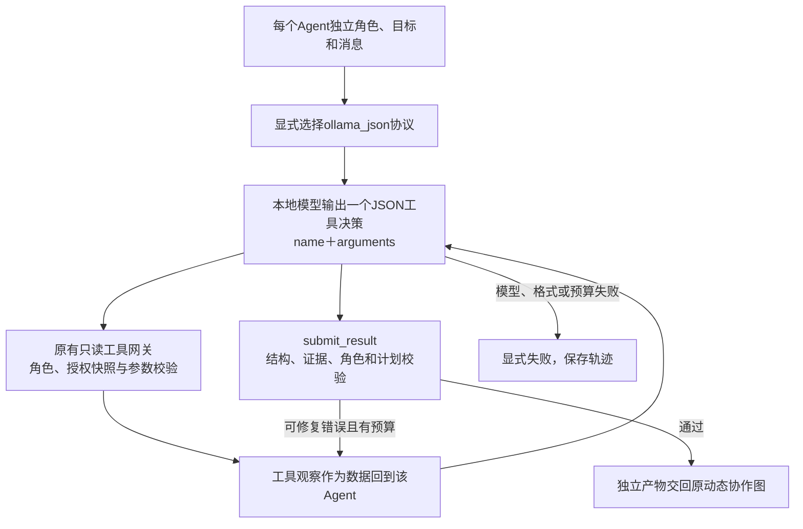

# 真实多Agent工具链：L1修复与集成诊断

客户端日期2026-11-13。本轮接续docs/30的“真实LLM完整图未验收”缺口；网页默认配置不变，试验使用隔离临时数据库与代理编写开发会谈。最终仍采用多Agent，协议能完成和业务正确分开计量。

## 1. 观察到的缺陷与修复

| 缺陷／线索 | 修改 | 验证范围 |
|---|---|---|
| 工作区有meeting_date，Agent初始消息却只有可能为null的meeting_time | 分别传实际日期与实际时刻，未知继续null，不借上传时间补全 | 三种时间上下文回归；真实图另查相对日期结果 |
| 有效JSON委派可能缺审查、依赖成环；之前父图拒绝，但协调者没有收到修正反馈 | planning.py共用原DAG校验，在submit_result先反馈；父图入口仍校验 | 故障注入无效计划→模型接收错误→合法计划，原图测试保留 |
| 协调者把分析委派写成让销售发送报价等执行任务 | 明确分析角色与允许字段，禁止直接安排业务执行 | 提示改进不等于语义担保，实际角色与产物仍需看轨迹 |
| meeting提交claims却缺summary，协议成功但纪要空白 | 明确摘要要求并在提交时反馈修复，不能用空纪要宣称业务完成 | 在首次候选完整图前加入；早期单角色结果仍按原版本记录 |
| 本机旧模板／模型会反复解释或返回额外字段 | 新增显式ollama_json传输选择，Schema约束工具决策；原ollama与openai保留 | 先测协议，再查完整图，不猜测所有旧版服务都有同一原因 |
| L1结构化格式仍把禁止字段提供给所有角色，协调者重复误填 | L2在提交Schema移除原服务器已禁止的actions／challenges／delegations，仅供对应角色使用 | 先前docs/29仅测过静态体积和失败探针；本轮才进行完整图修复迭代 |

本机服务版本0.11.5，模型信息／模板正文与hash随每轮保存。Qwen3模板末尾有think标签，原生轨迹有思考文本；这是实际观察，**并未通过服务内部渲染日志证明工具序列化Bug是本机故障的唯一原因**。请求think=false是配置事实，不能直接当实际无思考。相关官方仓库[问题报告](https://github.com/ollama/ollama/issues/14601)只作为诊断线索，不把他人描述当本机测量。

## 2. 可选结构化工具协议怎样工作

依据[Ollama结构化输出](https://docs.ollama.com/capabilities/structured-outputs)的format Schema能力，将本次工具集转换为oneOf联合：每支固定name及对应arguments，合并根级$defs；工具说明以合法JSON放入系统消息。不是让代码直接生成业务结果，也没有用gold提示答案。



模型依然决定何时读资料、读哪些资料、是否补查日期和何时提交；每次只选一个工具，原生profile可以一轮多个工具，两者工具批处理能力不同。父图仍由真实协调Agent规划，没有固定代码DAG替换。角色输出、来源权限、停止／预算、审核与正式业务写入边界不放宽。此协议也能供管理质检内核选择，但本轮完整图实验只覆盖事实整理，不能声称真实销售评分已通过。

profile是部署配置，不在销售上传流程增加选项；主.env未改，不静默切换、失败后不回退规则模式。格式失败仍显式报错；强制合法JSON／片段ID存在不能证明语义正确。长文本检索与内部逐步恢复不在本轮完成范围。

## 3. 运行协议与复核

预登记在[labs PLAN L1](../labs/backend_agent_audit/PLAN.md)。低预算meeting探针为6步／每次512／总6调用／180秒；完整图为10步／每次1536／总48调用／100工具／600秒，均8192上下文、温度0、seed2026。两类预算不混成同预算收益。模型固定本机已有权重，不升级服务或重拉模型来掩盖原问题。

三个完整图开发场景：明确报价承诺；报价改期并附条件试用；尚未确认的演示建议。事先固定窄检查：负责人、截止日、状态、法务条件、未确认建议不变成行动，另列角色覆盖、摘要、引用存在。人工检查原文与产物，不把这三例叫独立业务gold、长会谈或生产质量验证。

原始目录`test-results/backend-agent-audit/live-workflow`按每轮UTC创建，不覆盖旧轮；保存源文件／计划／数据hash与正文、模型元数据、实际请求、工具轨迹、每例结果、失败分母和预算。部分模型输出含推理文本，原始文件仅保留本地；公开结果只留必要指标，不包含公司资料、账号凭证或密钥。

复算（在仓库根目录，使用现有本地Ollama）：

```powershell
.venv\Scripts\python.exe labs/backend_agent_audit/live_workflow_probe.py --scope meeting --model qwen2.5:7b
.venv\Scripts\python.exe labs/backend_agent_audit/live_workflow_probe.py --scope meeting --model qwen2.5:7b --profile ollama_json
.venv\Scripts\python.exe labs/backend_agent_audit/live_workflow_probe.py --scope graph --model qwen2.5:7b --profile ollama_json --steps 10 --output 1536 --calls 48 --seconds 600
```

本轮候选包含日期、协调提示、计划反馈和工具传输多项，前后整体集成对照不归因到单项，也不作为LangGraph／其他框架或职责划分排名。当前脚本复算使用当前产品代码；旧版精确重现应使用原轮source_bundle，不拿当前源码冒充修复前版本。

## 4. 全部结果与采用决定

### 单角色探针：只能说明协议行为

| 模型／协议 | 结果 | 模型调用 | 无工具响应 | 输入／输出token | 秒 |
|---|---|---:|---:|---:|---:|
| Qwen3原生 | 完成，但摘要为空 | 5 | 2 | 12512／2339 | 73.82 |
| Qwen2.5原生 | 完成，但摘要为空 | 6 | 1 | 10213／585 | 46.99 |
| Qwen2.5结构化 | 完成，但摘要为空 | 3 | 0 | 6258／166 | 13.76 |
| Qwen3结构化 | 6步超限 | 6 | 0 | 13170／175 | 14.29 |

这些探针都早于摘要强制及L2字段裁剪，且日期上下文版本并非全部相同，只有单次、来源ID也不同，不能归因成某协议普遍更快或Qwen3能力更差；无工具响应减少亦部分来自格式约束本身。明确保留结构化协议对Qwen3的失败，不只列有利Qwen2.5结果。

### 原动态多Agent完整图：文字输入，无ASR重跑

统一Qwen2.5:7b、相同三个开发会谈和上述完整图预算。每例独立协调规划，未用规则结果／静态DAG替换。每轮按次序运行，角色可按图内依赖并发；不是随机大样本延迟实验。

| 版本 | 产出待审核报告 | 全部窄业务检查通过 | 模型调用合计 | 输入／输出token合计 | 三例耗时合计 |
|---|---:|---:|---:|---:|---:|
| 原生／原始代码 | 0/3 | 0/3 | 23 | 62279／6169 | 415.64秒 |
| L1结构化＋日期／计划反馈／摘要修复 | 0/3 | 0/3 | 36 | 106192／6267 | 448.81秒 |
| L2另加角色提交字段裁剪 | **3/3** | **0/3** | 87 | 148702／6921 | 494.64秒 |

原生三例分别为协调者超限／缺少审查任务／缺少审查任务。L1分别为协调者超限／会议理解超限／协调者超限。L2均waiting_review，确有coordinator、meeting、context、planner、risk、auditor六角色产物，未自动批准或写正式任务。三轮共9次图诊断＋4次单角色＝13次诊断，**仍只有3种开发会谈，不是13份独立会议**。原生失败前已停止，不能将失败轮成本直接与完成轮相减称成本优化。

| L2场景 | 秒／调用 | 预登记检查暴露的问题 | 额外核读观察（非独立盲评） |
|---|---|---|---|
| 明确报价 | 152.92秒／32 | 报价日期2026-11-13正确，负责人为空 | 将承诺分类为decision；推测性风险用condition引用原话；有无效affected_actions引用，审查质疑正确日期而未补负责人 |
| 改期与条件 | 192.82秒／27 | 报价应2026-11-16，实得11-14；负责人为空；没有正确的有条件试用项 | 法务前提被放到报价事项，跨事项条件混淆，审查未纠正 |
| 未确认建议 | 148.90秒／28 | 保留了不确定性，但仍生成“下一步计划”todo行动候选，未满足预登记不生成行动要求 | 这是待确认候选，并非已发布任务；内容泛化，宜归疑点／明确标记建议，不应伪装成原文已承诺 |

因此L2只是**协议集成阶段进展**，不是业务质量通过：两个明确报价负责人均漏掉（0/2），日期1/2正确，条件绑定0/1，未确认建议不生行动0/1。引用ID存在3/3，不代表引用语义支持3/3。审查未修复上述核心错误；不能再以“有审查Agent”推断结果可信。上述窄指标也未覆盖所有纪要／条件，附加核读由开发助手完成，不称外部人工质量评审。

采用：日期上下文、空摘要反馈、计划反馈和角色字段裁剪作为契约／集成修复保留；ollama_json保留为显式可选协议，**不修改主.env、不启用实际页面的真实评分／整理**。没有选出可上线的模型或最终最佳协作架构，也没有用本轮3例给框架排名。动态协调在简单例子仍32次调用且存在冗余上下文／泛化风险，当前效率不理想。

公开逐例指标与源码hash见[独立L1／L2汇总](../labs/backend_agent_audit/results/live_workflow_summary.json)。原始7个目录、全部失败和精确源快照保留；汇总初次因Windows路径分隔符失败，修复路径归一化后重算，原始模型记录没有改写。先前固定调用428条仍保留原summary，不混成同一质量分母。

## 5. 回归、正在运行的服务与下一步

- 最终111项产品＋35项既有实验检查共146项通过，138.13秒；另新增3项本轮计量检查通过，合计149项。期间先以3条时间上下文检查复现缺陷；计划／摘要校验改变后调整旧实验测试的合法输入，保留失败输出。Ruff与diff检查通过。
- 8765已加载本轮代码，进程17056；重启前确认两类队列均无活跃任务，原账号／数据保留。重启后32项真实HTTP权限／读取／Word-PDF导出通过，SQLite仍34表／70外键、完整性正常，health中live_available=false。凭据只用于临时登录并退出，无业务写入；本轮无前端源码变化、未重新浏览器验收或ASR运行。
- README7图加本页1图语法解析通过，未做本轮新图视觉渲染验收。原始回执在test-results/live-delivery-20261113，不提交截图、数据库、凭证或推理文本。
- 下一轮先设计类型化事项／变更与条件指向，保留相对日期原词并经日期工具核验；审查需指出具体字段和反证、测净修复，不能泛泛写警告。比较当前动态六角色与更紧凑的多Agent证据交接流程，按负责人、改期、条件目标、建议误提、支持度、完成率和成本决定，不能仅看谁调用少。
- 仍需独立标注／留出业务会谈、长文本分页与证据召回、真实音频端到端质量、内部恢复和企业部署。前端已接业务后端，不代表这些AI与生产缺口已补齐。恢复服务仍 `.\scripts\start.ps1 -SkipInstall`，不清库重建。
