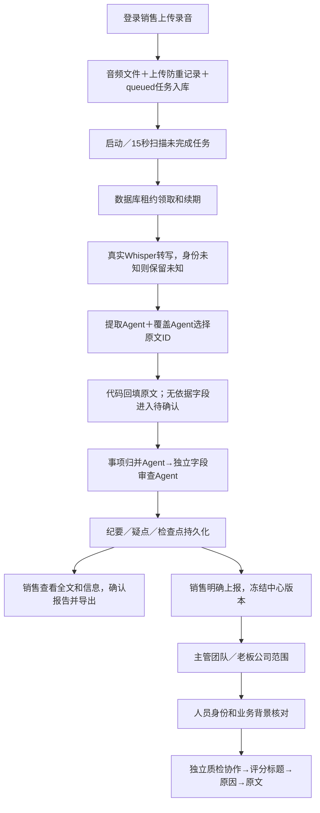

# 后端实际运行与组件验收

日期：2026-11-13。目标是验证实际启动和完整数据流，不将模块测试、模型质量和分布式部署混为一谈。

## 当前结论

**单机真实后台链路已走通，生产规模和全部AI业务质量尚未验收。** 当前8765主服务由 `start-local-ai.ps1 -SkipInstall` 启动，PID32584；真实语音与模型、账号鉴权都已启用。原`.env`、账号、原始会谈和历史失败保留。

| 验收对象 | 最新结果 | 可核对证据 |
|---|---|---|
| 产品及实验回归 | 189项全通过，115.38秒；原生协议显式验证可配置采样 | `test-results/backend-acceptance-frozen-20261113.xml` |
| 真实TCP音频完整链路 | 50项全通过，真实CPU ASR→真实4B多Agent→live报告；3次启动，任务接管与结果复用通过 | `backend-runtime/20261113T154011973969Z` |
| 主服务实际纪要与质检 | 30项全通过，两个报告均live；新协议、用量与审查checks实际入库，三角色范围/三级展示通过 | `main-live/20261113T153930682420Z` |
| 数据库 | SQLite WAL，37表，Alembic0003，完整性ok/外键违例0 | [脱敏运行汇总](../labs/backend_agent_audit/results/runtime_summary.json) |
| 离线备份与恢复 | 53文件；37表3409行逐行一致，恢复后账号/音频/导出可用 | `backend-runtime-main-restore-check.json` |
| 前端 | vue-tsc和Vite生产构建通过，同源页面/业务API已接通 | 本轮构建和实际HTTP记录 |
| 管理质检效果 | 三类固定开发案例预设检查3/3通过，33次调用；不是独立人员评价准确率 | [全轮次质量记录](../labs/backend_agent_audit/results/quality_summary.json) |
| 会谈协作效果 | state_v2开发回归四角色12/15，三角色11/15；两者15/15产出 | [同协议逐例对照](../labs/backend_agent_audit/results/coverage_ablation.json) |
| 长原文实际推理 | 1370字/3页，首尾改期成功，8次调用/40.12秒；仅一个开发例 | `live-workflow/20261113T152214003477Z` |

表中本地原始路径均以忽略目录`test-results/`为前缀；实验轮次另位于`backend-agent-audit/`。完整响应、源码/输入快照保留本地，公开JSON只含脱敏计数及来源hash。

**仍未通过的边界：** 暂停/取消误审、同句多个事项的负责人仍存在失败，当前不能无人审核发布任务或据此直接处分销售；未做独立真实销售金标准和20–100人生产负载验收。浏览器控制工具两次初始化失败，无本轮新点击/截图；Word可生成且同确认内容，原生分页渲染缺LibreOffice未验收。PDF两页已渲染检查，不能替代Word分页证明。

## 本轮执行前计划

当前采用 FastAPI + SQLAlchemy + SQLite WAL + Alembic；会谈与质检各一个本地线程执行器。任务先写入业务数据库，启动及每15秒扫描未完成状态，数据库租约负责领取、续期与旧执行者写入隔离。LangGraph SQLite 检查点和 AgentConversation 保存流程及已收到的模型响应。没有安装或运行 Redis、Celery、PostgreSQL，也没有独立消息代理。

本轮先冻结现状运行产品与实验测试、前端生产构建；再启动独立真实HTTP服务，用真实本地ASR和本地模型完成音频上传、重启恢复队列、转写、Agent分析、数据库持久化、前端同源读取、中心上报及权限隔离。随后重启验证已完成产物不重复生成，并验证确认报告的 Word/PDF 同版本导出。仅使用独立验收公司和公开测试录音，原账号和资料保持。

真实语音与模型调用不使用测试替身。真实模型产出报告仅代表链路完成；语义质量检查仍单独保留成功和失败，不能由HTTP200推导正确率。

## 组件对应关系

| 需求 | 当前实现 | 明确边界 |
|---|---|---|
| 业务数据、账号和归属 | SQLAlchemy + SQLite WAL，外键、唯一约束、事务 | 单机文件数据库，未验证企业生产容量 |
| 数据结构升级 | Alembic 0001—0003 | 未验证PostgreSQL迁移 |
| 后台任务 | 持久Run/SalesAnalysis + ThreadPoolExecutor | 没有Celery，无独立broker；内存调度丢失后靠数据库恢复 |
| 重复领取和故障接管 | WorkLease + 续期 + generation/fence | 单主机，不承诺网络分区下跨机高可用 |
| Agent过程恢复 | LangGraph检查点 + AgentConversation + 完成产物复用 | 已保存响应可复用；发送请求后未收到响应的窗口仍可能重调 |
| 录音 | 本地文件 + 数据库引用 + SHA256防重 | 没有对象存储；需要与数据库一起备份 |
| 页面进度 | 账号工作区通过HTTP读取任务状态 | 旧开发接口的SSE不等于账号页采用WebSocket |

## 修复过程与历史轮次

以下按实际执行保留失败与早期通过记录；最终状态以页首表为准。

第一轮产品及实验全量181项通过（116.39秒），前端vue-tsc/Vite构建通过。随后真实TCP联调暴露了模块测试未覆盖的问题：公开音频ASR成功、重启后任务成功接管，但提取模型把事实原句改写后当证据提交，六步仍未修正，未生成假纪要。失败原目录 `test-results/backend-runtime/20261113T143930068568Z` 保留。

据此加入版本化 `refs_v1` 交接：提取和覆盖Agent只选本页原文ID，代码回填冻结页原话，原有负责人/日期/条件原词校验与独立语义审查继续执行。旧运行无协议字段时仍走原quote契约，不混用历史消息；新增契约/恢复检查18项通过，真实HTTP补验重跑中。此改动后须重跑最终全量，181项不能冒充新冻结版本成绩。

既有15例较强本地模型试验已结束：13/15产出报告、8/15全部窄检查通过，其中额外12例6/12通过；两个协议失败也保留。该结果直接说明模型能力与HTTP/数据库可用性需要分别验收，不选择性只列通过案例；额外集已被查看，今后的改进均称开发回归。

### 实际链路通过记录

- 原目录 `test-results/backend-runtime/20261113T144617788123Z`：50项真实TCP断言通过，服务启动3次，37张表，CPU Whisper处理56.63秒公开音频、23段全文；Qwen3.5-4B执行8次真实模型调用，生成live报告。重启后任务自动接管至待确认耗时约46.19秒（单例，含同机开发负载，不当SLA）。
- 覆盖：一次性邀请码注册并绑定团队、音频幂等、先入库后关闭服务再启动处理、音频字节一致、销售私有资料与质检权限、主管团队/老板公司/异组隔离、未知发言人不擅自质检、确认报告Word/PDF同内容ID、完成后再启动不重复模型调用、报告与导出保持。
- 这份公开录音不是销售金标准，当前生成21条引用事实、0行动、1待确认；不能将“0行动”解释成正确率。真实模型不会自动改成规则结果。两个失败轮次均保留。
- 修复后产品与实验全量184项通过（136.76秒），包括真实子进程强杀后的接管、单连接池并发、权限及新引用契约；前端生产构建通过。
- 正式数据本轮离线备份53文件并恢复到新目录：37表3409行逐表逐行不变，恢复后账号范围、音频与Word/PDF核对通过。原资料和失败记录保留。证据 `test-results/backend-runtime-main-restore-check.json`。
- 主服务已实际用 `start-local-ai.ps1 -SkipInstall` 启动，端口8765、PID32620、会话19097，健康检查live/audio/auth均true；`.env`仍保留，不再把主页面当前进程描述为规则模式。旧记录的demo标记不改。
- 主服务真实纪要→明确上报→管理质检27项通过（`test-results/main-live/20261113T145507237462Z`）；纪要/质检均live，质检绑定上报账号，销售403/异组404/老板200，summary不含完整原因/原文、details不含原文、full含原文。新合成验收记录已保留，用户原会谈不改。单场约52.59秒，不当SLA。
- 本轮浏览器操控工具初始化两次都报 `failed to write kernel assets: 系统找不到指定的路径。(os error 3)`；中间已重置内核。未执行浏览器动作，未拍新截图，不以HTTP验收冒充浏览器验收。早期本地Chrome邀请码与三角色实操证据属于前批。

后续R4/F5：审查语义区分历史事项是否可追踪与当前是否仍欠履约；质量审查改成独立建议状态，代码比较真实上游，仅有差异才返工。四/三角色state_v2同15例分别12/11例通过，69/49次调用，194.64/130.20秒；额外覆盖Agent修复了相对日期疑点和一个条件事项负责人，却在双事项的一个负责人上退步。当前保留四角色作为质量优先开发配置，代价是更多调用；一次开发对照的1例差异不能证明统计显著性或泛化优势。旧base_v1两者9/15的[单独汇总](../labs/backend_agent_audit/results/coverage_ablation_base_v1.json)不覆盖。

主服务复验先出现一次验收脚本表名误用（纪要和质检实际上已产出），修正为读取ORM表名；随后未固定采样的一次真实质检失败，原两轮都保留。P1显式设置本地temperature=0/seed=2026，与实验请求一致，补角色/最后工具错误诊断。采样差异是已确认的配置缺口，不声称是全部失败的唯一原因。修复后主服务30项、音频50项和189项冻结回归均通过；并未增加步骤或总调用预算。

R4的角色适用性辅助脚本未进入首次源码包，已另留执行后annotation而不回填原manifest，后续探针补齐；不把事后hash当预先冻结证明。所有15例都已用于开发，后续重复不再称留出评测。



## 怎样启动和复验

在仓库根目录运行。已有准备好的模型与依赖时，真实本地AI入口为：

```powershell
.\scripts\start-local-ai.ps1 -SkipInstall
```

该入口检查CPU ASR、匹配分词器、便携Ollama0.40.16和4B模型；必要时只启动隔离11435服务，不替换用户安装的11434。它在当前进程启用真实分析、state_v2和temperature=0/seed=2026，保留`.env`，结束后恢复启动脚本设置的环境变量。旧纪要与质检保留原有demo/live标记，新任务使用新配置。模型选择是可运行的开发配置，原三例最新3/3而扩展集总共12/15，**不是最终生产质量选型**。

默认 `.\scripts\start.ps1 -SkipInstall` 遵循`.env`，目前其模型名为空时就是明确标注的规则演示；不能把两种入口混为一谈。

若尚未准备依赖或模型，按需先安装固定音频环境、准备官方模型和分词器；准备脚本只下载并验证资料，不自动改系统网络或覆盖旧安装：

```powershell
.venv\Scripts\python.exe -m pip install -r requirements-audio.lock
.venv\Scripts\python.exe scripts/prepare_local_inference.py
.venv\Scripts\python.exe scripts/prepare_modern_model.py --tag 4b-q4_K_M
.venv\Scripts\python.exe scripts/prepare_tokenizer.py qwen35-4b
```

Whisper权重需是已下载的本地目录，并通过`MEETFLOW_ASR_MODEL`配置；本机为`data/benchmarks/models/faster-whisper-small`。现有`prepare_audio_benchmark.py`可准备此权重，但同时下载公开AliMeeting评测包，部署时不必为了运行应用重复下载评测数据。分词器准备固定官方revision及SHA256，启动路径与已测版本一致，不自动追随模型仓库HEAD。

真实音频/重启的隔离验收命令（8766必须空闲，不写原业务库）：

```powershell
.venv\Scripts\python.exe scripts/accept_backend_runtime.py --tokenizer data/models/tokenizers/qwen35-4b/851bf6e806efd8d0a36b00ddf55e13ccb7b8cd0a/tokenizer.json
.venv\Scripts\python.exe -m pytest tests labs/backend_agent_audit -q
```

录音、账号密码、数据库和完整模型消息仅保存在忽略目录，不上传Git。当前实际无Redis/Celery进程；若以后需要多机器消费、独立扩容或成熟队列监控，再单独实现并验收PostgreSQL与broker/worker方案，不能只加依赖名字。


## 2026-11-14续验：实际功能与选型分开判断

当前保留small CPU + Qwen3.5-4B/state_v2四职责。相同pipeline源码/预算的4B与9B分别18/22、17/22开发案例全部窄检查通过；9B在原关键三例有退步。V3/V4候选未胜出，运行时分支已移除，Git/原始快照保存。转写Turbo诊断CER47.41%→44.02%，累计耗时569.05→1211.05秒，不符合预登记改善/时延门槛，不改主配置。详见docs36/37及公开continuation_summary。

修复本人补充的实际使用问题：保存补充只提升个人资料版本，不重复调用AI；补充绑定分析来源，历史答复不自动套入新问题。报告独立带入当前/历史补充并标明未经客户确认，不塞进3000字手写备注；旧确认报告/中心保持。新增API字段不会让旧来源指纹无故变化。

本轮冻结194项全过（118.55秒），前端vue-tsc/Vite构建通过。首次193过1产品变量覆盖错误及随后44过1测试响应误读均保留；修复后另用continuation-final-fixed-20261114.xml，不覆盖失败。实际主服务补充28项通过：真实模型4调用/1次分析，保存补充后仍4调用/1次分析；未知实际日期不被销售文字补充隐式设置，报告映射和Word/PDF同确认内容通过。原始supplement-runtime/20261114T043317774396Z。主服务真实纪要/管理质检另30项通过，原始main-live/20261114T043335444483Z。

100账号/5团队真实TCP：300次创建全部成功且确实queued、300次读取范围正确，P95约0.68秒，推理关闭。不是音频产能。24段CPU短音频实测RTF约0.389，对100场×30分钟仅ASR投影19.46计算小时，单机不能因此承诺企业日吞吐。

主服务已重启到新代码/已验证前端，8765 PID5960/会话60686，start-local-ai.ps1 -SkipInstall；原.env、账号、旧失败保留。新本地浏览器仍因控制工具初始化路径失败无法验收，不用HTTP冒充新浏览器操作。Word前批两页及本批补充报告另行实际渲染记录，不宣称Microsoft Word客户端验收。整体生产质量和容量仍需独立真实业务录音/标注与部署测量。


补充最终真实音频复验：backend-runtime/20261114T043411881798Z共50项通过，CPU Whisper-small、真实4B 5次调用、37表，独立服务三次启动验证先入队后重启接管和完成后不重复推理。不是脚本替身或默认演示。本人补充Word一页已实际查看：未知日期单列、本人说明、原文和当前补充来源均可读，无裁切/缺字；实际产品PDF另行渲染查看，样本和分页QA留report-supplement-render-20261114。当前运行页面已提供新构建，但未取得新浏览器工具实操证据。
